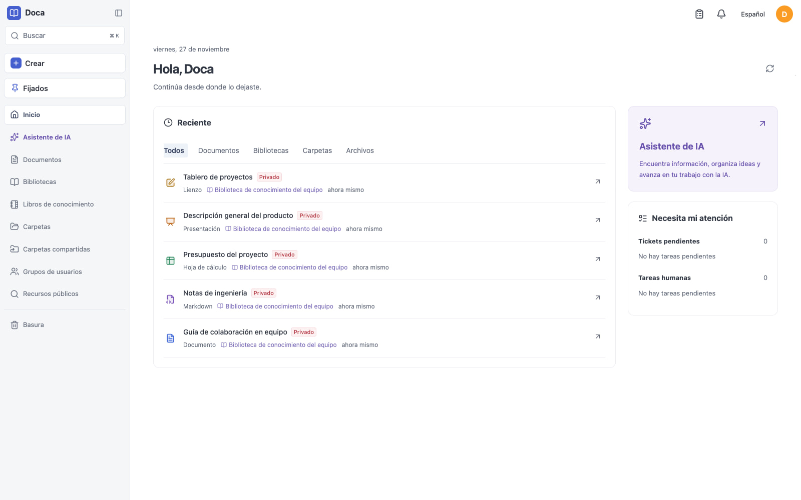
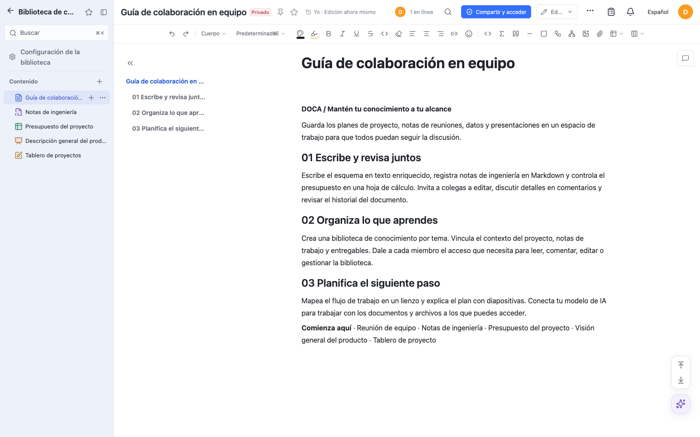
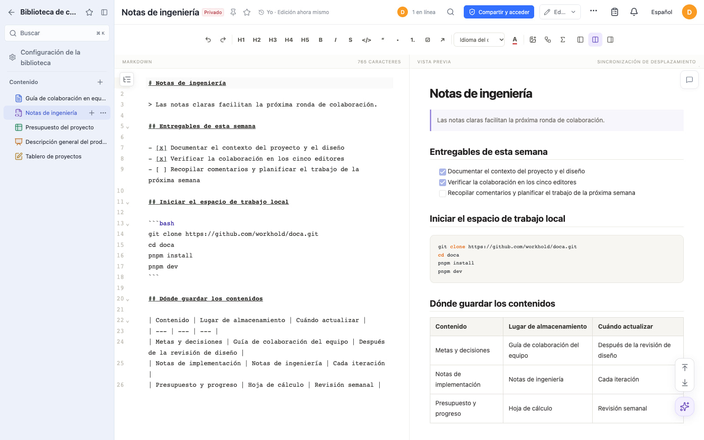
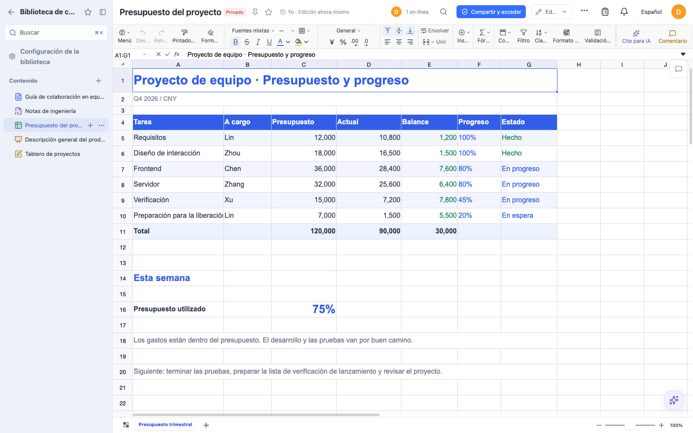
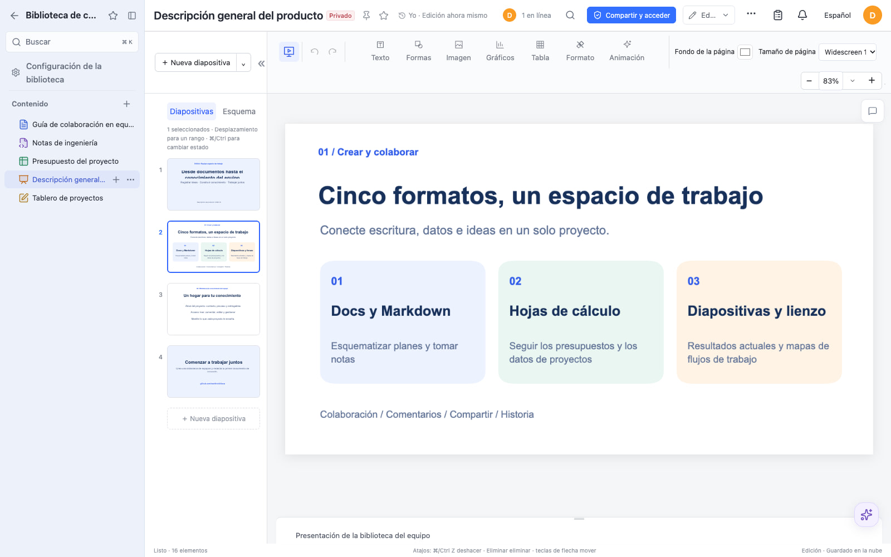
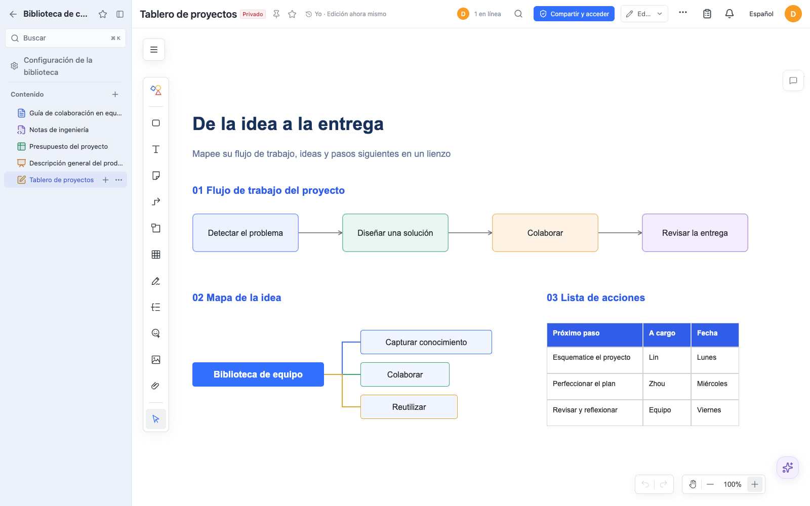

# Doca

[English](README.md) · [简体中文](README.zh-CN.md) · [繁體中文](README.zh-Hant.md) · [日本語](README.ja.md) · [Français](README.fr.md) · [한국어](README.ko.md) · Español · [Русский](README.ru.md)

Doca es un espacio de trabajo de código abierto para gestionar documentos y conocimiento en equipos pequeños o de forma individual. Colabora en tiempo real con texto enriquecido, Markdown, hojas de cálculo, diapositivas y un lienzo infinito. Organiza tus materiales en bibliotecas de conocimiento y conecta tus propios modelos de IA para trabajar con los documentos y archivos a los que tienes acceso.

[Documentación](https://workhold.github.io/doca/#/es/) · [Demostración](https://d.smartdoca.cc) · [Versiones](https://github.com/workhold/doca/releases) · [Tienda de complementos](https://store.smartdoca.cc)

## Espacio de trabajo



## Editor de texto enriquecido



## Editor de Markdown



## Hoja de cálculo



## Diapositivas



## Lienzo infinito



Capturas de una instalación aislada de Doca 0.3.0 con la interfaz y los documentos de ejemplo en español.

## Empezar con Docker

Necesitas Docker Engine, Docker Compose y una dirección HTTP(S) para el sitio. Descarga el archivo Compose, configura `DOCA_ORIGIN` y genera una clave maestra de credenciales exclusiva antes de arrancar. El primer arranque inicializa la cuenta de administración.

```sh
curl -fL https://github.com/workhold/doca/releases/download/v0.3.0/doca-compose-v0.3.0.yaml -o compose.yaml
```

```sh
docker compose up -d
```

[Guía de despliegue](https://workhold.github.io/doca/#/es/operations/deployment) · [Docker Hub](https://hub.docker.com/r/smartdoca/doca)

## Desarrollo desde el código fuente

Usa Node.js 22 o posterior y la versión de pnpm indicada por el proyecto.

```sh
git clone https://github.com/workhold/doca.git
cd doca
pnpm install --frozen-lockfile
pnpm dev
```

La aplicación se distribuye bajo licencia MIT. Los complementos los mantienen sus respectivos autores. [MIT](LICENSE)
