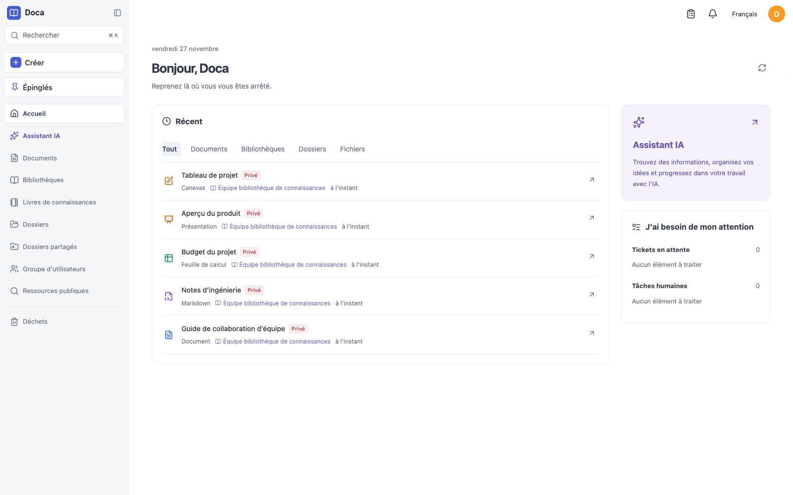
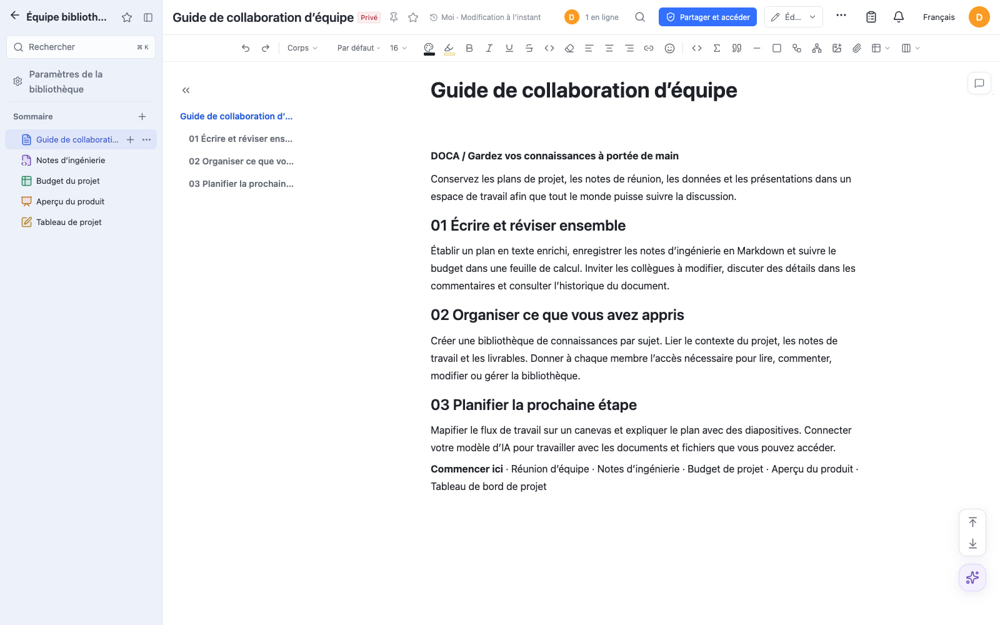
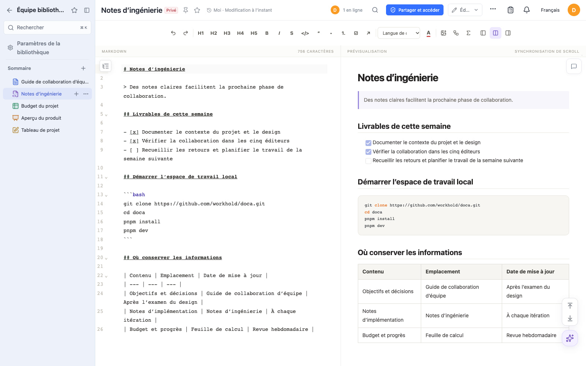
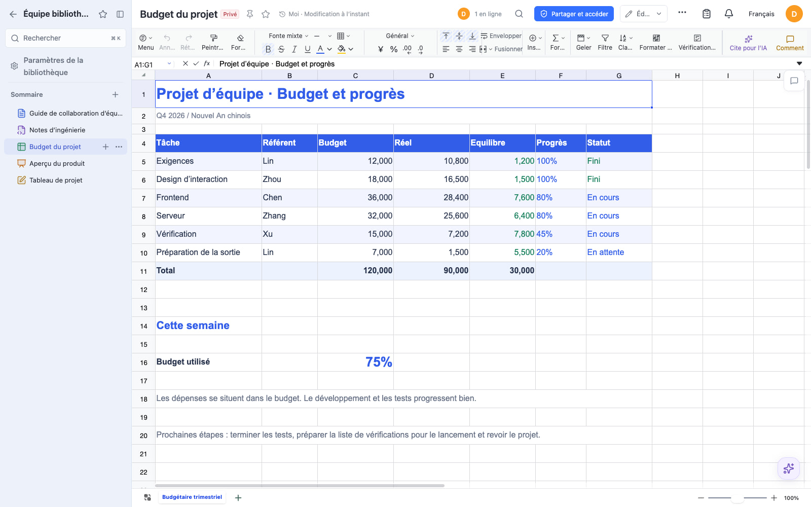
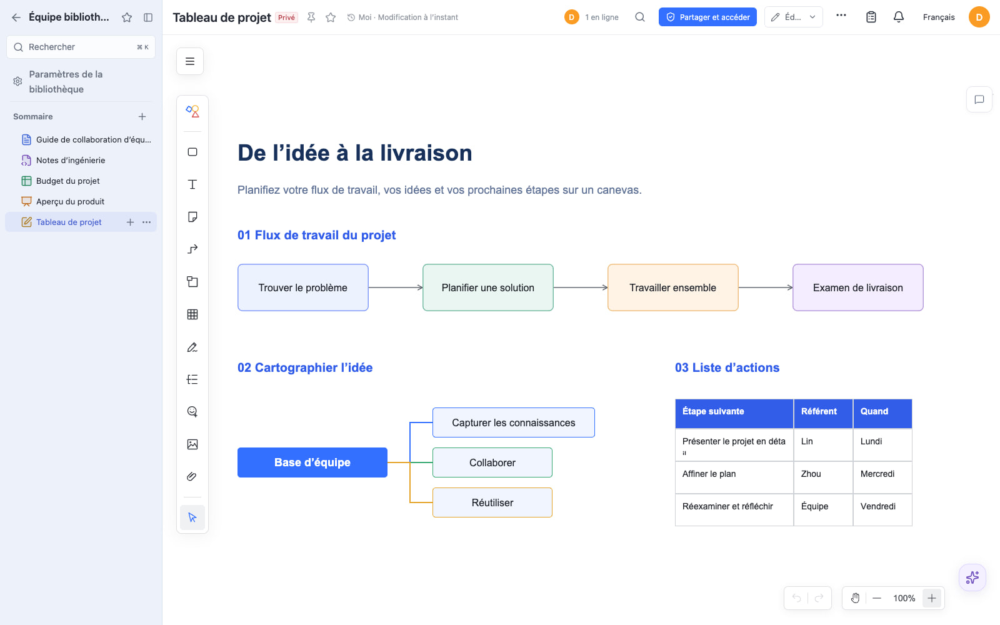

# Doca

[English](README.md) · [简体中文](README.zh-CN.md) · [繁體中文](README.zh-Hant.md) · [日本語](README.ja.md) · Français · [한국어](README.ko.md) · [Español](README.es.md) · [Русский](README.ru.md)

Doca est un espace de travail open source pour la gestion de documents et de connaissances, conçu pour les particuliers et les petites équipes. Collaborez en temps réel dans cinq éditeurs, organisez les documents dans des bibliothèques de connaissances et retrouvez les commentaires et l’historique. Connectez vos propres modèles d’IA pour travailler avec les contenus auxquels vous avez accès.

[Documentation](https://workhold.github.io/doca/#/fr/) · [Démo](https://d.smartdoca.cc) · [Versions](https://github.com/workhold/doca/releases) · [Catalogue d’extensions](https://store.smartdoca.cc)

## Espace de travail



## Éditeur de texte enrichi



## Éditeur Markdown



## Feuille de calcul



## Diapositives


## Canevas infini



Captures réalisées dans une instance isolée de Doca 0.3.0. L’interface et les exemples sont en français.

## Démarrer avec Docker

Prévoyez Docker Engine, Docker Compose et une URL HTTP(S) pour le site. Téléchargez le fichier Compose, renseignez `DOCA_ORIGIN` et générez une clé maîtresse dédiée pour les identifiants avant de démarrer. Le premier démarrage initialise le compte administrateur.

```sh
curl -fL https://github.com/workhold/doca/releases/download/v0.3.0/doca-compose-v0.3.0.yaml -o compose.yaml
```

```sh
docker compose up -d
```

[Guide de déploiement](https://workhold.github.io/doca/#/fr/operations/deployment) · [Docker Hub](https://hub.docker.com/r/smartdoca/doca)

## Développer à partir des sources

Utilisez Node.js 22 ou une version ultérieure ainsi que la version de pnpm indiquée par le projet.

```sh
git clone https://github.com/workhold/doca.git
cd doca
pnpm install --frozen-lockfile
pnpm dev
```

L’application est distribuée sous licence MIT. Les extensions sont maintenues par leurs auteurs. [MIT](LICENSE)
