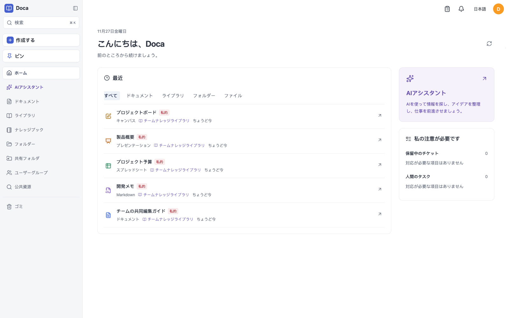
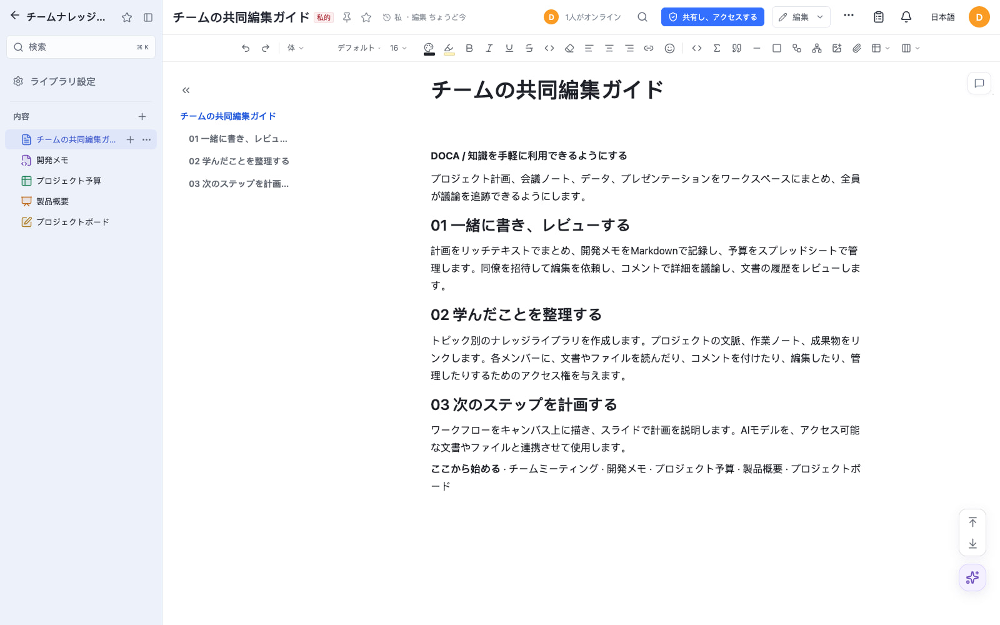
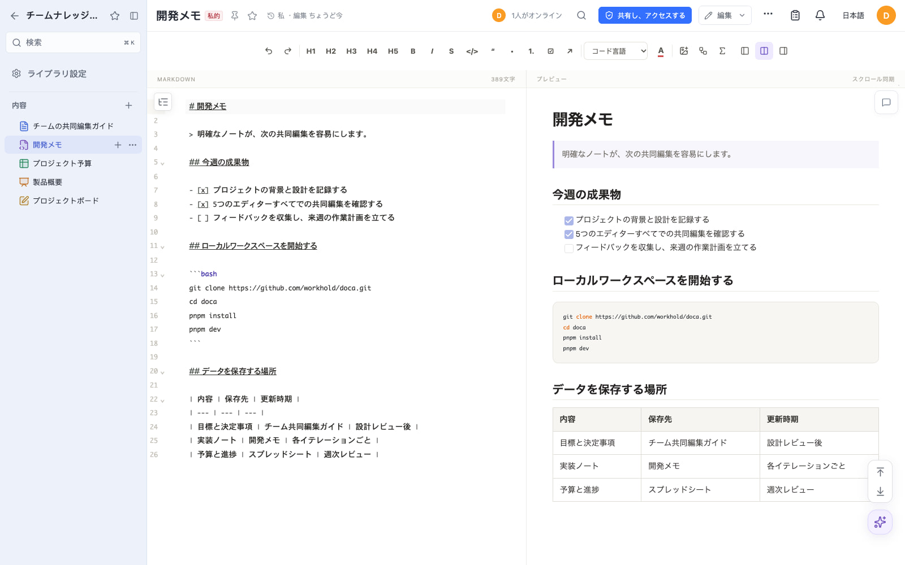
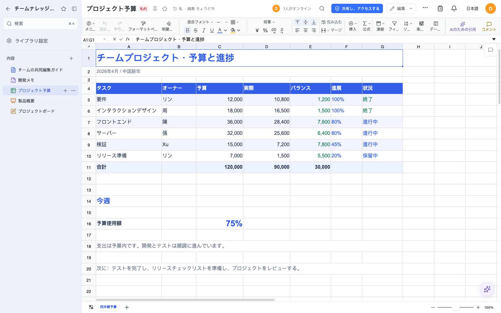
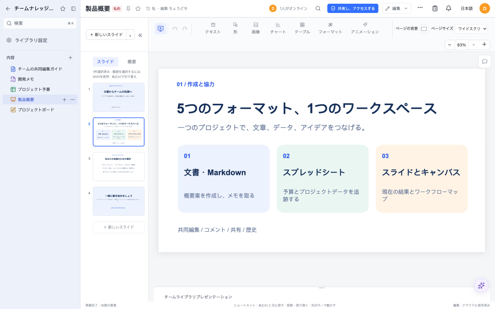
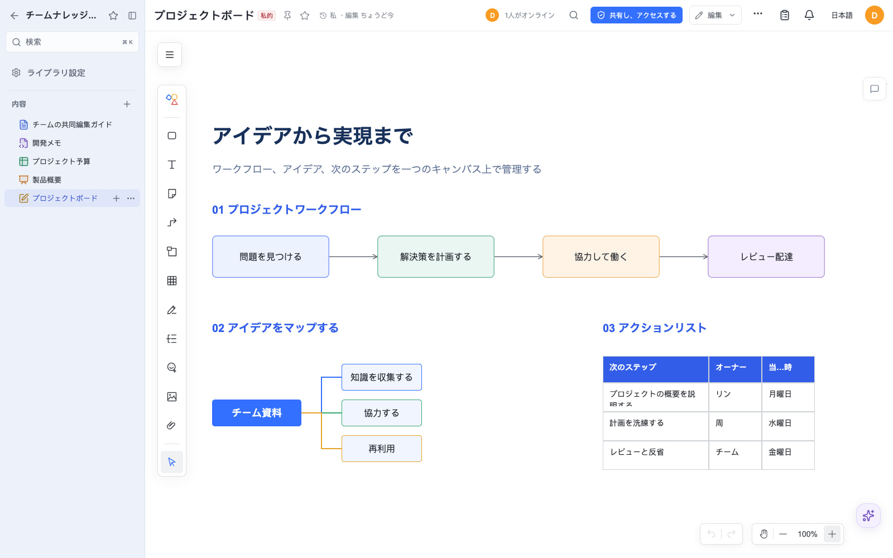

# Doca

[English](README.md) · [简体中文](README.zh-CN.md) · [繁體中文](README.zh-Hant.md) · 日本語 · [Français](README.fr.md) · [한국어](README.ko.md) · [Español](README.es.md) · [Русский](README.ru.md)

Doca は、個人や小規模チーム向けのオープンソースのドキュメント・ナレッジ管理ワークスペースです。リッチテキスト、Markdown、スプレッドシート、スライド、無限キャンバスを共同編集できます。コメントや変更履歴を活用し、ナレッジライブラリで情報を整理できます。自分の AI モデルを接続すると、アクセス権のある資料を使って作業できます。

[ドキュメント](https://workhold.github.io/doca/#/ja/) · [デモ](https://d.smartdoca.cc) · [リリース](https://github.com/workhold/doca/releases) · [プラグインストア](https://store.smartdoca.cc)

## ワークスペース



## リッチテキストエディター



## Markdown エディター



## スプレッドシート



## スライド



## 無限キャンバス



日本語の画面とサンプルデータを使い、隔離された Doca 0.3.0 の環境で撮影しました。

## Docker で始める

Docker Engine、Docker Compose、サイトを公開する HTTP(S) の URL を用意します。Compose ファイルをダウンロードし、`DOCA_ORIGIN` と専用に生成した資格情報用のマスターキーを設定してから起動します。初回起動時に管理者が初期化されます。

```sh
curl -fL https://github.com/workhold/doca/releases/download/v0.3.1/doca-compose-v0.3.1.yaml -o compose.yaml
```

```sh
docker compose up -d
```

[デプロイガイド](https://workhold.github.io/doca/#/ja/operations/deployment) · [Docker Hub](https://hub.docker.com/r/smartdoca/doca)

## ソースコードから開発する

Node.js 22 以降と、プロジェクトで指定された pnpm のバージョンを使用します。

```sh
git clone https://github.com/workhold/doca.git
cd doca
pnpm install --frozen-lockfile
pnpm dev
```

本体のライセンスは MIT です。プラグインは各作者が管理しています。 [MIT](LICENSE)
