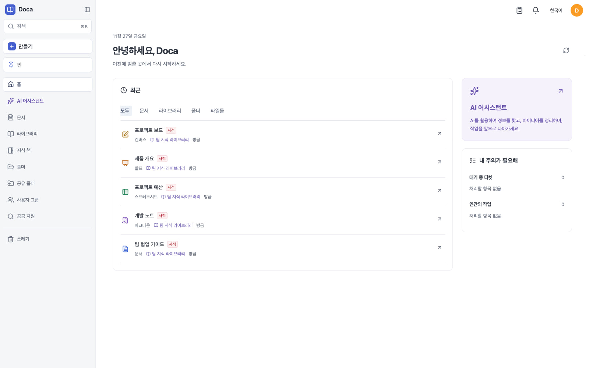
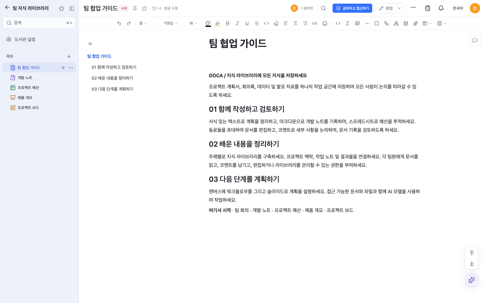
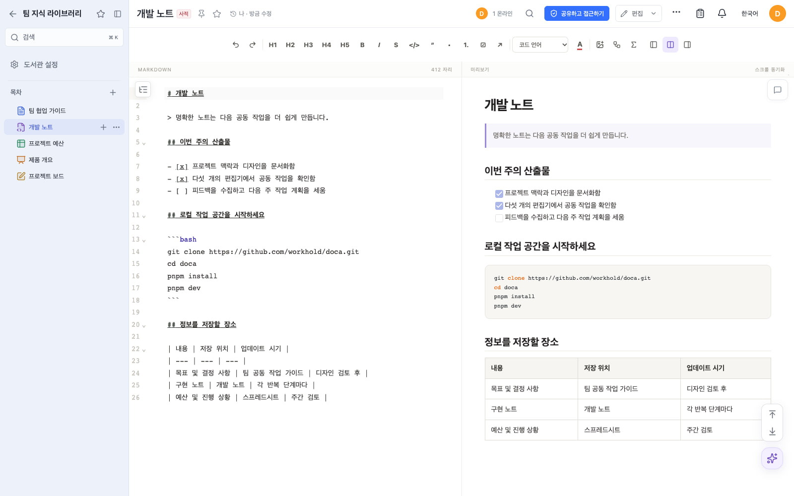
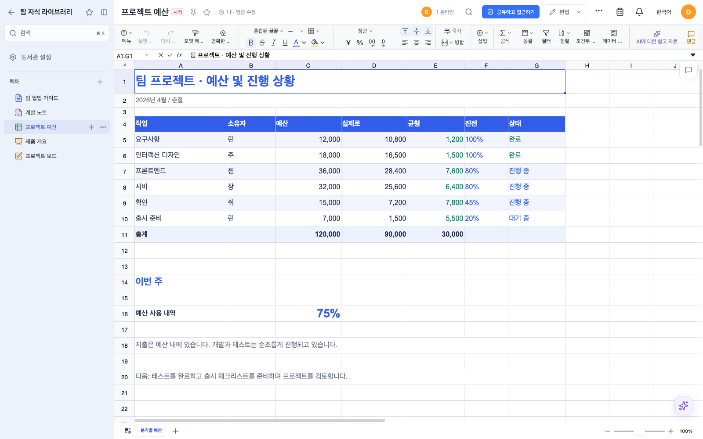
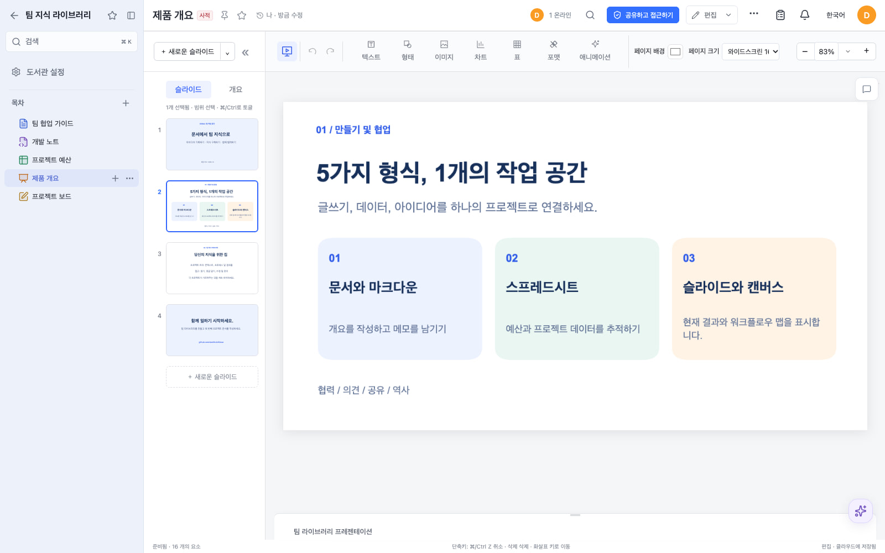
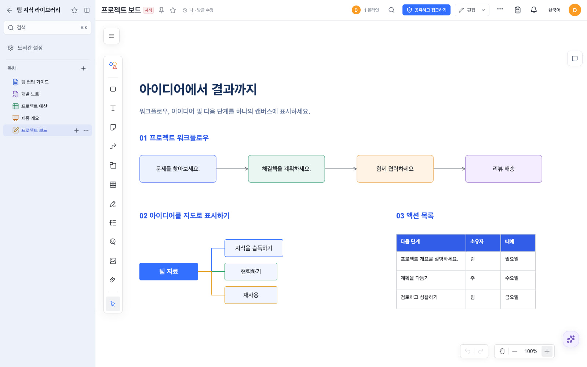

# Doca

[English](README.md) · [简体中文](README.zh-CN.md) · [繁體中文](README.zh-Hant.md) · [日本語](README.ja.md) · [Français](README.fr.md) · 한국어 · [Español](README.es.md) · [Русский](README.ru.md)

Doca는 개인과 소규모 팀을 위한 오픈 소스 문서 및 지식 관리 작업 공간입니다. 서식 있는 텍스트, Markdown, 스프레드시트, 슬라이드와 무한 캔버스에서 실시간으로 공동 편집하고 댓글과 변경 내역을 활용하세요. 지식 라이브러리로 자료를 정리하고, 자체 AI 모델을 연결해 접근 권한이 있는 문서와 파일을 활용할 수 있습니다.

[문서](https://workhold.github.io/doca/#/ko/) · [데모](https://d.smartdoca.cc) · [릴리스](https://github.com/workhold/doca/releases) · [플러그인 스토어](https://store.smartdoca.cc)

## 작업 공간



## 서식 있는 텍스트 편집기



## Markdown 편집기



## 스프레드시트



## 슬라이드



## 무한 캔버스



별도 테스트 환경의 Doca 0.3.0에서 한국어 인터페이스와 예제 데이터를 사용해 캡처했습니다.

## Docker로 시작하기

Docker Engine, Docker Compose 및 사이트의 HTTP(S) 주소를 준비합니다. Compose 파일을 내려받고 `DOCA_ORIGIN`과 새로 생성한 자격 증명용 마스터 키를 설정한 뒤 실행합니다. 처음 실행할 때 관리자 계정이 초기화됩니다.

```sh
curl -fL https://github.com/workhold/doca/releases/download/v0.3.1/doca-compose-v0.3.1.yaml -o compose.yaml
```

```sh
docker compose up -d
```

[배포 가이드](https://workhold.github.io/doca/#/ko/operations/deployment) · [Docker Hub](https://hub.docker.com/r/smartdoca/doca)

## 소스 코드로 개발하기

Node.js 22 이상과 프로젝트에 명시된 pnpm 버전을 사용합니다.

```sh
git clone https://github.com/workhold/doca.git
cd doca
pnpm install --frozen-lockfile
pnpm dev
```

본체는 MIT 라이선스로 배포됩니다. 플러그인은 각 제작자가 관리합니다. [MIT](LICENSE)
