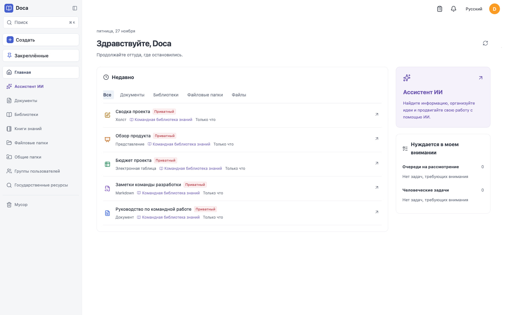
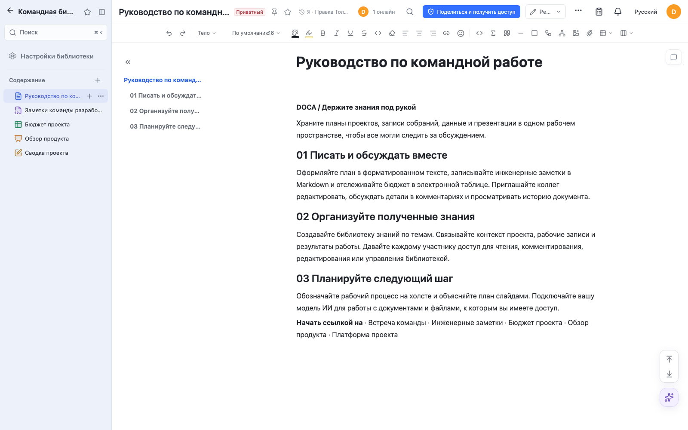
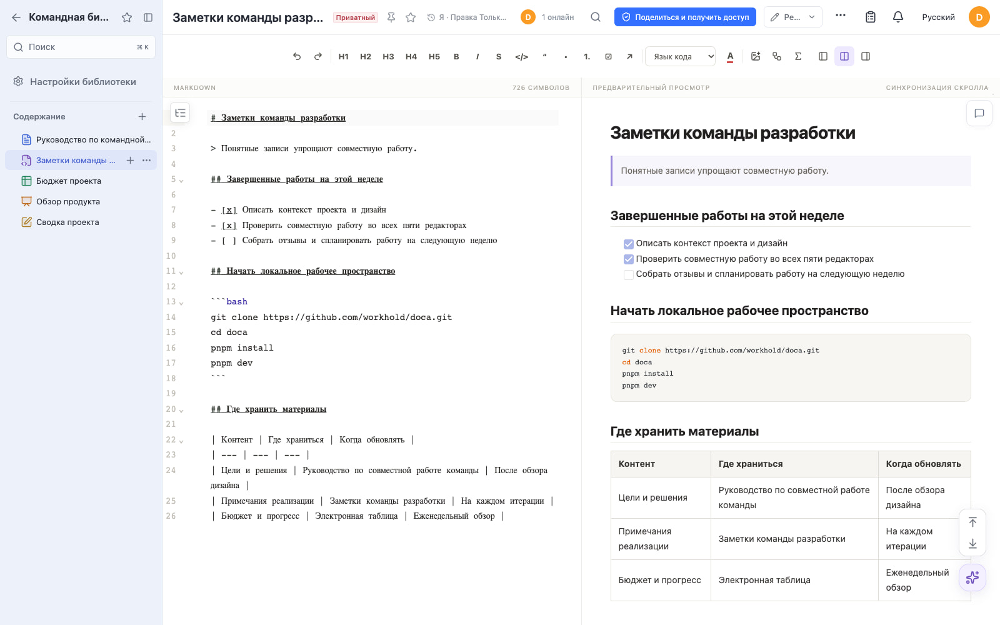
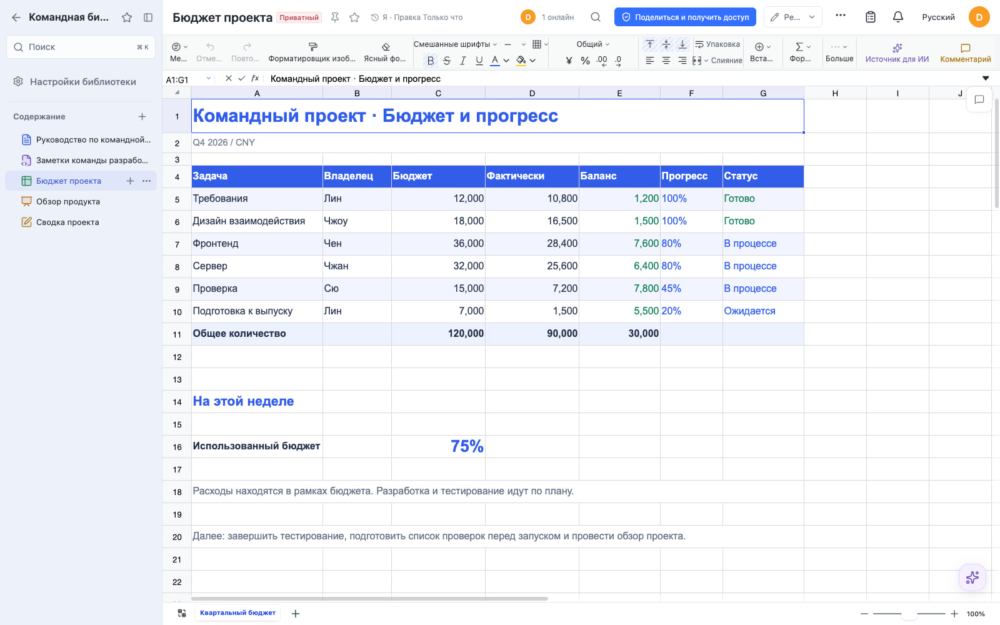
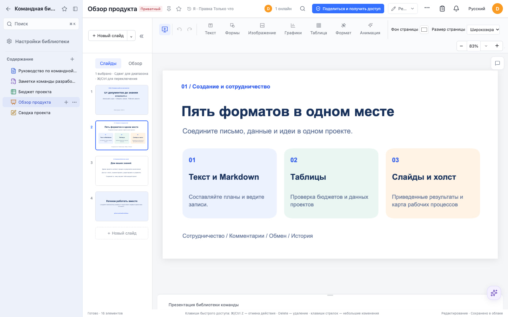
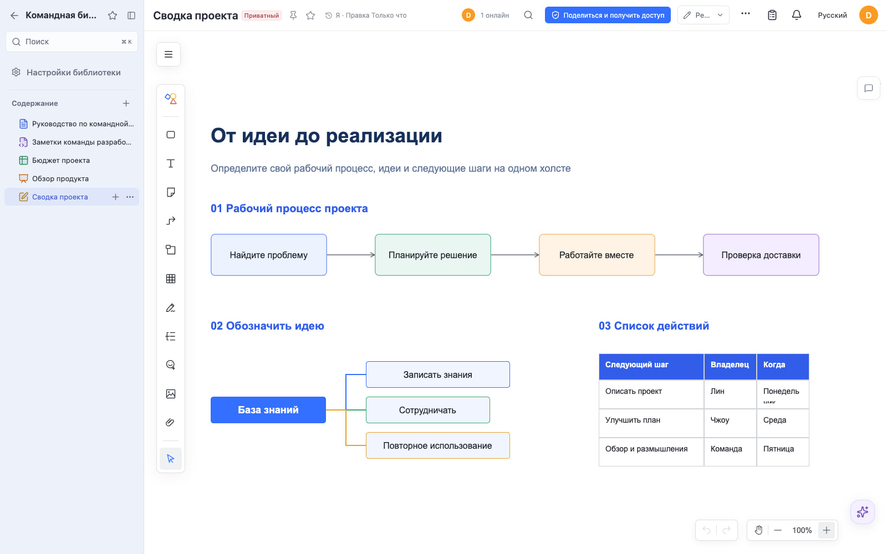

# Doca

[English](README.md) · [简体中文](README.zh-CN.md) · [繁體中文](README.zh-Hant.md) · [日本語](README.ja.md) · [Français](README.fr.md) · [한국어](README.ko.md) · [Español](README.es.md) · Русский

Doca — рабочее пространство с открытым исходным кодом для документов и базы знаний. Оно подходит для личной работы и небольших команд. Совместно редактируйте форматированный текст, Markdown, таблицы, слайды и бесконечные холсты. Организуйте материалы в библиотеках знаний и подключайте собственные модели ИИ для работы с доступными вам документами и файлами.

[Документация](https://workhold.github.io/doca/#/ru/) · [Демонстрация](https://d.smartdoca.cc) · [Выпуски](https://github.com/workhold/doca/releases) · [Каталог плагинов](https://store.smartdoca.cc)

## Рабочее пространство



## Редактор форматированного текста



## Редактор Markdown



## Электронная таблица



## Слайды



## Бесконечный холст



Снимки сделаны в изолированной среде Doca 0.3.0 с русским интерфейсом и демонстрационными документами.

## Быстрый запуск с Docker

Подготовьте Docker Engine, Docker Compose и адрес сайта по HTTP(S). Скачайте файл Compose, задайте `DOCA_ORIGIN` и сгенерируйте отдельный мастер-ключ учётных данных. Затем запустите сервис. Учётная запись администратора инициализируется при первом запуске.

```sh
curl -fL https://github.com/workhold/doca/releases/download/v0.3.1/doca-compose-v0.3.1.yaml -o compose.yaml
```

```sh
docker compose up -d
```

[Руководство по развёртыванию](https://workhold.github.io/doca/#/ru/operations/deployment) · [Docker Hub](https://hub.docker.com/r/smartdoca/doca)

## Разработка из исходного кода

Используйте Node.js 22 или новее и версию pnpm, указанную проектом.

```sh
git clone https://github.com/workhold/doca.git
cd doca
pnpm install --frozen-lockfile
pnpm dev
```

Приложение распространяется по лицензии MIT. Плагины поддерживают их авторы. [MIT](LICENSE)
