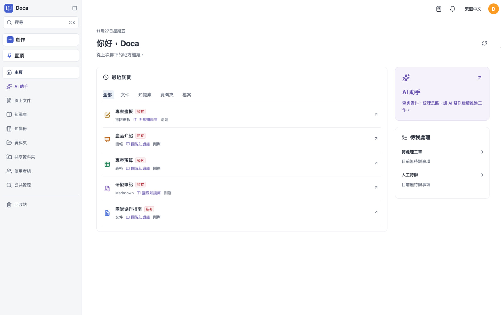
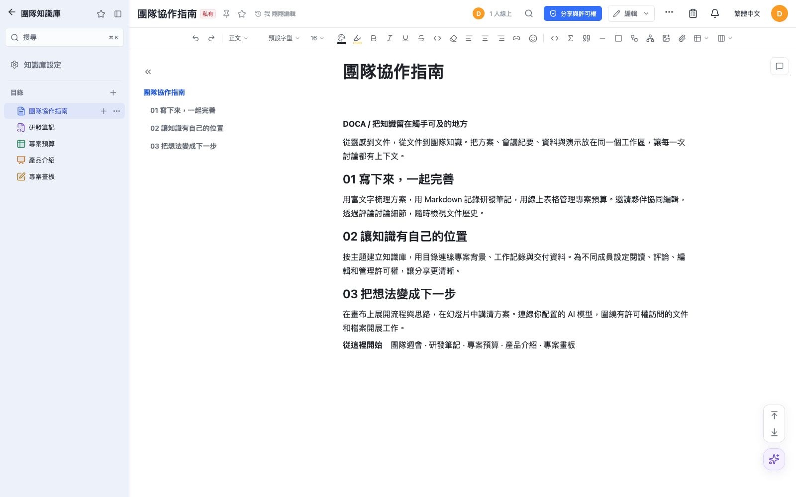
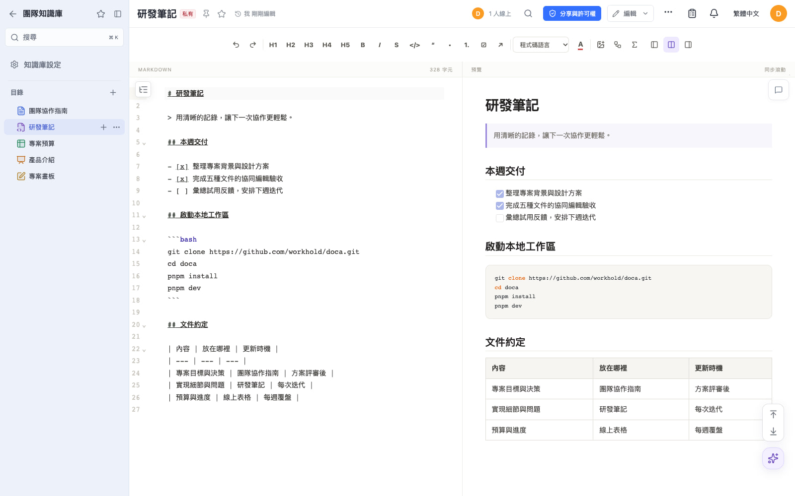
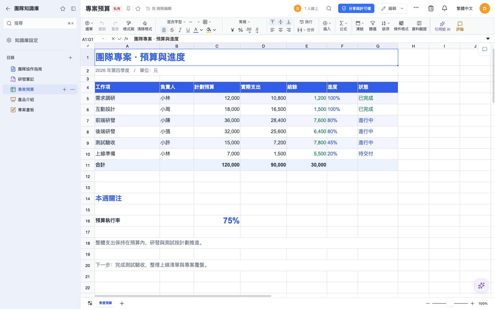
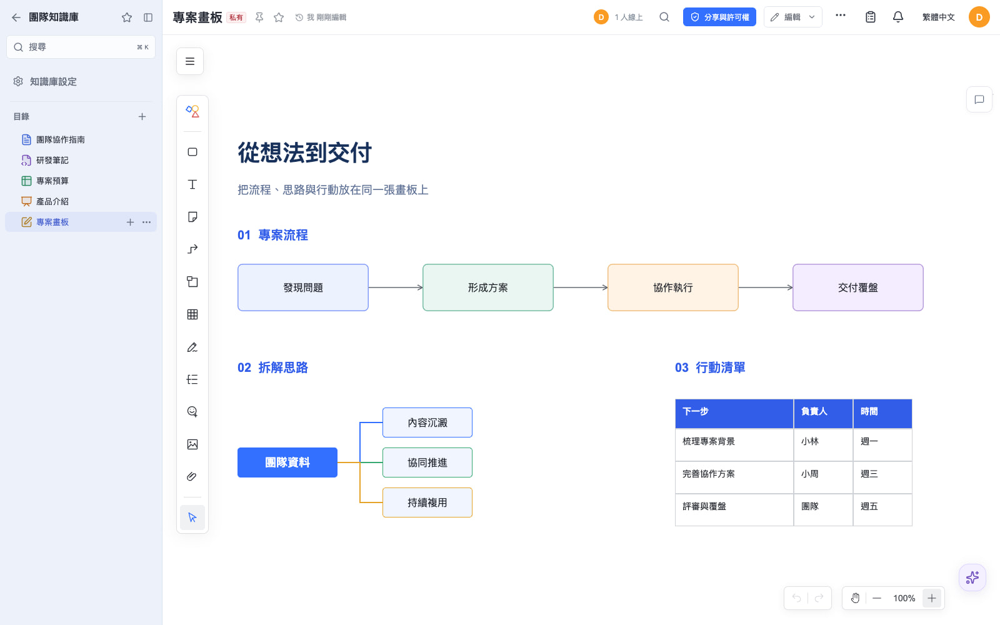

# Doca

[English](README.md) · [简体中文](README.zh-CN.md) · 繁體中文 · [日本語](README.ja.md) · [Français](README.fr.md) · [한국어](README.ko.md) · [Español](README.es.md) · [Русский](README.ru.md)

Doca 是面向個人和小型團隊的開放原始碼文件與知識管理工作區。以即時協作、留言及版本記錄一起編輯富文字、Markdown、試算表、簡報和無限畫布。使用知識庫整理文件，並連接自己的 AI 模型來處理有權限存取的資料。

[文件](https://workhold.github.io/doca/#/zh-hant/) · [線上試用](https://d.smartdoca.cc) · [發行版本](https://github.com/workhold/doca/releases) · [外掛市集](https://store.smartdoca.cc)

## 工作區



## 富文字編輯器



## Markdown 編輯器



## 試算表



## 簡報


## 無限畫布



截圖取自獨立環境中的 Doca 0.3.0，介面與示範內容均為繁體中文。

## 使用 Docker 快速啟動

請準備 Docker Engine、Docker Compose 以及網站的 HTTP(S) 公開位址。下載 Compose 檔案，填寫 `DOCA_ORIGIN` 並產生專用的憑證主金鑰，再啟動服務。首次啟動會初始化管理員。

```sh
curl -fL https://github.com/workhold/doca/releases/download/v0.3.1/doca-compose-v0.3.1.yaml -o compose.yaml
```

```sh
docker compose up -d
```

[部署指南](https://workhold.github.io/doca/#/zh-hant/operations/deployment) · [Docker Hub](https://hub.docker.com/r/smartdoca/doca)

## 從原始碼開發

使用 Node.js 22 或更新版本以及專案鎖定的 pnpm 版本。

```sh
git clone https://github.com/workhold/doca.git
cd doca
pnpm install --frozen-lockfile
pnpm dev
```

主程式採用 MIT 授權。外掛由各自的作者維護。 [MIT](LICENSE)
