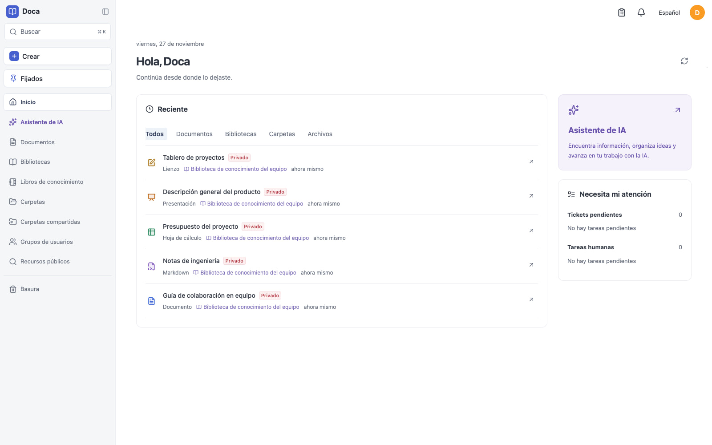

# Documentación de Doca

[English](README.md) · [简体中文](README.zh-CN.md) · [繁體中文](README.zh-Hant.md) · [日本語](README.ja.md) · [Français](README.fr.md) · [한국어](README.ko.md) · [Español](README.es.md) · [Русский](README.ru.md)

Doca es un espacio de trabajo para gestionar documentos y conocimiento, diseñado para personas y equipos pequeños. Estas guías explican cómo instalar, usar, administrar y ampliar Doca. Consulta las [Notas de la versión 0.3.1](releases/0.3.1.es.md) antes de instalar o actualizar.

[Sitio oficial](https://i.smartdoca.cc) · [Demostración en línea](https://d.smartdoca.cc) · [Mercado de complementos](https://store.smartdoca.cc)

**Los datos de la demostración se eliminan periódicamente. Evita guardar información importante allí.**

## Primeros pasos

- [Inicio rápido](quickstart.es.md)
- [Desplegar sin acceso a GitHub](deployment-without-github.es.md)
- [Funciones y límites](features.es.md)
- [Configuración](configuration.es.md)
- [Guía de usuario](user-guide.es.md)
- [Preguntas frecuentes y resolución de problemas](faq.es.md)

## Guías de usuario

- [Documentos y uso compartido](document-experience.es.md)
- [Permisos](permission-inheritance.es.md)
- [Descubrimiento y colecciones](public-resource-discovery.es.md)
- [Comentarios y notificaciones](comments-and-community.es.md)
- [Libros de conocimiento](knowledge-books.es.md)
- [Asistente del navegador](browser-assistant.es.md)
- [Servicios MCP](mcp.es.md)
- [Cliente de escritorio](desktop-client.es.md)

## Despliegue y operaciones

- [Despliegue](deployment.es.md)
- [Almacenamiento de archivos](storage.es.md)
- [Escalado horizontal](horizontal-scaling.es.md)
- [Autenticación](authentication.es.md)
- [Credenciales de servicio](service-credentials.es.md)
- [Webhooks](webhooks.es.md)

## Desarrollo y extensiones

- [Entorno de desarrollo](development.es.md)
- [Contrato de actualización de la base de datos](database-schema-evolution.es.md)
- [Arquitectura](architecture.es.md)
- [Integración de editores](editor-integration.es.md)
- [Colaboración](collaboration.es.md)
- [Internacionalización](i18n.es.md)
- [Desarrollo de complementos](plugin-development.es.md)
- [Despliegue de complementos](plugin-deployment.es.md)

## Referencias y registros del proyecto

- [API HTTP](api.es.md)
- [Base de datos](database.es.md)
- [Contrato del SDK de complementos](plugin-sdk-contract.es.md)
- [Contrato de almacenamiento de complementos](plugin-horizontal-scaling.es.md)
- [Contrato de colaboración](collaboration-sdk-contract.es.md)
- [Intercambio de archivos](editor-file-exchange-contract.es.md)
- [Notas de la versión](releases/0.3.1.es.md)
- [Mantenimiento de la documentación](documentation.es.md)
- [Registros de investigación y verificación](research.es.md)

Una instancia de Doca en ejecución proporciona `/api/openapi.json`. Cada contrato identifica las interfaces disponibles y las funciones previstas. Los registros históricos conservan su idioma y fecha originales.
