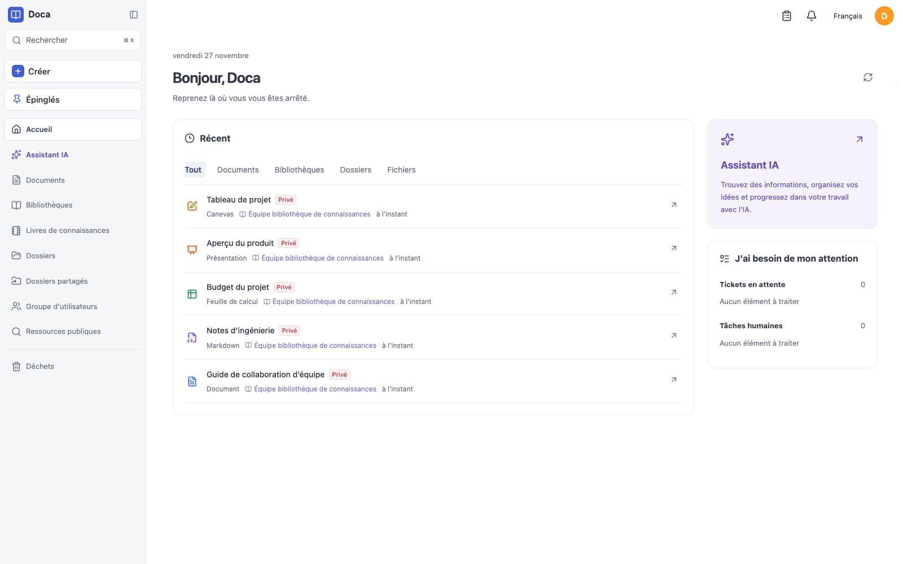

# Documentation de Doca

[English](README.md) · [简体中文](README.zh-CN.md) · [繁體中文](README.zh-Hant.md) · [日本語](README.ja.md) · [Français](README.fr.md) · [한국어](README.ko.md) · [Español](README.es.md) · [Русский](README.ru.md)

Doca est un espace de travail pour gérer des documents et des connaissances, conçu pour les particuliers et les petites équipes. Ces guides couvrent l’installation, l’utilisation, l’exploitation et les extensions. Consultez les [Notes de version 0.3.0](releases/0.3.0.fr.md) avant d’installer ou de mettre à jour Doca.

[Site officiel](https://i.smartdoca.cc) · [Démo en ligne](https://d.smartdoca.cc) · [Catalogue de plugins](https://store.smartdoca.cc)

**Les données de la démo sont régulièrement effacées. N’y conservez aucune donnée importante.**

## Premiers pas

- [Démarrage rapide](quickstart.fr.md)
- [Déployer sans accès à GitHub](deployment-without-github.fr.md)
- [Fonctionnalités et limites](features.fr.md)
- [Configuration](configuration.fr.md)
- [Guide d’utilisation](user-guide.fr.md)
- [Questions fréquentes et dépannage](faq.fr.md)

## Guides d’utilisation

- [Documents et partage](document-experience.fr.md)
- [Autorisations](permission-inheritance.fr.md)
- [Découverte et collections](public-resource-discovery.fr.md)
- [Commentaires et notifications](comments-and-community.fr.md)
- [Livres de connaissances](knowledge-books.fr.md)
- [Assistant de navigateur](browser-assistant.fr.md)
- [Services MCP](mcp.fr.md)
- [Client de bureau](desktop-client.fr.md)

## Déploiement et exploitation

- [Déploiement](deployment.fr.md)
- [Stockage des fichiers](storage.fr.md)
- [Mise à l’échelle horizontale](horizontal-scaling.fr.md)
- [Authentification](authentication.fr.md)
- [Identifiants de service](service-credentials.fr.md)
- [Webhooks](webhooks.fr.md)

## Développement et extensions

- [Environnement de développement](development.fr.md)
- [Mise à niveau de la base de données](database-schema-evolution.fr.md)
- [Architecture](architecture.fr.md)
- [Intégration des éditeurs](editor-integration.fr.md)
- [Collaboration](collaboration.fr.md)
- [Internationalisation](i18n.fr.md)
- [Développement de plugins](plugin-development.fr.md)
- [Déploiement de plugins](plugin-deployment.fr.md)

## Références et archives du projet

- [API HTTP](api.fr.md)
- [Base de données](database.fr.md)
- [Contrat du SDK de plugins](plugin-sdk-contract.fr.md)
- [Contrat de stockage des plugins](plugin-horizontal-scaling.fr.md)
- [Contrat de collaboration](collaboration-sdk-contract.fr.md)
- [Échange de fichiers](editor-file-exchange-contract.fr.md)
- [Notes de version](releases/0.3.0.fr.md)
- [Maintenance de la documentation](documentation.fr.md)
- [Études et rapports de vérification](research.fr.md)

Une instance Doca en cours d’exécution fournit `/api/openapi.json`. Chaque contrat indique les interfaces disponibles et les fonctionnalités prévues. Les rapports historiques conservent leur langue et leur date d’origine.
