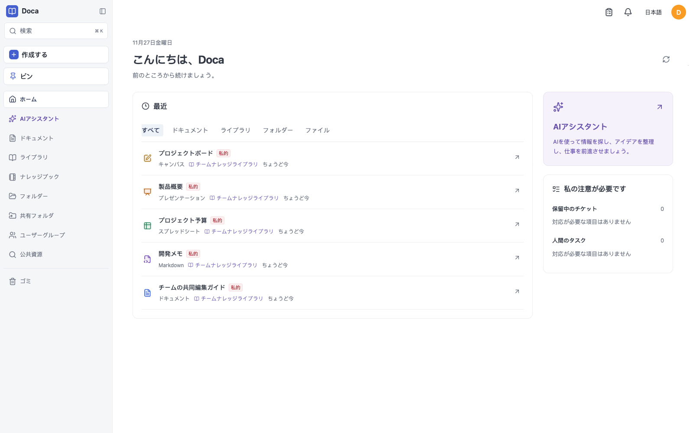

# Doca ドキュメント

[English](README.md) · [简体中文](README.zh-CN.md) · [繁體中文](README.zh-Hant.md) · [日本語](README.ja.md) · [Français](README.fr.md) · [한국어](README.ko.md) · [Español](README.es.md) · [Русский](README.ru.md)

Doca は個人や小規模チームで文書とナレッジを管理するためのワークスペースです。ここでは導入、利用、運用、拡張方法を説明します。インストールや更新の前に[リリースノート 0.3.1](releases/0.3.1.ja.md)をご確認ください。

[公式サイト](https://i.smartdoca.cc) · [オンラインデモ](https://d.smartdoca.cc) · [プラグインストア](https://store.smartdoca.cc)

**デモのデータは定期的に削除されます。重要なデータは保存しないでください。**

## はじめに

- [クイックスタート](quickstart.ja.md)
- [GitHub を使わない導入方法](deployment-without-github.ja.md)
- [機能と制限](features.ja.md)
- [設定](configuration.ja.md)
- [利用ガイド](user-guide.ja.md)
- [よくある質問とトラブルシューティング](faq.ja.md)

## ユーザーガイド

- [文書と共有](document-experience.ja.md)
- [アクセス権](permission-inheritance.ja.md)
- [公開リソースとコレクション](public-resource-discovery.ja.md)
- [コメントと通知](comments-and-community.ja.md)
- [ナレッジブック](knowledge-books.ja.md)
- [ブラウザーアシスタント](browser-assistant.ja.md)
- [MCP サービス](mcp.ja.md)
- [デスクトップクライアント](desktop-client.ja.md)

## 導入と運用

- [導入](deployment.ja.md)
- [ファイルストレージ](storage.ja.md)
- [水平スケーリング](horizontal-scaling.ja.md)
- [認証](authentication.ja.md)
- [サービス認証情報](service-credentials.ja.md)
- [Webhook](webhooks.ja.md)

## 開発と拡張

- [開発環境](development.ja.md)
- [データベースの更新仕様](database-schema-evolution.ja.md)
- [アーキテクチャ](architecture.ja.md)
- [エディター連携](editor-integration.ja.md)
- [共同編集](collaboration.ja.md)
- [国際化](i18n.ja.md)
- [プラグイン開発](plugin-development.ja.md)
- [プラグインの導入](plugin-deployment.ja.md)

## リファレンスとプロジェクト記録

- [HTTP API](api.ja.md)
- [データベース](database.ja.md)
- [プラグイン SDK 仕様](plugin-sdk-contract.ja.md)
- [プラグインのストレージ仕様](plugin-horizontal-scaling.ja.md)
- [共同編集の仕様](collaboration-sdk-contract.ja.md)
- [ファイル交換](editor-file-exchange-contract.ja.md)
- [リリースノート](releases/0.3.1.ja.md)
- [ドキュメントの保守](documentation.ja.md)
- [調査・検証記録](research.ja.md)

稼働中の Doca では `/api/openapi.json` を参照できます。各仕様書には利用可能なインターフェースと計画中の機能を明記しています。過去の調査記録は原文と日付を保持しています。
