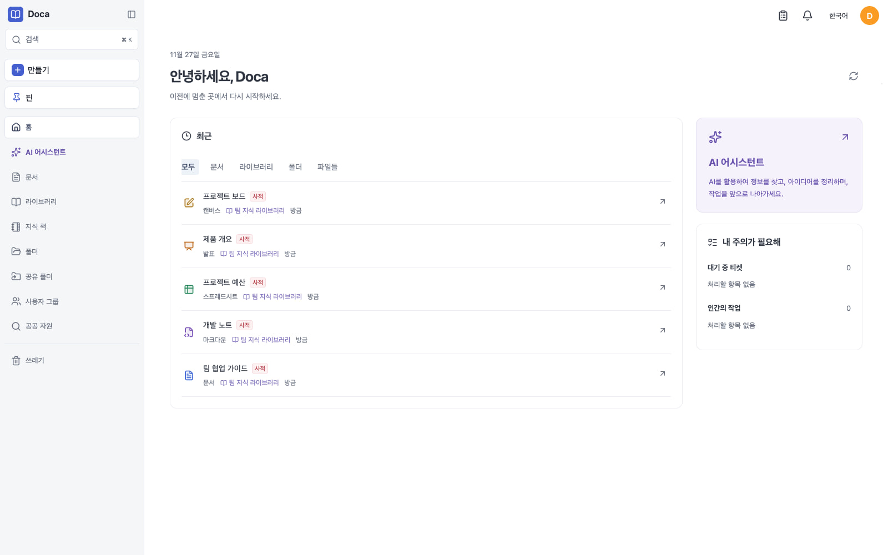

# Doca 문서

[English](README.md) · [简体中文](README.zh-CN.md) · [繁體中文](README.zh-Hant.md) · [日本語](README.ja.md) · [Français](README.fr.md) · [한국어](README.ko.md) · [Español](README.es.md) · [Русский](README.ru.md)

Doca는 개인과 소규모 팀이 문서와 지식을 관리하는 작업 공간입니다. 이 문서에서는 설치, 사용, 운영, 확장 방법을 안내합니다. 설치하거나 업데이트하기 전에 [릴리스 노트 0.3.0](releases/0.3.0.ko.md)를 확인하세요.

[공식 웹사이트](https://i.smartdoca.cc) · [온라인 데모](https://d.smartdoca.cc) · [플러그인 마켓](https://store.smartdoca.cc)

**데모 데이터는 주기적으로 삭제됩니다. 중요한 데이터를 저장하지 마세요.**

## 시작하기

- [빠른 시작](quickstart.ko.md)
- [GitHub 없이 배포하기](deployment-without-github.ko.md)
- [기능 및 제한](features.ko.md)
- [구성](configuration.ko.md)
- [사용자 안내서](user-guide.ko.md)
- [자주 묻는 질문 및 문제 해결](faq.ko.md)

## 사용자 가이드

- [문서 및 공유](document-experience.ko.md)
- [권한](permission-inheritance.ko.md)
- [공개 리소스 및 컬렉션](public-resource-discovery.ko.md)
- [댓글 및 알림](comments-and-community.ko.md)
- [지식 문서집](knowledge-books.ko.md)
- [브라우저 도우미](browser-assistant.ko.md)
- [MCP 서비스](mcp.ko.md)
- [데스크톱 클라이언트](desktop-client.ko.md)

## 배포 및 운영

- [배포](deployment.ko.md)
- [파일 저장소](storage.ko.md)
- [수평 확장](horizontal-scaling.ko.md)
- [인증](authentication.ko.md)
- [서비스 자격 증명](service-credentials.ko.md)
- [웹훅](webhooks.ko.md)

## 개발 및 확장

- [개발 환경](development.ko.md)
- [데이터베이스 업그레이드 규약](database-schema-evolution.ko.md)
- [아키텍처](architecture.ko.md)
- [편집기 통합](editor-integration.ko.md)
- [공동 편집](collaboration.ko.md)
- [국제화](i18n.ko.md)
- [플러그인 개발](plugin-development.ko.md)
- [플러그인 배포](plugin-deployment.ko.md)

## 참고 자료 및 프로젝트 기록

- [HTTP API](api.ko.md)
- [데이터베이스](database.ko.md)
- [플러그인 SDK 규약](plugin-sdk-contract.ko.md)
- [플러그인 저장소 규약](plugin-horizontal-scaling.ko.md)
- [공동 편집 규약](collaboration-sdk-contract.ko.md)
- [파일 교환](editor-file-exchange-contract.ko.md)
- [릴리스 노트](releases/0.3.0.ko.md)
- [문서 관리](documentation.ko.md)
- [조사 및 검증 기록](research.ko.md)

실행 중인 Doca의 `/api/openapi.json`에서 API 명세를 볼 수 있습니다. 각 규약은 사용 가능한 인터페이스와 계획 중인 기능을 표시합니다. 이전 조사 기록의 언어와 날짜는 그대로 유지됩니다.
