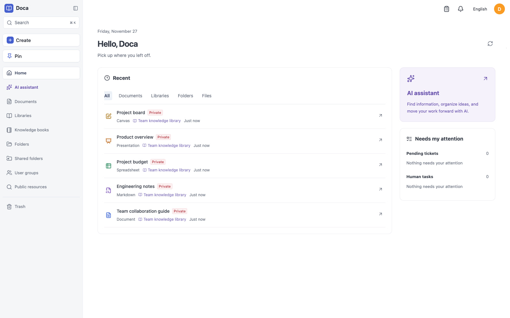

# Doca documentation

**English** · [简体中文](README.zh-CN.md) · [繁體中文](README.zh-Hant.md) · [日本語](README.ja.md) · [Français](README.fr.md) · [한국어](README.ko.md) · [Español](README.es.md) · [Русский](README.ru.md)

Doca is a document and knowledge workspace for individuals and small teams. These guides track current source; follow the [0.3.1 release notes](releases/0.3.1.md) for installation and upgrades. Package contracts identify their own implementation limits.

[Website](https://i.smartdoca.cc) · [Live demo](https://d.smartdoca.cc) · [Plugin marketplace](https://store.smartdoca.cc)

**Demo data is cleared from time to time. Please do not store important data in the demo.**

## Get started

- [Quick start](quickstart.md): clone → configure `.env` → pull the image → start → initialize the administrator password.
- [Deploy without GitHub access](deployment-without-github.md): transfer deployment files, pull or load the image, and initialize the administrator.
- [Capabilities and limits](features.md): core features, independent plugins, and unavailable capabilities.
- [Configuration](configuration.md): required settings and optional services.
- [User guide](user-guide.md): documents, libraries, files, search, and AI.
- [FAQ and troubleshooting](faq.md).

## User guides

[Documents and sharing](document-experience.md) · [Permissions](permission-inheritance.md) · [Discovery and collections](public-resource-discovery.md) · [Comments and notifications](comments-and-community.md) · [Knowledge books](knowledge-books.md)

[Browser assistant](browser-assistant.md) · [MCP services](mcp.md) · [Desktop client](desktop-client.md)

## Deployment and operations

[Deployment](deployment.md) · [File storage](storage.md) · [Horizontal scaling](horizontal-scaling.md) · [Authentication](authentication.md) · [Service credentials](service-credentials.md) · [Webhooks](webhooks.md)

## Development and extensions

[Development setup](development.md) · [Database upgrade contract](database-schema-evolution.md) · [Architecture](architecture.md) · [Editor integration](editor-integration.md) · [Collaboration](collaboration.md) · [Internationalization](i18n.md) · [Plugin development](plugin-development.md) · [Plugin deployment](plugin-deployment.md)

## Reference and project records

[HTTP API](api.md) · [Database](database.md) · [Plugin SDK contract](plugin-sdk-contract.md) · [Plugin storage contract](plugin-horizontal-scaling.md) · [Collaboration contract](collaboration-sdk-contract.md) · [File exchange](editor-file-exchange-contract.md) · [Release notes](releases/0.3.1.md) · [Documentation maintenance](documentation.md) · [Research and acceptance records](research.md)

The running application provides `/api/openapi.json`. Proposed capabilities are labeled in the relevant contract; a design record does not establish that an API is exported. Research records retain their original language and date.
