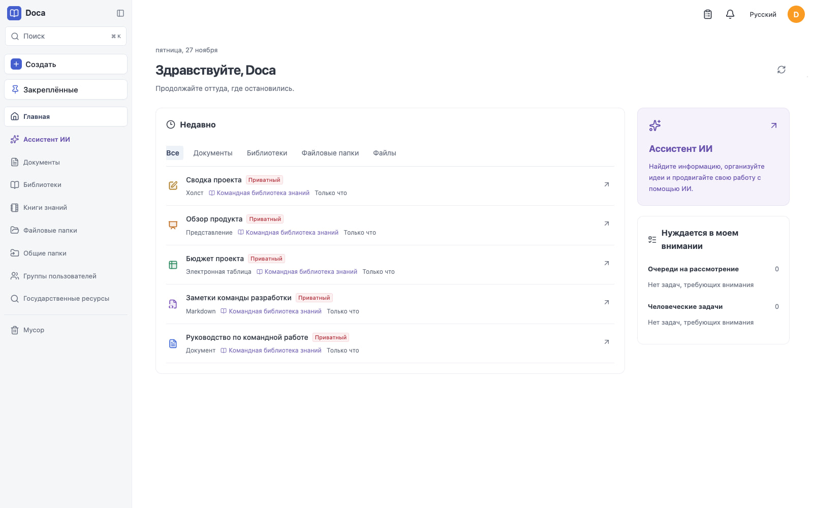

# Документация Doca

[English](README.md) · [简体中文](README.zh-CN.md) · [繁體中文](README.zh-Hant.md) · [日本語](README.ja.md) · [Français](README.fr.md) · [한국어](README.ko.md) · [Español](README.es.md) · [Русский](README.ru.md)

Doca — рабочее пространство для документов и базы знаний, рассчитанное на частных пользователей и небольшие команды. В этих руководствах описано, как установить, использовать, администрировать и расширять Doca. Перед установкой или обновлением прочтите [Примечания к выпуску 0.3.1](releases/0.3.1.ru.md).

[Официальный сайт](https://i.smartdoca.cc) · [Онлайн-демо](https://d.smartdoca.cc) · [Каталог плагинов](https://store.smartdoca.cc)

**Данные в демоверсии регулярно удаляются. Не храните там важные данные.**

## Начало работы

- [Быстрый старт](quickstart.ru.md)
- [Развёртывание без доступа к GitHub](deployment-without-github.ru.md)
- [Возможности и ограничения](features.ru.md)
- [Настройка](configuration.ru.md)
- [Руководство пользователя](user-guide.ru.md)
- [Частые вопросы и устранение неполадок](faq.ru.md)

## Руководства пользователя

- [Документы и общий доступ](document-experience.ru.md)
- [Права доступа](permission-inheritance.ru.md)
- [Поиск общедоступных материалов и коллекции](public-resource-discovery.ru.md)
- [Комментарии и уведомления](comments-and-community.ru.md)
- [Книги знаний](knowledge-books.ru.md)
- [Помощник браузера](browser-assistant.ru.md)
- [Сервисы MCP](mcp.ru.md)
- [Настольный клиент](desktop-client.ru.md)

## Развёртывание и эксплуатация

- [Развёртывание](deployment.ru.md)
- [Хранение файлов](storage.ru.md)
- [Горизонтальное масштабирование](horizontal-scaling.ru.md)
- [Аутентификация](authentication.ru.md)
- [Учётные данные сервисов](service-credentials.ru.md)
- [Вебхуки](webhooks.ru.md)

## Разработка и расширения

- [Среда разработки](development.ru.md)
- [Правила обновления базы данных](database-schema-evolution.ru.md)
- [Архитектура](architecture.ru.md)
- [Интеграция редакторов](editor-integration.ru.md)
- [Совместное редактирование](collaboration.ru.md)
- [Интернационализация](i18n.ru.md)
- [Разработка плагинов](plugin-development.ru.md)
- [Развёртывание плагинов](plugin-deployment.ru.md)

## Справочники и записи проекта

- [HTTP API](api.ru.md)
- [База данных](database.ru.md)
- [Контракт SDK плагинов](plugin-sdk-contract.ru.md)
- [Контракт хранения данных плагинов](plugin-horizontal-scaling.ru.md)
- [Контракт совместного редактирования](collaboration-sdk-contract.ru.md)
- [Обмен файлами](editor-file-exchange-contract.ru.md)
- [Примечания к выпуску](releases/0.3.1.ru.md)
- [Сопровождение документации](documentation.ru.md)
- [Материалы исследований и проверок](research.ru.md)

Работающий экземпляр Doca предоставляет описание API по адресу `/api/openapi.json`. В каждом контракте указаны доступные интерфейсы и запланированные возможности. В архивных отчётах сохранены исходные язык и дата.
