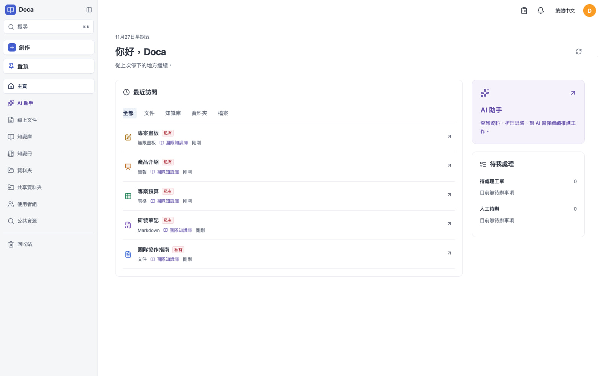

# Doca 文件

[English](README.md) · [简体中文](README.zh-CN.md) · [繁體中文](README.zh-Hant.md) · [日本語](README.ja.md) · [Français](README.fr.md) · [한국어](README.ko.md) · [Español](README.es.md) · [Русский](README.ru.md)

Doca 是為個人和小型團隊設計的文件與知識工作區。這份文件涵蓋安裝、使用、部署與擴充。安裝或升級前，請先閱讀[版本說明 0.3.1](releases/0.3.1.zh-Hant.md)。

[網站](https://i.smartdoca.cc) · [線上展示](https://d.smartdoca.cc) · [外掛市集](https://store.smartdoca.cc)

**線上展示的資料會定期清除，請勿存放重要資料。**

## 入門

- [快速開始](quickstart.zh-Hant.md)
- [無法存取 GitHub 時的部署方式](deployment-without-github.zh-Hant.md)
- [功能與限制](features.zh-Hant.md)
- [設定](configuration.zh-Hant.md)
- [使用手冊](user-guide.zh-Hant.md)
- [常見問題與疑難排解](faq.zh-Hant.md)

## 使用指南

- [文件與分享](document-experience.zh-Hant.md)
- [權限](permission-inheritance.zh-Hant.md)
- [探索與收藏](public-resource-discovery.zh-Hant.md)
- [留言與通知](comments-and-community.zh-Hant.md)
- [知識冊](knowledge-books.zh-Hant.md)
- [瀏覽器助手](browser-assistant.zh-Hant.md)
- [MCP 服務](mcp.zh-Hant.md)
- [桌面用戶端](desktop-client.zh-Hant.md)

## 部署與維運

- [部署](deployment.zh-Hant.md)
- [檔案儲存](storage.zh-Hant.md)
- [水平擴充](horizontal-scaling.zh-Hant.md)
- [驗證](authentication.zh-Hant.md)
- [服務憑證](service-credentials.zh-Hant.md)
- [Webhook](webhooks.zh-Hant.md)

## 開發與擴充

- [開發環境](development.zh-Hant.md)
- [資料庫升級規範](database-schema-evolution.zh-Hant.md)
- [架構](architecture.zh-Hant.md)
- [編輯器整合](editor-integration.zh-Hant.md)
- [協作](collaboration.zh-Hant.md)
- [國際化](i18n.zh-Hant.md)
- [外掛開發](plugin-development.zh-Hant.md)
- [外掛部署](plugin-deployment.zh-Hant.md)

## 技術參考與專案記錄

- [HTTP API](api.zh-Hant.md)
- [資料庫](database.zh-Hant.md)
- [外掛 SDK 規範](plugin-sdk-contract.zh-Hant.md)
- [外掛儲存規範](plugin-horizontal-scaling.zh-Hant.md)
- [協作規範](collaboration-sdk-contract.zh-Hant.md)
- [檔案交換](editor-file-exchange-contract.zh-Hant.md)
- [版本說明](releases/0.3.1.zh-Hant.md)
- [文件維護](documentation.zh-Hant.md)
- [研究與驗收記錄](research.zh-Hant.md)

執行中的 Doca 提供 `/api/openapi.json`。各規範會標明已提供的介面與規劃中的功能。歷史研究記錄保留原文與日期。
