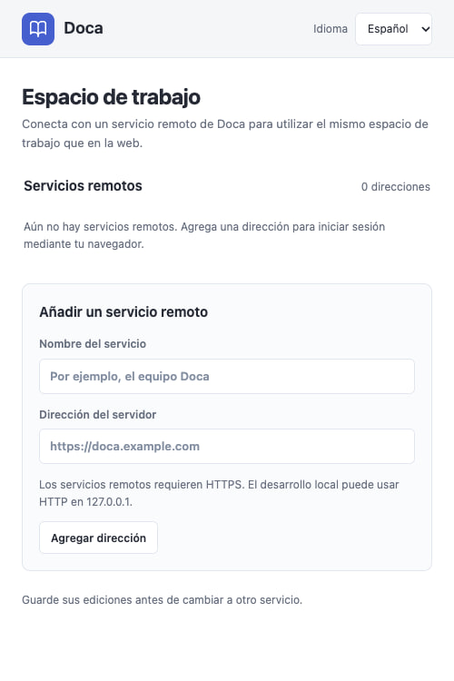
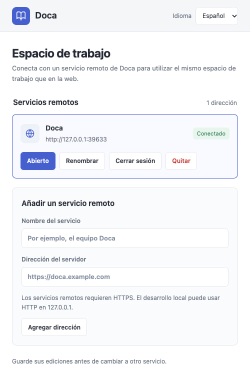
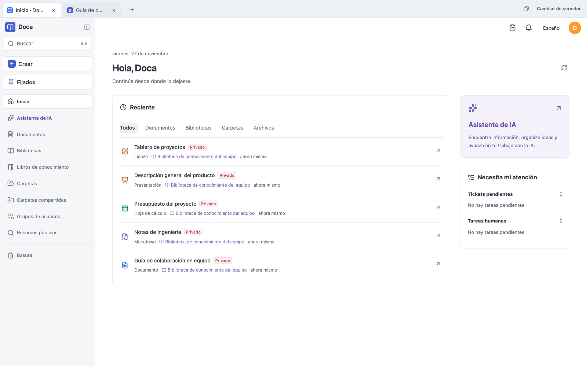

# Cliente de escritorio de Doca

El cliente de escritorio de Doca usa Tauri 2. Incluye la interfaz web de Doca y un gestor para conectarse a los servidores que despliegues. Puedes mantener varias conexiones abiertas y cada ventana de trabajo corresponde a una cuenta en un servidor. El paquete contiene los componentes necesarios para el cliente. El servidor requiere Doca 0.2.37 o una versión posterior.

## Instalación y conexión

Descarga el instalador para macOS (DMG) o Windows (NSIS o MSI) desde la [versión 0.3.1 de Doca](https://github.com/workhold/doca/releases/tag/v0.3.1). Los instaladores se distribuyen sin firma ni notarización. En el primer inicio en macOS, haz clic derecho en la aplicación y selecciona **Abrir**. Windows puede mostrar un aviso de SmartScreen.

El gestor de conexiones aparece al iniciar la aplicación por primera vez. Usa el primer idioma compatible de las preferencias del sistema y recurre al inglés cuando es necesario. Antes de conectarte, puedes elegir cualquiera de los ocho idiomas en **Idioma**. El gestor guarda la preferencia en el dispositivo.

Escribe un nombre y la dirección del servidor y selecciona **Agregar dirección**. Usa HTTPS en producción. El desarrollo local puede usar HTTP en 127.0.0.1. Especifica el protocolo, el nombre de host y, si procede, el puerto. En el servidor añadido, selecciona el inicio de sesión mediante el navegador. El navegador del sistema abre `/#/desktop-connect`. Tras iniciar sesión y aprobar la conexión, el cliente abre el espacio de trabajo.

En el gestor puedes añadir, renombrar, seleccionar, cerrar sesión y eliminar servidores. Es posible conservar varias sesiones abiertas. El cliente guarda las credenciales en un archivo cifrado en el dispositivo. El servidor conserva únicamente su hash. Consulta [Conexión y autenticación](#connection-and-authentication).

## Espacio de trabajo y varios servidores

Cada ventana de espacio de trabajo tiene su propia barra de pestañas. Las pestañas son contextos independientes de Doca Web de origen igual dentro de esa ventana; cambiar de pestaña mantiene la página abierta, y cerrar una pestaña elimina su página. Las pestañas de fondo detienen la navegación, las notificaciones y el control de presencia, así como las actualizaciones cuando se seleccionan nuevamente. La colaboración en documentos y las guardas continúan mientras la pestaña esté abierta. Los usuarios pueden crear pestañas y ventanas, abrir enlaces de origen igual en una nueva pestaña y usar Ctrl/Command+T, Ctrl/Command+W, Ctrl/Command+N y Ctrl/Command+Tab (Shift invierte la dirección de la pestaña). El botón de nueva pestaña sigue la lista de pestañas y la herramienta de nueva ventana tiene un tooltip; hacer clic derecho en el título de una pestaña ofrece opciones como duplicar (misma URL), abrir en una nueva ventana, cerrar, cerrar a la izquierda, cerrar a la derecha y cerrar todo, y las pestañas se pueden arrastrar para reordenar dentro de su propia ventana.

El espacio de trabajo autenticado muestra **Cambiar de servidor** En su barra de pestañas y en las páginas de configuración, se mantiene un control de encabezado porque no hay barra de pestañas. Varios servidores pueden estar conectados al mismo tiempo: abrir un servidor inicia su propio proxy y ventanas sin cerrar las ventanas de otros servidores, y volver a abrir un servidor conectado centra sus ventanas existentes. Seleccionar otro servidor en el gestor cierra todas las ventanas del espacio de trabajo anterior antes de abrir el nuevo host, así que primero verifique las guardas de documentos pendientes. Cerrar sesión, expiración de credenciales o eliminación de endpoint solo cierra las ventanas de ese servidor.

En las compilaciones de origen con soporte para el idioma de escritorio, la barra de pestañas sigue el idioma de la interfaz de la página activa. **Cambiar de servidor** Abre el gestor en ese idioma. El gestor… **Idioma** El selector establece una preferencia local al dispositivo para el gestor. Utilice la configuración de idioma propia del espacio de trabajo para cambiar el idioma de un espacio de trabajo conectado.

Un reinicio normal restaura todas las ventanas y páginas guardadas de ese host. Cerrar una ventana de espacio de trabajo mientras otras ventanas de espacio de trabajo permanecen cierra solo esa ventana, que no se restaura; cerrar la última ventana de espacio de trabajo termina la aplicación y conserva todas las ventanas registradas, por lo que el próximo reinicio las restaura todas. Cuando un host no tiene ventanas guardadas, la aplicación abre una nueva pestaña de inicio. Los complementos empresariales permanecen instalados y ejecutados en su servidor y se cargan a través del proxy autenticado; véase [plugins en el cliente de escritorio](#plugins-in-the-desktop-client).

Al descargar un archivo, un archivo adjunto o una exportación, se abre el diálogo de guardado del sistema con el nombre de archivo sugerido por el servidor, comenzando en la carpeta de descargas del sistema. La descarga se guarda en la ubicación elegida y se muestra posteriormente en el gestor de archivos; cancelar el diálogo descarta esa operación y no se guarda nada. Los recursos del host se obtienen con la credencial de escritorio en segundo plano, por lo que la página del espacio de trabajo nunca accede a una respuesta de archivo bruto.

En Archivos, seleccione dos o más archivos y elija **Descargar ZIP** Para guardarlos juntos. También puedes descargar archivos locales en una carpeta de escritura y verificar el destino en el diálogo de subida antes de confirmar.

Los enlaces de escritorio que abren una pestaña externa utilizan el navegador del sistema. Los enlaces a otra página Doca en la misma origen se abren todavía en la barra de pestañas del espacio de trabajo.

El proxy local normalmente reutiliza la misma origen para un determinado backend y cuenta. Si el puerto preferido está ocupado, un puerto diferente puede exponer un conjunto distinto de preferencias de WebView y datos sin conexión para esa ejecución. Los datos almacenados en la origen original permanecen en el disco.

Documentos abiertos en línea para el nuevo cliente que se une **Menú de cuenta → Documentos sin conexión** una vez que sus cuerpos estén en caché. Si el servidor no es accesible, abrálos desde **Editaciones recientes** En casa. Edita bajo la última autorización conocida y sincroniza cuando la conexión vuelva. El primer inicio de sesión requiere una conexión. Ver [la entrada del documento sin conexión](access-offline-events.md#离线文档入口).

## Conexión y autenticación

Añada un origen de servicio HTTPS nombrado; HTTP solo está aceptado para un host de desarrollo de bucle cerrado. El navegador del sistema abre el host seleccionado. `/#/desktop-connect` Página, donde se aplican los métodos de inicio de sesión existentes. La aprobación genera un código de uso único y de corta duración. `doca://auth/complete`El cliente de escritorio verifica el origen, el estado y el verificador PKCE, almacena su identificación de escritorio en un archivo de credenciales cifrado local en la aplicación (una entrada por punto de acceso, bajo una clave aleatoria exclusiva para el propietario), y abre ese host. Las entradas creadas por versiones anteriores permanecen en el Keychain del sistema operativo como un fallback de solo lectura y se convierten en archivo la primera vez que se utiliza; el cierre explícito de sesión, la expiración o la eliminación del punto de acceso eliminan la entrada del archivo y cualquier entrada del Keychain que se haya conservado. Se debe actualizar el host que no cuenta con la ruta de red de escritorio.

El host solo almacena un hash del credenciales de escritorio y verifica el estado de la cuenta en cada solicitud. Las credenciales de escritorio no tienen fecha de vencimiento. La salida explícita del escritorio, el cambio/reiniciado de contraseña, la desactivación de la cuenta y la revocación del administrador las anulan. Volver a habilitar una cuenta no revive las credenciales revocadas. Las credenciales de navegador, móvil y asistente de navegador mantienen sus formatos y reglas existentes.

## Frontend y transporte agrupados

El paquete de escritorio utiliza su propia versión web a través de un transporte de bucle local. Solo realiza reenvío `/api/v1/` Tráfico HTTP y WebSocket hacia el host seleccionado, proporciona el contenido de escritorio del host, elimina las cookies de WebView y el tráfico ascendente `Set-Cookie`, reescribe el Origin de origen y requiere un cookie de capacidad HttpOnly aleatorio con Host y Origin correspondientes. El WebView del espacio de trabajo no tiene permiso para IPC de Tauri y no puede leer el bearer. Los enlaces públicos utilizan el origen del host seleccionado.

El control switch-backend utiliza un privado `POST /_doca/manager` Acción de loopback que requiere la capacidad de proxy y el origen local exacto; no devuelve credenciales y nunca envía la solicitud al host seleccionado. Las páginas web del navegador no muestran este control.

## Datos de sesión y restauración

`workspace-session.json` La versión 1 en la carpeta de datos de la aplicación de escritorio almacena los IDs de endpoint/account, IDs de ventana y pestaña, orden de pestañas, rutas de hash dentro de la aplicación y títulos, así como la pestaña activa de cada ventana. No almacena datos de portador, cuerpo de documento, entradas de formulario ni datos de complementos. Un reinicio normal restaura todas las ventanas y páginas guardadas para el endpoint seleccionado. **Solo cuando el archivo de credenciales aún contiene el token de ese endpoint (o una entrada de fallback de Keychain conservada) y el ID de cuenta coincide.**Las pestañas de fondo se cargan cuando se seleccionan. Los límites son 16 ventanas, 32 pestañas por ventana y 128 pestañas por endpoint/conta. Los formatos de sesión desconocidos o corruptos impiden el inicio sin modificar el archivo original; es necesario conservar una copia antes de eliminar explícitamente ese archivo para poder recuperarlo. La versión anterior del escritorio ignora este archivo separado.

La salida explícita en cualquier pestaña de Web o en el gestor de conexiones revoca la credencial de escritorio, cierra todas las ventanas de esa sesión y elimina la lista de páginas guardadas de ese endpoint/cuenta. Una credencial de bootstrap rechazada también cierra esas ventanas y descarta su credencial local. Cambiar de backend mantiene la lista de páginas guardadas del antiguo host para un regreso posterior, mientras cierra las páginas en ejecución y el proxy. El cambio de backend cierra. **todos** Windows y pestañas para el host anterior, y abre las páginas guardadas del host seleccionado en un almacén de datos de WebView separado, clasificado por endpoint y cuenta; documentos, borradores, cookies, credenciales y rutas de página no se mueven entre hosts. Una cuenta diferente en el mismo host nunca recibe las páginas guardadas de la cuenta anterior, y el cliente nunca convierte una ruta o borrador a otro backend. La eliminación de un endpoint revoca su credencial de escritorio, elimina su entrada del cofre y la lista de páginas guardadas; los datos de WebView en caché permanecen hasta que se implemente una función de limpieza separada. Un host inaccesible no elimina su entrada guardada o credencial.

## Plugins en el cliente de escritorio

Los paquetes de complementos empresariales se instalan y ejecutan en el host remoto Doca seleccionado. El paquete de escritorio no incluye un instalador de complementos separado ni un servidor de ejecución de complementos. Cada pestaña ejecuta el cargador de complementos web incluido: lee las declaraciones de inicialización del host y importa los paquetes versiónados correspondientes. `/api/v1/plugin-assets/{id}/{version}/` a través del proxy autenticado, y verifica su ID de manifiesto y versión. Las llamadas de la API del plugin utilizan el mismo host seleccionado. Las pestañas de escritorio usan la interfaz del host web; las móviles `host.native` El puente no está disponible.`null`). El código del servidor de complementos y los datos gestionados de los complementos permanecen en el host remoto. Véase [contrato de SDK de complemento](plugin-sdk-contract.es.md) y [Guía de desarrollo de complementos](plugin-development.es.md).

## Preservación de datos locales en el juicio

Una versión de prueba no publicada anteriormente podría crear un `local-v1` perfil en el directorio de datos de la aplicación de escritorio. La versión de compilación solo remota no abre, modifica, elimina, migra ni empaqueta este perfil. Si existe, mantén todo su directorio, incluyendo los archivos SQLite WAL. `credential.key`, para uso con la versión de prueba anterior correspondiente. No copie archivos individuales en un nuevo perfil, ni asuma que el cliente remoto los transfirió. Volver a la versión de prueba anterior es el camino actual de recuperación; un futuro modo local o migración requeriría un plan aprobado por separado.

El privado `profiles.json` El formato de punto de acceso de la versión 1 y las referencias de credenciales permanecen iguales; los tokens de escritorio ahora se encuentran en formato cifrado. `credentials.json` El archivo v1 con Keychain se mantiene como un fallback de solo lectura. Su historial `active: "local"` El valor “no” significa que no se selecciona ningún host remoto en esta construcción. Las configuraciones y credenciales existentes no se reescriben al iniciar el sistema, incluyendo la restauración automática de las páginas. Las versiones de configuraciones desconocidas o inválidas bloquean el inicio, mientras el archivo original permanece intacto. La decisión relativa a las sesiones de ventana, aprobada por separado, está… [característica 007](../specs/007-desktop-workspace-tabs/spec.md).

## Construcción y verificación

El conjunto de iconos de escritorio se genera a partir de `icons/icon-source.png`; `icons/icon.svg` se mantiene byte-identicamente al favicon de la web. Tauri `beforeBuildCommand` Construye la interfaz web correspondiente y el gestor de conexiones. Tauri se compila `apps/web/dist` directamente como `web` recurso. De `apps/desktop`, correr `node_modules/.bin/tauri build`No se copia ningún archivo ejecutable de Node ni el árbol de dependencias del servidor en la aplicación. La aplicación resultante no requiere que se instalen Node o Docker. Se debe construir y verificar cada sistema operativo y cada arquitectura de CPU por separado. Se requiere macOS 14 o una versión más reciente para los almacenes de datos de WebView aislados; Windows y Linux utilizan directorios de datos de WebView separados.

Vea [Validación del cliente de escritorio](../specs/006-desktop-client/validation.md) para el tamaño medido del paquete y [Validación de tabs/ventanas](../specs/007-desktop-workspace-tabs/validation.md) Por los cheques ejecutados y los límites de la plataforma. La firma del paquete, la notarización y la distribución siguen siendo pasos de lanzamiento.
