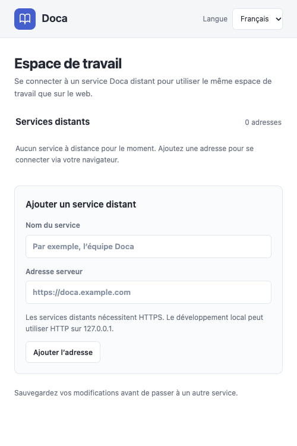
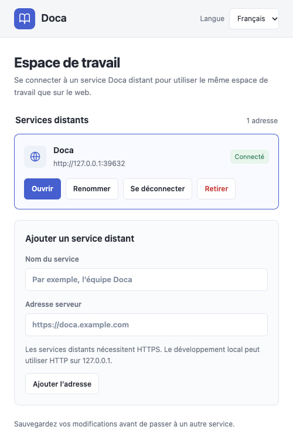
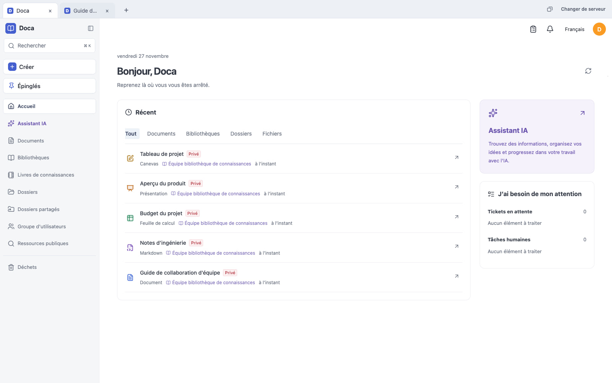

# Client de bureau Doca

Le client de bureau Doca utilise Tauri 2. Il embarque l’interface Web de Doca et un gestionnaire de connexions pour accéder aux instances que vous déployez. Vous pouvez rester connecté à plusieurs serveurs. Chaque fenêtre de travail utilise un compte sur un serveur donné. Le paquet contient les composants nécessaires au client. Le serveur doit utiliser Doca 0.2.37 ou une version ultérieure.

## Installation et connexion

Téléchargez le programme d’installation pour macOS (DMG) ou Windows (NSIS ou MSI) depuis la [page de Doca 0.3.1](https://github.com/workhold/doca/releases/tag/v0.3.1). Ces exécutables sont distribués sans signature ni notarisation. Sur macOS, faites un clic droit puis sélectionnez **Ouvrir** au premier lancement. Windows peut afficher une invitation SmartScreen.

Le gestionnaire de connexions s’affiche au premier lancement. Il utilise la première langue prise en charge dans les préférences système et se replie sur l’anglais au besoin. Avant de vous connecter, sélectionnez l’une des huit options dans **Langue**. Le gestionnaire mémorise cette préférence sur l’appareil.

Saisissez un nom et l’adresse du serveur, puis sélectionnez **Ajouter l’adresse**. Utilisez HTTPS en production. Le développement local accepte HTTP sur 127.0.0.1. Indiquez le protocole, le nom d’hôte et, si besoin, le port. Choisissez ensuite la connexion via le navigateur sur le serveur ajouté. Le navigateur système ouvre `/#/desktop-connect`. Une fois la connexion autorisée, le client ouvre l’espace de travail.

Le gestionnaire permet d’ajouter, de renommer, de sélectionner, de déconnecter et de retirer des serveurs. Plusieurs sessions peuvent rester ouvertes. Le client enregistre les identifiants dans un fichier chiffré sur l’appareil et le serveur en conserve le hachage. Voir [Connexion et authentification](#connection-and-authentication).

## Espace de travail et serveurs multiples

Chaque fenêtre de workspace possède sa propre bande de onglets. Les onglets sont des contextes de page Doca Web indépendants de même origine au sein de cette fenêtre ; changer d’onglet maintient la page ouverte, et fermer un onglet supprime sa page. Les onglets en arrière-plan arrêtent la navigation, les notifications et le polling ainsi que les mises à jour lors du réselection. La collaboration sur le document et le sauvegarde continuent tant que l’onglet est ouvert. Les utilisateurs peuvent créer des onglets et des fenêtres, ouvrir des liens de même origine dans un nouvel onglet, et utiliser Ctrl/Command+T, Ctrl/Command+W, Ctrl/Command+N et Ctrl/Command+Tab (Shift inverse la direction de l’onglet). Le bouton Nouvel onglet suit la liste des onglets, et l’outil Nouvelle fenêtre dispose d’une tooltip ; cliquer droit sur le titre d’un onglet permet de créer une copie (même URL), d’ouvrir dans une nouvelle fenêtre, de fermer, de fermer à gauche, de fermer à droite ou de fermer toutes, et les onglets peuvent être déplacés pour réorganiser leur position au sein de leur propre fenêtre.

L'espace de travail connecté montre **Changer de serveur** Dans sa barre de tabulations, et les pages de paramètres conservent un contrôle de en-tête car elles n’ont pas de barre de tabulations. Plusieurs serveurs peuvent rester connectés en même temps : l’ouverture d’un serveur active son propre proxy et les fenêtres sans fermer celles des autres serveurs, et réouvrir un serveur connecté focalise les fenêtres existantes. Sélectionner un autre serveur dans le gestionnaire ferme toutes les fenêtres du workspace précédent avant d’ouvrir le nouveau serveur, donc vérifiez d’abord les sauvegardes de documents en attente. Le déconnexion, l’expiration des identifiants ou la suppression de l’endpoint ferment uniquement les fenêtres de ce serveur.

Dans les builds de source avec support de langue de bureau, la barre des onglets suit le langage de l’interface de la page active. **Changer de serveur** ouvre le gestionnaire dans cette langue. Le gestionnaire **Langue** Le sélecteur définit une préférence locale au niveau du dispositif pour le gestionnaire. Utilisez la configuration linguistique propre à l'espace de travail pour changer la langue d'un espace de travail connecté.

Un relancement normal restaure tous les fenêtres et pages sauvegardées pour cet hôte. Fermer une fenêtre d’espace de travail tandis que d’autres fenêtres d’espace de travail restent ouvertes ne ferme que cette fenêtre, qui n’est pas restaurée ; fermer la dernière fenêtre d’espace de travail met fin à l’application et conserve toutes les fenêtres enregistrées, de sorte que le prochain relancement les restaure toutes. Lorsqu’un hôte n’a pas de fenêtres sauvegardées, l’application ouvre une nouvelle fiche d’accueil. Les extensions commerciales restent installées et exécutées sur votre serveur et sont chargées via le proxy authentifié ; voir [extensions dans le client de bureau](#plugins-in-the-desktop-client).

Télécharger un fichier, une pièce jointe ou une exportation ouvre la boîte de dialogue de sauvegarde du système avec le nom de fichier suggéré par le serveur, en commençant dans le dossier de téléchargement du système. Le téléchargement est enregistré à l’emplacement choisi et affiché ensuite dans le gestionnaire de fichiers ; annuler la boîte de dialogue le supprime et rien n’est enregistré. Les ressources hôte sont récupérées en arrière-plan avec les identifiants de bureau, de sorte que la page du espace de travail ne se rend jamais sur une réponse de fichier brut.

Dans Fichiers, sélectionnez deux ou plusieurs fichiers et choisissez **Télécharger le ZIP** Pour les sauvegarder ensemble. Vous pouvez également déposer les fichiers locaux dans un dossier écriture et vérifier la destination dans le dialogue de chargement avant de confirmer.

Les liens de bureau qui ouvrent une fiche externe utilisent le navigateur système. Les liens vers une autre page Doca sur la même origine restent ouverts dans la barre des fichiers du espace de travail.

Le proxy local utilise normalement la même origine pour un backend et un compte donnés. Si le port préféré est occupé, un autre port peut afficher un ensemble différent de préférences WebView et de données hors ligne pour cette exécution. Les données stockées à l’origine restent sur le disque.

Les documents ont été ouverts en ligne lors de l’inscription d’un nouveau client **Menu de compte → Documents hors ligne** une fois leurs corps stockés en cache. Si le serveur n'est pas accessible, ouvre-les. **Modifications récentes** Dans le home. Modifier sous la dernière autorisation connue et synchroniser lorsque la connexion est rétablie. Le premier accès nécessite une connexion. Voir [l’entrée du document hors ligne](access-offline-events.md#离线文档入口).

## Connexion et authentification

Ajoutez une origine de service HTTPS nommée ; HTTP n’est accepté que pour un hôte de développement en boucle. Le navigateur du système ouvre l’hôte sélectionné. `/#/desktop-connect` page, où s’appliquent les méthodes de connexion existantes. L’approbation génère un code d’utilisation temporaire et unique. `doca://auth/complete`Le client de bureau vérifie l’origine, l’état et le verificateur PKCE, stocke sa clé de connexion chiffrée locale dans un fichier de credenciales (une entrée par point d’accès, sous une clé aléatoire réservée aux propriétaires), et ouvre cette adresse. Les entrées créées par les versions précédentes restent dans le Keychain de l’OS en tant que fallback en lecture seule, et sont converties en fichier lors de la première utilisation ; un déconnexion explicite, une expiration ou la suppression d’un point d’accès effacent l’entrée du fichier ainsi que toute entrée conservée dans le Keychain. Les adresses sans route de type desktop doivent être mises à jour.

Le hôte ne stocke qu’un hash du identifiant de bureau et vérifie l’état de l’accoutumé à chaque demande. Les identifiants de bureau n’ont pas de date d’expiration. Un déconnexion explicite du bureau, un changement ou un réinitialisation du mot de passe, l’inactivité de l’accoutumé ou la révocation de l’administrateur les rend invalides. La reactivation d’un accoutumé ne réactive pas un identifiant annulé. Les identifiants pour navigateur, mobile et assistant de navigateur conservent leurs formats et règles existants.

## Frontend et transport intégrés

Le paquet de bureau utilise sa propre version Web via un transport local loopback. Il ne fait que transmettre. `/api/v1/` Trafic HTTP et WebSocket vers l’hôte sélectionné, fournit le contenu de bureau de cet hôte, supprime les cookies de WebView et le trafic en amont. `Set-Cookie`, réécrit l’Origin en amont, et exige un cookie HttpOnly aléatoire avec un Host et un Origin correspondants. Le WebView du workspace n’a pas les permissions Tauri IPC et ne peut pas lire le bearer. Les liens publics utilisent l’origin du host sélectionné.

Le contrôle switch-backend utilise un réseau privé `POST /_doca/manager` Action de loopback qui nécessite la capacité de proxy et l’origine locale exacte ; elle ne renvoie aucune credenciale et ne transmet jamais la requête au hôte sélectionné. Les pages web du navigateur ne montrent pas ce contrôle.

## Données de session et restauration

`workspace-session.json` La version 1 dans le dossier de données de l’application de bureau stocke les IDs d’endpoint/account, les IDs de fenêtre et de fiche, l’ordre des fichiers, les routes et titres dans l’application, ainsi que la fiche active de chaque fenêtre. Elle ne stocke aucune donnée porteuse, le corps du document, les entrées de formulaire ou les données de plugins. Un redémarrage normal restaure toutes les fenêtres et pages sauvegardées pour l’endpoint sélectionné. **Seulement lorsque le fichier de credentiel contient toujours le token de l’endpoint (ou une entrée de fallback du Keychain est conservée), et lorsque l’ID de compte correspond.**Les onglets de fond sont chargés lorsqu’ils sont sélectionnés. Les limites sont de 16 fenêtres, 32 onglets par fenêtre et 128 onglets par endpoint/compte. Les formats de session inconnus ou corrompus empêchent le démarrage sans modifier le fichier original ; il est conseillé de conserver une copie avant de supprimer définitivement ce fichier afin de pouvoir le récupérer. La version précédente du système de bureau ne prend pas en compte ce fichier distinct.

Le déconnexion explicite dans n’importe quelle fiche Web ou le gestionnaire de connexion annule la credenciale de bureau, ferme toutes les fenêtres pour cette session et efface la liste des pages sauvegardées de cet endpoint/compte. Une credenciale bootstrap rejetée ferme également ces fenêtres et supprime sa credenciale locale. Le changement de backends conserve la liste des pages sauvegardées de l’ancien hôte pour un retour ultérieur, tout en fermant ses pages en cours et son proxy. Le changement de configuration ferme. **tout** Windows et onglets pour l’hôte précédent, et ouvre les pages sauvegardées de l’hôte sélectionné dans un stockage de données WebView distinct, cléé par endpoint et compte ; les documents, les versions préliminaires, les cookies, les identifiants et les routes de page ne se déplacent pas entre les hôtes. Un compte différent sur le même hôte ne reçoit jamais les pages sauvegardées du compte précédent, et le client ne convertit jamais une route ou une version préliminaire en un autre backend. L’effacement d’un endpoint annule sa credenciale de bureau, supprime son entrée dans le coffre et la liste des pages sauvegardées ; les données WebView en cache restent jusqu’à ce qu’une fonction de nettoyage distinct soit mise en œuvre. Un hôte inaccessible ne supprime pas sa entrée sauvegardée ou sa credenciale.

## Les plugins dans le client de bureau

Les paquets de plugins professionnels sont installés et exécutés sur l'hôte Doca distant sélectionné. Le paquet de bureau ne comprend pas d'installateur de plugin distinct ni de runtime serveur de plugin. Chaque fichier tab exécute le chargeur de plugin Web intégré : il lit les déclarations de bootstrap de l'hôte et importe les bundles versionnés correspondants. `/api/v1/plugin-assets/{id}/{version}/` via le proxy authentifié, et vérifie leur ID de manifeste et leur version. Les appels API du plugin utilisent le même hôte sélectionné. Les onglets de bureau utilisent l’interface hôte Web ; les appareils mobiles `host.native` Le pont n’est pas disponible.`null`). Le code du serveur de plugin et les données gérées du plugin restent sur l'hôte distant. Voir [contrat SDK extension](plugin-sdk-contract.fr.md) et [guide de développement de plugins](plugin-development.fr.md).

## Sauvegarde des données locales du procès

Une version de test inédite précédente pourrait créer un `local-v1` profil dans le dossier de données de l’application de bureau. La build uniquement en mode distant ne ouvre, ne modifie, ne supprime, ne migre ni ne package pas ce profil. Si celui-ci existe, conservez son entier dossier, y compris les fichiers SQLite WAL. `credential.key`, à utiliser avec la version de test plus ancienne correspondante. Ne copiez pas de fichiers individuels dans un nouveau profil, ni ne supposez que le client distant les a transférés. Retourner à la version de test plus ancienne est la voie de récupération actuelle ; un mode local futur ou une migration nécessiterait un plan approuvé séparément.

Le privé `profiles.json` Le format d’endpoint de la version 1 et les références aux credences restent les mêmes ; les tokens de bureau se trouvent désormais dans un format chiffré. `credentials.json` Fichier v1 avec le Keychain conservé en mode lecture seule en cas de panne. Son historique `active: "local"` La valeur signifie qu’aucun hôte distant n’est sélectionné dans cette build. Les paramètres et identifiants existants ne sont pas réécrits au démarrage, y compris la restauration automatique des pages. Les versions de paramètres inconnues ou invalides bloquent le démarrage tant que le fichier original reste intact. La décision concernant la session fenêtre, approuvée séparément, se trouve… [caractéristique 007](../specs/007-desktop-workspace-tabs/spec.md).

## Construction et vérification

Le ensemble d’icônes de bureau est généré à partir de `icons/icon-source.png`; `icons/icon.svg` reste identique en termes de byte au favicon du site web. Tauri `beforeBuildCommand` Construit le frontend Web correspondant et le gestionnaire de connexion. Tauri est chargé. `apps/web/dist` directement comme `web` ressource. De `apps/desktop`, courir `node_modules/.bin/tauri build`Aucun fichier exécutable Node ou arbre de dépendances serveur n’est copié dans l’application. L’application obtenue n’a pas besoin d’être installée avec Node ou Docker. Il est nécessaire de construire et de vérifier chaque système d’exploitation et chaque architecture de CPU séparément. macOS 14 ou plus récent est requis pour les stockages de données WebView isolés ; Windows et Linux utilisent des dossiers de données WebView distincts.

Voir [Vérification du client de bureau](../specs/006-desktop-client/validation.md) pour la taille mesurée du paquet et [validation des onglets/Windows](../specs/007-desktop-workspace-tabs/validation.md) Pour les vérifications exécutées et les limites de plateforme. La signature du paquet, la notarisation et la distribution restent des étapes de sortie.
