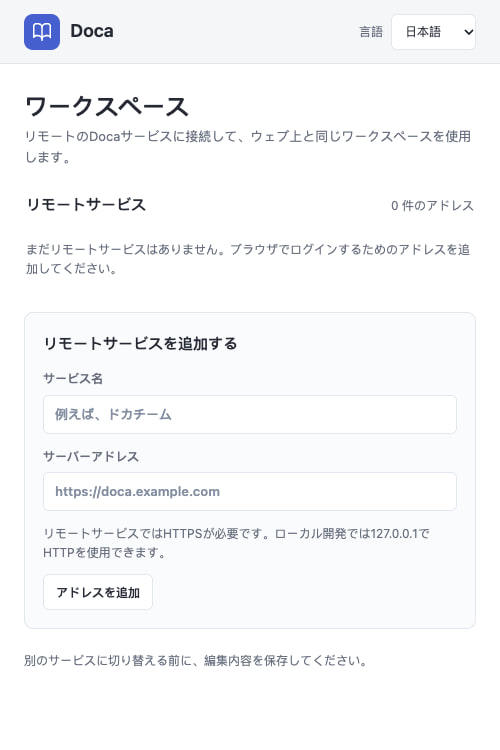
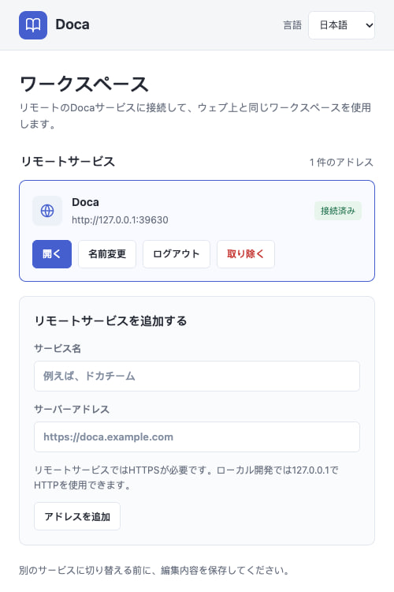
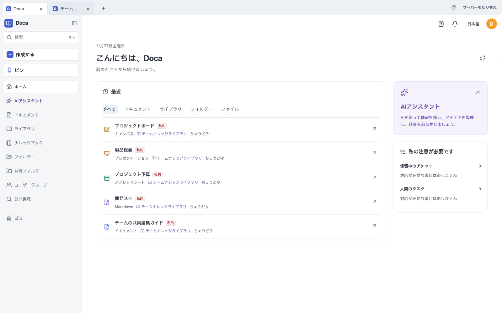

# Doca デスクトップクライアント

Doca デスクトップクライアントは Tauri 2 を使用しています。Doca の Web フロントエンドと接続マネージャーを同梱し、ご自身でデプロイした Doca サーバーに接続できます。複数のサーバーに同時に接続できます。各ワークスペースウィンドウは、接続先の一つのアカウントに対応します。パッケージにはクライアントの実行に必要なコンポーネントを収録しています。接続先は 0.2.37 以降が必要です。

## インストールと接続

[Doca 0.3.1 のリリースページ](https://github.com/workhold/doca/releases/tag/v0.3.1)から、macOS 用（DMG）または Windows 用（NSIS／MSI）のインストーラーをダウンロードしてください。このビルドには署名と公証がありません。macOS では初回起動時にアプリを右クリックして**開く**を選びます。Windows では SmartScreen が確認を求める場合があります。

初回起動時に接続マネージャーが表示されます。システム設定の優先順で利用できる言語を選び、該当する言語がない場合は英語を使います。接続する前に、**言語**から Doca の 8 言語のいずれかを選択できます。接続マネージャーの言語は端末に保存されます。

サーバー名と URL を入力し、アドレスの追加ボタンを選びます。本番サーバーには HTTPS が必要です。ローカル開発では 127.0.0.1 の HTTP を使えます。入力するのはスキーム、ホスト名、必要に応じてポート番号です。ブラウザーでのサインインを選ぶと、システムのブラウザーで `/#/desktop-connect` が開きます。サインインして接続を承認すると、ワークスペースが自動的に開きます。

接続マネージャーでは接続先の追加、名前変更、切り替え、サインアウト、削除ができます。複数のサーバーにサインインしたまま利用できます。クライアントは認証情報を端末の暗号化ファイルに、サーバーはハッシュだけを保存します。詳しくは[接続と認証](#connection-and-authentication)をご覧ください。

## ワークスペースと複数のサーバー

各ワークスペースウィンドウには独自のタブストリップがあります。タブはそのウィンドウ内の独立した同じオリジンを持つDoca Webページコンテキストです。タブを切り替えると開いているページが続行し、タブを閉じるとそのページが終了します。背景のタブは、再選択時にナビゲーション、通知、プレゼンスポーリング、および更新を一時停止します。文書の共同編集と保存はタブが開いている間は続きます。ユーザーはタブやウィンドウを作成したり、新しいタブで同じオリジンのリンクを開いたり、Ctrl/Command+T、Ctrl/Command+W、Ctrl/Command+N、Ctrl/Command+Tab（Shiftを押すとタブの方向が逆転）を使用できます。新タブボタンはタブリストに従い、新ウィンドウツールにはツールチップがあります。タブタイトルを右クリックすると、同じURLの複製、新ウィンドウでの開き、閉じる、左側の閉じる、右側の閉じる、全ての閉じるが選択でき、タブは自分のウィンドウ内で再順序を入れ替えることができます。

ログインしたワークスペースが表示されます **サーバーを切り替え** タブストリップや設定ページにはヘッダーコントロールがありません。複数のサーバーが同時に接続可能です。サーバーを開くと、他のサーバーのウィンドウを閉じずに独自のプロキシやウィンドウを起動し、接続済みのサーバーを再開すると既存のウィンドウがフォーカスされます。マネージャーで別のサーバーを選択すると、新しいホストを開く前に以前のすべてのワークスペースウィンドウが閉じられますので、保留中の文書保存を先に確認してください。ログアウト、認証情報の有効期限切れ、またはエンドポイントの削除は、そのサーバーのウィンドウのみを閉じます。

デスクトップ言語サポートが付いたソースビルドでは、タブストリップはアクティブなページのインターフェース言語に従います。 **サーバーを切り替え** その言語でマネージャーを開く。マネージャーの **言語** セレクターはマネージャーに対してデバイスローカルな設定を設定します。接続されたワークスペースの言語を変更するには、ワークスペース自身の言語設定を使用してください。

通常の再起動では、そのホストのすべての保存されたウィンドウとページが復元されます。他のワークスペースウィンドウが残っている状態でワークスペースウィンドウを閉じると、そのウィンドウのみが閉じられ、復元されません。最後のワークスペースウィンドウを閉じるとアプリが終了し、すべての記録されたウィンドウが保持されるため、次の起動時にそれらがすべて復元されます。ホストに保存されたウィンドウがない場合、アプリは新しいホームタブを開きます。ビジネスプラグインはサーバー上でインストールされ、実行され続け、認証されたプロキシを通じて読み込まれます。 [デスクトップクライアント内のプラグイン](#plugins-in-the-desktop-client).

ファイルや添付ファイル、エクスポートをダウンロードすると、サーバーが提案したファイル名でシステムの保存ダイアログが開かれ、システムのダウンロードフォルダから始まります。ダウンロードされたファイルは選択した場所に保存され、その後ファイルマネージャーで表示されます。ダイアログをキャンセルすると、それは破棄され、何も保存されません。ホストリソースはデスクトップ認証情報を使ってバックグラウンドで取得されるため、ワークスペースページは生のファイルレスポンスにはたどり着きません。

「ファイル」で2つ以上のファイルを選択し、選択します。 **ZIPファイルをダウンロードする** 一緒に保存するためです。また、ローカルファイルを書き込み可能なフォルダにダウンロードし、確定する前にアップロードダイアログで目的場所を確認することもできます。

外部タブを開くデスクトップリンクはシステムブラウザを使用します。同じオリジンにある別のDocaページへのリンクは、ワークスペースタブストリップで開きます。

ローカルプロキシは通常、指定されたバックエンドとアカウントに対して同じオリジンを再利用します。推奨されるポートが占有されている場合、別のポートを使用して、その起動時の異なるWebViewの設定やオフラインデータを提供することができます。元のオリジンに保存されたデータはディスク上に保持されます。

新しいクライアントが参加する際に、オンラインで文書が開かれる **アカウントメニュー → オフライン文書** 体がキャッシュされると。サーバーにアクセスできない場合は、それらを開きます。 **最近の編集** ホームページ上です。最後の許可情報に基づいて編集し、接続が再開したら同期します。初回ログインでは接続が必要です。詳細は [オフライン文書エントリ](access-offline-events.md#离线文档入口).

## 接続と認証

名前付きHTTPSサービスオリジンを追加します。HTTPはループバック開発ホストの場合のみ受け付けられます。システムブラウザが選択したホストを開きます。 `/#/desktop-connect` その既存のログイン方法が適用されるページです。承認後は短期間有効の一回限りのコードが生成されます。 `doca://auth/complete`デスクトップクライアントはオリジン、状態、PKCE検証器をチェックし、その固有のデスクトップベアラーをアプリローカル暗号化認証ファイルに保存する（オーナー専用のランダムキーに基づき、エンドポイントごとに1件ずつ）。その後、そのホストを開く。以前のバージョンで作成されたエントリは、OSのKeychainに読み取り専用の代替データとして残され、最初の使用時にファイルに変換される。明示的なサインアウト、有効期限切れ、またはエンドポイントの削除により、そのファイルエントリおよびKeychain内の任意のエントリが削除される。デスクトップルートがないホストはアップグレードが必要である。

ホストはデスクトップアカウントのハッシュのみを保存し、各リクエスト時にアカウントの状態をチェックします。デスクトップ認証情報には有効期限はありません。明示的なデスクトップログアウト、パスワードの変更/リセット、アカウントの無効化、管理者の解除によってそれらは無効になります。アカウントを再有効にしても、無効になった認証情報は復元されません。ブラウザ、モバイル、ブラウザアシスタントの認証情報は、既存の形式と規則を保持します。

## フロントエンドとトランスポートを組み合わせたもの

デスクトップパッケージは、ローカルループバックトランスポートを通じて自身のWebビルドを提供します。単に転送するだけです。 `/api/v1/` 選択されたホストへのHTTPおよびWebSocketトラフィック、そのホストのデスクトップベアラーを提供し、WebViewのクッキーとアップストリームを削除する `Set-Cookie`上流のOriginを書き換え、HostとOriginが一致するランダムなHttpOnly capability cookieが必要です。workspace WebViewにはTauri IPC権限がなく、Bearerを読み取ることができません。公開リンクは選択されたホストのOriginを使用します。

スイッチ-サーバー制御はプライベートを使用する `POST /_doca/manager` プロキシ機能と正確なローカルOriginが必要なループバックアクションであり、認証情報は返却せず、選択したホストにリクエストを転送することもありません。ブラウザのウェブページではこの制御機能は表示されません。

## セッションデータと復元

`workspace-session.json` デスクトップアプリのデータディレクトリ内のバージョン1には、エンドポイント/アカウントID、ウィンドウおよびタブID、タブの順序、アプリ内ハッシュルートとタイトル、各ウィンドウのアクティブタブが保存されます。持ち出し用データ、文書本文、フォーム入力値、プラグインデータは保存されません。通常の再起動により、選択されたエンドポイントのすべての保存されたウィンドウとページが復元されます。 **認証ファイルにそのエンドポイントのトークンがまだ保持されている場合（またはキーチェインのフォールバックエントリが保持されている場合）、そしてアカウントIDが一致している場合のみ。**背景タブは選択されたときに読み込まれます。制限は、16つのウィンドウ、各ウィンドウあたり32のタブ、各エンドポイント/アカウントあたり128のタブです。不明または破損したセッション形式の場合、元のファイルを変更せずに起動ができません。そのファイルを明確に削除する前にコピーを保存して、復元することができます。以前のデスクトップバージョンでは、この別個のファイルは無視されます。

任意のWebタブや接続マネージャーでの明示的なログアウトにより、デスクトップ認証情報が無効化され、そのセッションのすべてのウィンドウが閉じられ、そのエンドポイント/アカウントの保存されたページリストが削除されます。拒否されたブートストラッピング認証情報もこれらのウィンドウを閉じ、ローカル認証情報を破棄します。バックエンドの切り替えでは、以前のホストの保存されたページリストが後で復帰時に保持され、同時に実行中のページやプロキシも閉じられます。切り替えでは閉じられます。 **すべて** 以前のホスト用のWindowsとタブは、エンドポイントとアカウントでキー付けされた別のWebViewデータストア内で、選択したホスト自身が保存したページを開きます。文書、下書き、クッキー、認証情報、ページルートはホスト間で移動しません。同じホスト上の別のアカウントは、以前のアカウントが保存したページを受け取ることはなく、クライアントはルートや下書きを別のサーバーに変換することもありません。エンドポイントを削除すると、そのデスクトップ認証情報、バンクのエントリ、保存されたページリストが削除されます。キャッシュされたWebViewデータは、別のクリーンアップ機能が実装されるまで保持されます。アクセス不可能なホストは、保存されたエントリや認証情報を削除しません。

## デスクトップクライアントのプラグイン

ビジネスプラグインパッケージは、選択されたリモートDocaホスト上にインストール・実行されます。デスクトップパッケージには、個別のプラグインインストーラやプラグインサーバーの実行環境は含まれていません。各タブは、バンドルされたWebプラグインローダーを実行します。これは、ホストのブートストラッピング宣言を読み取り、バージョン化されたバンドルをインポートします。 `/api/v1/plugin-assets/{id}/{version}/` 認証されたプロキシを通じて、マニフェストIDとバージョンを確認する。プラグインAPI呼び出しは同じ選択されたホストを使用する。デスクトップタブはWebホストインターフェースを使用し、モバイル端末は `host.native` ブリッジが利用できない（`null`）。プラグインサーバーのコードと管理されたプラグインデータはリモートホスト上に保持されます。詳細はこちらをご覧ください。 [プラグイン SDKコントラクト](plugin-sdk-contract.ja.md) そして [プラグイン開発ガイド](plugin-development.ja.md).

## 試験用ローカルデータの保存

未公開の初期テストバージョンが生まれる可能性がある `local-v1` デスクトップアプリのデータディレクトリ内のプロファイルです。リモートのみでのビルドでは、このプロファイルを開いたり、変更したり、削除したり、移行したり、パッケージ化したりしません。もし存在する場合は、SQLite WALファイルを含む全てのディレクトリを保持してください。 `credential.key`対応する古い試用版と共に使用するためです。個々のファイルを新しいプロファイルにコピーしたり、リモートクライアントがそれらを転送したと仮定したりしないでください。古い試用版に戻ることが現在の復元方法です。将来的なローカルモードや移行には、別途承認された計画が必要です。

私的のもの `profiles.json` バージョン1のエンドポイント形式と認証情報の参照は変わらない。デスクトップトークンは今では暗号化された状態になっている。 `credentials.json` Keychainが読み取り専用の代替手段として保持されているv1ファイル。その歴史的背景 `active: "local"` 「value」とは、このビルドでリモートホストが選択されていないことを意味します。既存の設定や認証情報は起動時に書き換えられず、自動ページ復元も含まれます。不明または有効でない設定バージョンは、元のファイルが変更されない限り起動を阻害します。別途承認されたウィンドウセッションの決定はここにあります。 [特徴007](../specs/007-desktop-workspace-tabs/spec.md).

## 構築と検証

デスクトップアイコンセットは、これによって生成されます。 `icons/icon-source.png`; `icons/icon.svg` Webのファビコンとバイトレベルで同一のままです。Tauri `beforeBuildCommand` マッチングするWebフロントエンドと接続マネージャを構築します。Tauriがバンドルします。 `apps/web/dist` 直接に、 `web` リソース。から `apps/desktop`、実行する `node_modules/.bin/tauri build`Nodeの実行可能ファイルやサーバー依存関係のツリーはアプリケーションにコピーされません。結果として作成されるアプリケーションは、NodeやDockerをインストールする必要はありません。各OSやCPUアーキテクチャを個別にビルドし、検証する必要があります。Isolated WebViewデータストアを使用するにはmacOS 14以降が必要です。WindowsやLinuxでは、別々のWebViewデータディレクトリが使用されます。

見てください [デスクトップクライアントの検証](../specs/006-desktop-client/validation.md) 測定されたバンドルサイズについて [タブ/ウィンドウの検証](../specs/007-desktop-workspace-tabs/validation.md) 実行されたチェックやプラットフォームの制限のためです。パッケージの署名、認証、配布は依然としてリリースステップです。
