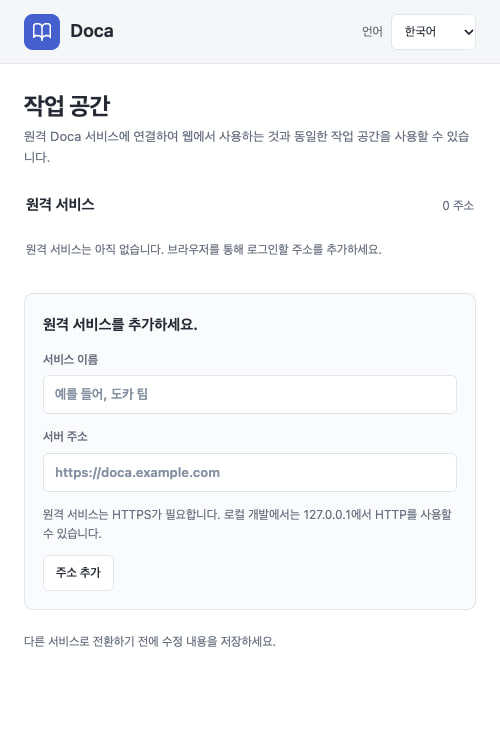
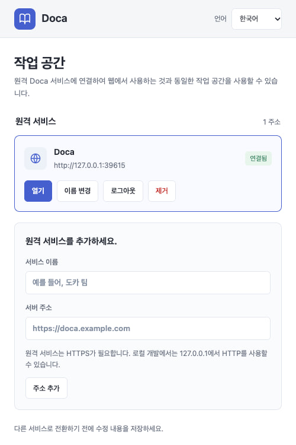
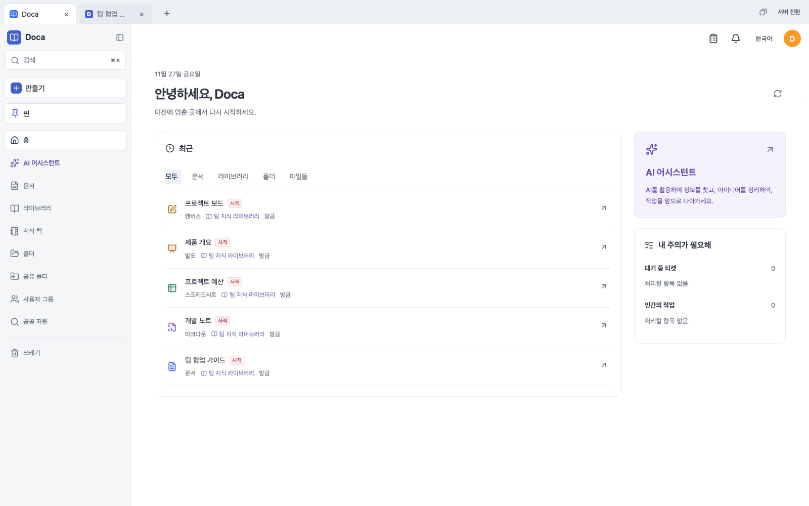

# Doca 데스크톱 클라이언트

Doca 데스크톱 클라이언트는 Tauri 2를 사용합니다. Doca 웹 화면과 연결 관리자를 포함하며, 직접 배포한 원격 서버에 연결할 수 있습니다. 여러 서버에 동시에 연결된 상태로 작업할 수 있습니다. 작업 공간 창마다 한 서버의 계정이 연결됩니다. 패키지에는 클라이언트 실행에 필요한 구성 요소가 들어 있습니다. 서버는 Doca 0.2.37 이상이어야 합니다.

## 설치 및 연결

[Doca 0.3.1 릴리스](https://github.com/workhold/doca/releases/tag/v0.3.1)에서 macOS용(DMG) 또는 Windows용(NSIS 또는 MSI) 설치 파일을 다운로드하세요. 이 빌드는 서명 및 공증 없이 배포됩니다. macOS에서는 처음 실행할 때 앱을 마우스 오른쪽 버튼으로 클릭한 뒤 **열기**를 선택합니다. Windows에서 SmartScreen 메시지가 표시될 수 있습니다.

처음 실행하면 연결 관리자가 표시됩니다. 시스템의 선호 언어 중 지원되는 첫 언어를 사용하며, 해당 언어가 없으면 영어로 표시합니다. 연결하기 전에 **언어**에서 지원되는 여덟 가지 언어를 선택할 수 있습니다. 연결 관리자의 선택은 기기에 저장됩니다.

이름과 서버 주소를 입력한 다음 **주소 추가**를 선택합니다. 운영 서버에는 HTTPS가 필요하며, 로컬 개발에서는 127.0.0.1에 HTTP로 연결할 수 있습니다. 프로토콜과 호스트 이름, 필요한 경우 포트만 입력합니다. 추가한 서버에서 브라우저 로그인을 선택하면 시스템 브라우저가 `/#/desktop-connect`를 엽니다. 로그인하고 연결을 승인하면 클라이언트가 작업 공간을 엽니다.

연결 관리자에서 서버 추가, 이름 변경, 선택, 로그아웃, 삭제를 할 수 있습니다. 여러 서버의 로그인 상태를 동시에 유지할 수 있습니다. 클라이언트는 기기의 암호화된 파일에 자격 증명을 저장하며 서버에는 해시만 저장됩니다. [연결 및 인증](#connection-and-authentication) 문서를 참고하세요.

## 작업 공간 및 여러 서버

각 작업 공간 창에는 고유한 탭 스트립이 있습니다. 탭은 해당 창 내에서 독립적이고 동일 원본의 Doca 웹 페이지 컨텍스트입니다. 탭을 전환하면 열려 있는 페이지가 계속 실행되며, 탭을 닫으면 해당 페이지가 종료됩니다. 배경 탭은 다시 선택될 때 네비게이션, 알림, 존재 확인 및 새로고침을 중단합니다. 문서 공동 작업 및 저장은 탭이 열려 있는 동안 계속됩니다. 사용자는 탭과 창을 생성하고, 새로운 탭에서 동일 원본 링크를 열며, Ctrl/Command+T, Ctrl/Command+W, Ctrl/Command+N 및 Ctrl/Command+Tab(Shift를 누르면 탭 방향이 반대가 됩니다)을 사용할 수 있습니다. 새 탭 버튼은 탭 목록에 따라 움직이며, 새 창 도구에는 툴팁이 있습니다. 탭 제목을 오른쪽 클릭하면 동일 URL의 복제, 새로운 창에서 열기, 닫기, 왼쪽 닫기, 오른쪽 닫기, 모두 닫기가 가능하며, 탭은 자체 창 내에서 재정렬하기 위해 끌 수 있습니다.

로그인한 작업 공간이 표시됩니다 **서버 전환** 탭 스트립에 있고 설정 페이지에는 탭 스트립이 없기 때문에 헤더 컨트롤이 유지됩니다. 여러 서버를 동시에 연결할 수 있습니다: 서버를 열면 다른 서버의 창을 닫지 않고 자체 프록시와 윈도우를 시작하며, 연결된 서버를 다시 열면 기존 창에 집중됩니다. 관리자에서 다른 서버를 선택하면 새로운 호스트를 열기 전에 이전 모든 작업 공간 창이 닫히므로, 미결정된 문서 저장을 먼저 확인하세요. 로그아웃, 자격 증명 만료, 또는 엔드포인트 삭제는 해당 서버의 창만 닫습니다.

데스크톱 언어 지원이 있는 소스 빌드에서는 탭 스트립이 활성 페이지의 인터페이스 언어를 따릅니다. **서버 전환** 그 언어로 매니저를 엽니다. 매니저의 **언어** 선택자는 관리자에 대한 장치별 설정을 지정합니다. 연결된 작업 공간의 언어를 변경하려면 작업 공간의 자체 언어 설정을 사용하세요.

정상적인 재시작에서는 해당 호스트에 저장된 모든 창과 페이지를 복원합니다. 다른 작업 공간 창이 남아 있는 상태에서 작업 공간 창을 닫으면 해당 창만 닫히고 복원되지 않습니다. 마지막 작업 공간 창을 닫으면 앱이 종료되고 모든 기록된 창이 유지되므로 다음 재시작 시 모두 복원됩니다. 호스트에 저장된 창이 없는 경우 앱은 새로운 홈 탭을 열어줍니다. 비즈니스 플러그인은 서버에 계속 설치되어 실행되며 인증된 프록시를 통해 로드됩니다. 자세한 내용은...을 참조하세요. [데스크톱 클라이언트의 플러그인들](#plugins-in-the-desktop-client).

파일이나 첨부물, 또는 내보내기를 다운로드하면 서버가 제안한 파일명으로 시스템 저장 대화상자가 열리며 시스템 다운로드 폴더에서 시작됩니다. 다운로드된 파일은 선택한 위치에 저장되며 이후 파일 관리자에서 확인됩니다. 대화상자를 취소하면 해당 대화상자가 삭제되고 아무것도 저장되지 않습니다. 호스트 리소스는 배경에서 데스크톱 자격증명을 사용하여 가져오므로, 작업 공간 페이지는 원시 파일 응답으로 이동하지 않습니다.

파일에서 두 개 이상의 파일을 선택하고 선택하세요. **ZIP 파일 다운로드** 그들을 함께 저장할 수 있습니다. 또한 로컬 파일을 쓰기 가능한 폴더에 저장하고, 확인하기 전에 업로드 대화상자에서 목적지를 확인할 수도 있습니다.

외부 탭을 열게 되는 데스크톱 링크는 시스템 브라우저를 사용합니다. 같은 origin에 있는 다른 Doca 페이지의 링크는 여전히 작업 공간 탭 스트립에서 열립니다.

로컬 프록시는 일반적으로 주어진 백엔드와 계정에 대해 동일한 원본을 재사용합니다. 선호하는 포트가 사용 중일 경우, 다른 포트를 사용하여 그 실행에 맞는 다른 WebView 설정과 오프라인 데이터를 제공할 수 있습니다. 원래 원본에 저장된 데이터는 디스크에 그대로 남아 있습니다.

새로운 클라이언트가 가입할 때 온라인에서 문서가 열림 **계정 메뉴 → 오프라인 문서** 몸이 캐시되면. 서버에 접근할 수 없다면, 그들을 열어야 합니다. **최근 수정** 홈에서. 마지막 허가서에 따라 수정하고 연결이 다시 되면 동기화합니다. 첫 번째 로그인은 연결이 필요합니다. 참고하세요. [오프라인 문서 기록](access-offline-events.md#离线文档入口).

## 연결 및 인증

이름이 지정된 HTTPS 서비스 원본을 추가합니다. HTTP는 루프백 개발 호스트에만 허용됩니다. 시스템 브라우저는 선택된 호스트를 열어줍니다. `/#/desktop-connect` 페이지에서 기존 로그인 방법이 적용됩니다. 승인을 통해 단기간 사용 가능한 코드가 발급됩니다. `doca://auth/complete`데스크톱 클라이언트는 원본, 상태 및 PKCE 검증자를 확인한 후, 자신의 고유한 데스크톱 보유자 정보를 앱 로컬 암호화 자격증 파일에 저장합니다(소유자 전용 무작위 키에 따라 각 엔드포인트마다 하나의 항목). 그 후 해당 호스트를 열어 사용합니다. 이전 버전에서 생성된 항목들은 OS Keychain에 읽기 전용 대체 정보로 남아 있으며, 첫 사용 시 해당 파일로 변환됩니다. 명시적인 로그아웃, 만료 또는 엔드포인트 삭제 시 해당 파일 항목과 Keychain에 남아 있는 모든 항목이 삭제됩니다. 데스크톱 라우팅이 없는 호스트는 업그레이드해야 합니다.

호스트는 데스크톱 자격 증명의 해시만 저장하고 각 요청 시 계정 상태를 확인합니다. 데스크톱 자격 증명에는 유효 기간이 없습니다. 명시적인 데스크톱 로그아웃, 비밀번호 변경/재설정, 계정 비활성화 및 관리자 권한 취소로 인해 자격 증명이 무효화됩니다. 계정을 다시 활성화해도 무효화된 자격 증명은 복구되지 않습니다. 브라우저, 모바일 및 브라우저 보조 자격 증명은 기존의 형식과 규칙을 그대로 유지합니다.

## 결합된 프론트엔드 및 전송

데스크톱 패키지는 로컬 루프백 전송을 통해 자체 웹 빌드를 제공합니다. 단지 전달만 합니다. `/api/v1/` 선택된 호스트로의 HTTP 및 WebSocket 트래픽, 해당 호스트의 데스크톱 베이어를 제공하고 WebView 쿠키와 업스트림을 제거합니다. `Set-Cookie`업스트림 Origin을 재작성하며, Host와 Origin이 일치하는 무작위 HttpOnly capability 쿠키가 필요합니다. workspace WebView는 Tauri IPC 권한이 없어 bearer를 읽을 수 없습니다. 공개 링크는 선택된 호스트의 origin을 사용합니다.

스위치-백엔드 제어는 프라이빗한 방식을 사용합니다. `POST /_doca/manager` 프록시 기능과 정확한 로컬 원본이 필요한 루프백 작업입니다. 자격 증명을 반환하지 않으며 선택된 호스트로 요청을 전달하지도 않습니다. 브라우저 웹 페이지에서는 이 기능이 표시되지 않습니다.

## 세션 데이터 및 복구

`workspace-session.json` 데스크톱 앱 데이터 디렉터리의 버전 1에는 엔드포인트/계정 ID, 창 및 탭 ID, 탭 순서, 앱 내 해시 경로 및 제목, 그리고 각 창의 활성 탭이 저장됩니다. 이곳에는 보유자 정보, 문서 본문, 형식 입력 또는 플러그인 데이터는 저장되지 않습니다. 정상적인 재시작 시 선택된 엔드포인트에 저장된 모든 창과 페이지가 복원됩니다. **자격증서 파일에 여전히 해당 엔드포인트의 토큰이 존재할 때(또는 키체인의 보조 항목이 존재할 때) 그리고 계정 ID가 일치할 때만.**배경 탭은 선택될 때 로드됩니다. 한계는 각 창당 16개의 창, 각 창당 32개의 탭, 각 엔드포인트/계정당 128개의 탭입니다. 알 수 없거나 손상된 세션 형식은 원본 파일을 변경하지 않고 시작을 차단합니다; 복구를 위해 해당 파일을 명시적으로 제거하기 전에 복사본을 보관해야 합니다. 이전 데스크톱 버전은 이 별도 파일을 무시합니다.

어떤 웹 탭이나 연결 관리자에서 명시적으로 로그아웃하면 데스크톱 자격 증명이 해지되고 해당 세션의 모든 창이 닫히며 해당 엔드포인트/계정의 저장된 페이지 목록이 삭제됩니다. 거부된 bootstrap 자격 증명도 해당 창들을 닫고 로컬 자격 증명을 제거합니다. 백엔드를 전환하면 이전 호스트의 저장된 페이지 목록이 나중에 다시 사용할 수 있도록 유지되며, 실행 중인 페이지와 프록시도 닫히게 됩니다. 전환 시에는 모든 것을 닫습니다. **모두** 이전 호스트의 윈도우와 탭은 엔드포인트와 계정으로 키워진 별도의 WebView 데이터 저장소에서 선택된 호스트의 저장된 페이지를 열어줍니다. 문서, 초안, 쿠키, 자격 증명 및 페이지 경로는 호스트 간에 이동되지 않습니다. 같은 호스트에 있는 다른 계정은 이전 계정의 저장된 페이지를 받지 못하며, 클라이언트는 경로나 초안을 다른 백엔드로 변환하지도 않습니다. 엔드포인트를 제거하면 그 데스크톱 자격 증명이 삭제되고, 보안 저장소 항목과 저장된 페이지 목록도 사라집니다. 캐시된 WebView 데이터는 별도의 정리 기능이 구현될 때까지 남아 있습니다. 접근 불가능한 호스트는 저장된 항목이나 자격 증명을 지우지 않습니다.

## 데스크톱 클라이언트의 플러그인들

비즈니스 플러그인 패키지는 선택된 원격 Doca 호스트에 설치되고 실행됩니다. 데스크톱 패키지에는 별도의 플러그인 설치기나 플러그인 서버 런타임이 포함되어 있지 않습니다. 각 탭은 포함된 웹 플러그인 로더를 실행합니다: 이는 호스트의 bootstrap 선언문을 읽고, 버전이 지정된 패키지들을 불러옵니다. `/api/v1/plugin-assets/{id}/{version}/` 인증된 프록시를 통해, 그리고 그들의 매니페스트 ID와 버전을 확인합니다. 플러그인 API 호출은 동일한 선택된 호스트를 사용합니다. 데스크톱 탭은 웹 호스트 인터페이스를 사용하며, 모바일은... `host.native` 브리지가 사용 불가능합니다.`null`). 플러그인 서버 코드와 관리되는 플러그인 데이터는 원격 호스트에 남아 있습니다. 참조하세요. [플러그인 SDK 계약](plugin-sdk-contract.ko.md) 그리고 [플러그인 개발 가이드](plugin-development.ko.md).

## 시험용 현지 데이터 보존

미공개된 초기 테스트 버전이 만들어질 수 있음 `local-v1` 데스크톱 앱 데이터 디렉터리에 있는 프로필입니다. 원격 전용 빌드는 이 프로필을 열거나, 수정하거나, 삭제하거나, 마이그레이션하거나, 패키지화하지 않습니다. 만약 프로필이 존재한다면, SQLite WAL 파일을 포함한 전체 디렉터리를 그대로 유지하세요. `credential.key`맞는 더 오래된 시험 빌드와 함께 사용하도록 합니다. 개별 파일을 새로운 프로필에 복사하거나 원격 클라이언트가 그 파일을 전송했다고 가정하지 마세요. 더 오래된 시험 빌드로 돌아가는 것이 현재의 복구 방법입니다. 향후 로컬 모드나 마이그레이션은 별도로 승인된 계획이 필요합니다.

사적 `profiles.json` 버전 1 엔드포인트 형식과 자격증명 참조는 동일하게 유지됩니다; 데스크톱 토큰은 이제 암호화된 상태로 저장됩니다. `credentials.json` 키체인이 읽기 전용으로 저장된 v1 파일. 역사적 내용도 포함됨 `active: "local"` 값이란 이 빌드에서 원격 호스트가 선택되지 않았다는 것을 의미합니다. 기존 설정과 자격 증명은 시작 시에 다시 작성되지 않으며, 자동 페이지 복원도 포함됩니다. 알 수 없거나 유효하지 않은 설정 버전은 원본 파일이 변경되지 않은 상태에서 시작을 방해합니다. 별도로 승인된 창-세션 결정은 있습니다. [특징 007](../specs/007-desktop-workspace-tabs/spec.md).

## 구축 및 검증

데스크톱 아이콘 세트는 이로부터 생성됩니다. `icons/icon-source.png`; `icons/icon.svg` 웹 팬시콘과 바이트 단위로 동일하게 유지됩니다. Tauri `beforeBuildCommand` 매칭 웹 프론트엔드와 연결 관리자를 구축합니다. Tauri가 번들링을 수행합니다. `apps/web/dist` 바로 그대로 `web` 자원.부터 `apps/desktop`, 실행 `node_modules/.bin/tauri build`Node 실행 파일이나 서버 의존성 트리가 앱에 복사되지 않습니다. 결과적으로 생성된 애플리케이션은 Node나 Docker를 설치할 필요가 없습니다. 각 OS와 CPU 아키텍처를 개별적으로 빌드하고 검증해야 합니다. Isolated WebView 데이터 저장소를 위해서는 macOS 14 이상이 필요하며, Windows와 Linux는 별도의 WebView 데이터 디렉터리를 사용합니다.

보세요 [데스크톱 클라이언트 검증](../specs/006-desktop-client/validation.md) 측정된 번들 크기와 [탭/윈도우 검증](../specs/007-desktop-workspace-tabs/validation.md) 실행된 검사 및 플랫폼 제한에 관한 사항입니다. 패키지 서명, 인증서 발급 및 배포는 여전히 릴리스 단계입니다.
