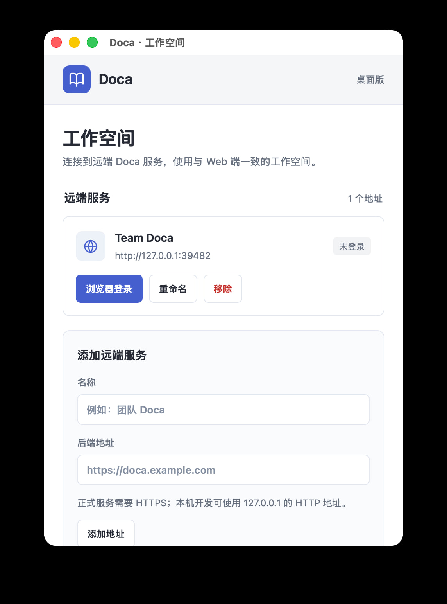
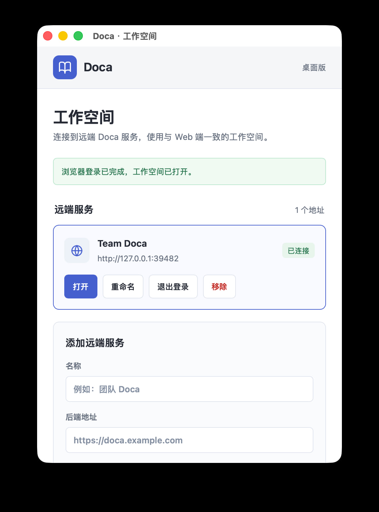
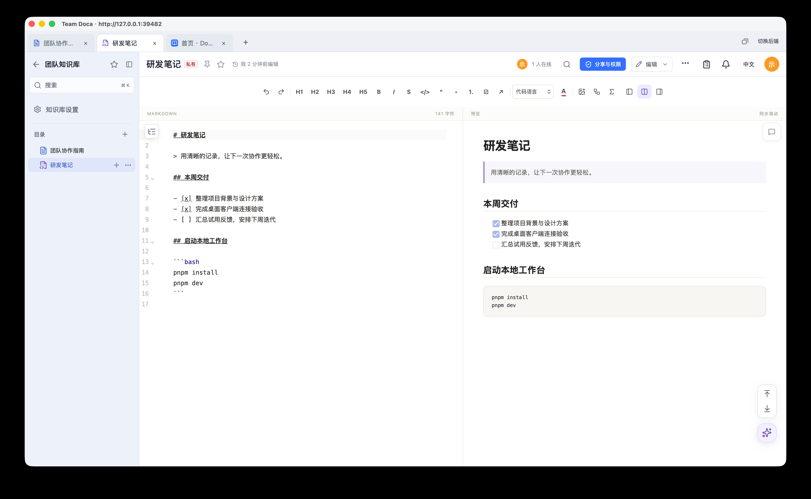

# Doca desktop client

[简体中文](desktop-client.zh-CN.md)

The desktop client in `apps/desktop` uses Tauri 2. It packages the Doca Web frontend and a connection manager styled to match the Web application, and connects to remote Doca hosts that you deploy. Several backends can stay connected at once, and each workspace window binds to one backend account. The package contains no Node executable, business host or local database runtime. A host must run 0.2.37 or newer to support the desktop authorization routes described below.

## Install and connect

Download the macOS (dmg) or Windows (NSIS/MSI) installer from [GitHub Releases](https://github.com/workhold/doca/releases). Current builds are unsigned and not notarized: on macOS, right-click the app and choose **Open** the first time; Windows may show a SmartScreen prompt.

The first launch shows the connection manager. Enter a name and the service origin, then choose **Add**: production services require HTTPS, loopback development hosts may use HTTP on 127.0.0.1, and the origin cannot include a path, credentials, query or fragment. Then choose **Sign in via browser** on the entry: the system browser opens the host's `/#/desktop-connect` page, where its existing login methods apply. After approval the desktop client opens the workspace automatically.

The connection manager can add, rename, select, sign out of and remove multiple hosts, and several backends can stay signed in at once. Credentials live only in the local encrypted credential file; the host stores only a hash. See [connection and authentication](#connection-and-authentication).

## Workspace and multiple backends

Each workspace window has its own tab strip. Tabs are independent same-origin Doca Web page contexts within that window; switching tabs keeps an open page running, and closing a tab disposes its page. Background tabs pause navigation, notification, and presence polling and refresh when reselected. Document collaboration and saves continue while the tab is open. Users can create tabs and windows, open same-origin links in a new tab, and use Ctrl/Command+T, Ctrl/Command+W, Ctrl/Command+N and Ctrl/Command+Tab (Shift reverses tab direction). The new-tab button follows the tab list and the new-window tool has a tooltip; right-clicking a tab title offers duplicate (same URL), open in a new window, close, close left, close right and close all, and tabs drag to reorder within their own window.

The signed-in workspace shows **Switch backend** in its tab strip, and settings pages keep a header control because they have no tab strip. Several backends can stay connected at once: opening a backend starts its own proxy and windows without closing other backends' windows, and re-opening a connected backend focuses its existing windows. Selecting another backend in the manager closes every previous workspace window before opening the new host, so check pending document saves first. Sign-out, credential expiry, or endpoint removal close only that backend's windows.

A normal relaunch restores all saved windows and pages for that host. Closing a workspace window while other workspace windows remain closes only that window, which is not restored; closing the last workspace window quits the app and keeps every recorded window, so the next launch restores them all. When a host has no saved windows, the app opens a new home tab. Business plugins stay installed and executed on your server and load through the authenticated proxy; see [plugins in the desktop client](#plugins-in-the-desktop-client).

Downloading a file, attachment or export opens the system save dialog with the server-suggested file name, starting in the system downloads folder. The download is written to the chosen location and revealed in the file manager afterwards; cancelling the dialog discards it and nothing is written. Host resources are fetched with the desktop credential in the background, so the workspace page never navigates to a raw file response.

In Files, select two or more files and choose **Download ZIP** to save them together. You can also drop local files onto a writable folder and check the destination in the upload dialog before confirming.

Desktop links that would open an external tab use the system browser. Links to another Doca page on the same origin still open in the workspace tab strip.

The local proxy normally reuses the same origin for a given backend and account. If the preferred port is busy, a different port can expose a different set of WebView preferences and offline data for that launch. Data stored at the original origin stays on disk.

## Connection and authentication

Add a named HTTPS service origin; HTTP is accepted only for a loopback development host. The system browser opens the selected host's `/#/desktop-connect` page, where its existing login methods apply. Approval yields a short-lived, single-use code through `doca://auth/complete`. The desktop client checks the origin, state and PKCE verifier, stores its distinct desktop bearer in an app-local encrypted credential file (one entry per endpoint under an owner-only random key), and opens that host. Entries created by earlier builds stay in the OS Keychain as a read-only fallback and are converted into the file on first use; explicit sign-out, expiry, or endpoint removal deletes the file entry and any retained Keychain entry. A host without the desktop routes must be upgraded.

The host stores only a hash of the desktop bearer and checks account status on each request. Desktop credentials have no time expiry. Explicit desktop sign-out, password change/reset, account disablement and administrator revocation invalidate them. Re-enabling an account does not revive a revoked credential. Browser, mobile and browser-assistant credentials retain their existing formats and rules.

## Bundled frontend and transport

The desktop package serves its own Web build through a local loopback transport. It forwards only `/api/v1/` HTTP and WebSocket traffic to the selected host, supplies that host's desktop bearer, strips WebView cookies and upstream `Set-Cookie`, rewrites the upstream Origin, and requires a random HttpOnly capability cookie with matching Host and Origin. The workspace WebView has no Tauri IPC permission and cannot read the bearer. Public links use the selected host's origin.

The switch-backend control uses a private `POST /_doca/manager` loopback action that requires the proxy capability and exact local Origin; it returns no credential and never forwards the request to the selected host. Browser Web pages do not show this control.

## Session data and restoration

`workspace-session.json` version 1 in the desktop app data directory stores endpoint/account IDs, window and tab IDs, tab order, in-app hash routes and titles, and each window's active tab. It stores no bearer, document body, form input or plugin data. A normal relaunch restores all saved windows and pages for the selected endpoint **only when the credential file still holds that endpoint's token (or a retained Keychain fallback entry does) and the account ID matches**. Background tabs are loaded when selected. The limits are 16 windows, 32 tabs per window and 128 tabs per endpoint/account. Unknown or corrupt session formats block startup without changing the original file; preserve a copy before explicitly removing that file to recover. The earlier desktop build ignores this separate file.

Explicit sign-out in any Web tab or the connection manager revokes the desktop credential, closes every window for that session and clears that endpoint/account's saved page list. A rejected bootstrap credential also closes those windows and drops its local credential. Switching backends keeps the old host's saved page list for a later return, while closing its running pages and proxy. Switching closes **all** windows and tabs for the previous host and opens the selected host's own saved pages in a separate WebView data store keyed by endpoint and account; documents, drafts, cookies, credentials and page routes do not move between hosts. A different account on the same host never receives the previous account's saved pages, and the client never converts a route or draft to another backend. Removing an endpoint revokes its desktop credential, removes its vault entry and saved page list; cached WebView data remains until a separate cleanup feature is implemented. An unreachable host does not clear its saved entry or credential.

## Plugins in the desktop client

Business plugin packages are installed and run on the selected remote Doca host. The desktop package includes no separate plugin installer or plugin server runtime. Each tab runs the bundled Web plugin loader: it reads the host's bootstrap declarations, imports matching versioned bundles from `/api/v1/plugin-assets/{id}/{version}/` through the authenticated proxy, and checks their manifest ID and version. Plugin API calls use the same selected host. Desktop tabs use the Web host interface; the mobile `host.native` bridge is unavailable (`null`). Plugin server code and managed plugin data stay on the remote host. See the [plugin SDK contract](plugin-sdk-contract.md) and [plugin development guide](plugin-development.md).

## Trial local data preservation

An unreleased earlier trial build could create a `local-v1` profile in the desktop app data directory. The remote-only build does not open, modify, delete, migrate or package this profile. If it exists, keep its entire directory, including SQLite WAL files and `credential.key`, for use with the matching older trial build. Do not copy individual files into a new profile or assume the remote client transferred them. Returning to the older trial build is the current recovery path; a future local mode or migration would need a separately approved plan.

The private `profiles.json` version 1 endpoint format and credential references remain the same; desktop tokens now live in the encrypted `credentials.json` v1 file with the Keychain kept as a read-only fallback. Its historical `active: "local"` value means no remote host is selected in this build. Existing settings and credentials are not rewritten at startup, including automatic page restoration. Unknown or invalid setting versions block startup while the original file remains untouched. The separately approved window-session decision is in [feature 007](../specs/007-desktop-workspace-tabs/spec.md).

## Build and verification

The desktop icon set is generated from `icons/icon-source.png`; `icons/icon.svg` stays byte-identical to the Web favicon. The Tauri `beforeBuildCommand` builds the matching Web frontend and the connection manager. Tauri bundles `apps/web/dist` directly as the `web` resource. From `apps/desktop`, run `node_modules/.bin/tauri build`; no Node executable or server dependency tree is copied into the app. The resulting application does not require installed Node or Docker. Build and verify each OS and CPU architecture separately. macOS 14 or newer is required for isolated WebView data stores; Windows and Linux use separate WebView data directories.

See [desktop client validation](../specs/006-desktop-client/validation.md) for measured bundle size and [tabs/windows validation](../specs/007-desktop-workspace-tabs/validation.md) for executed checks and platform limits. Package signing, notarization and distribution remain release steps.
