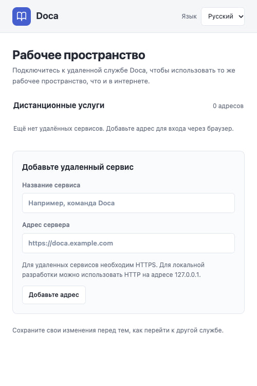
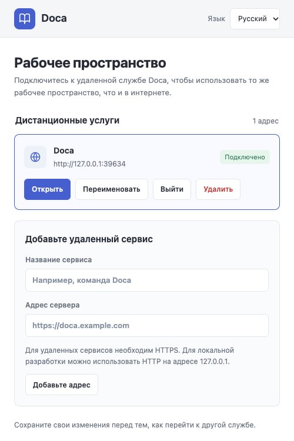
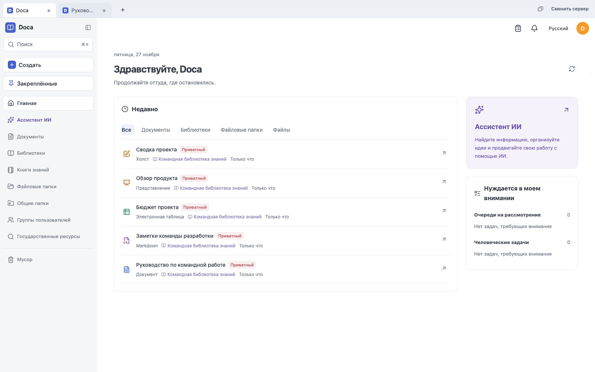

# Настольный клиент Doca

Настольный клиент Doca использует Tauri 2. В комплект входят веб-интерфейс Doca и диспетчер подключений к развёрнутым вами серверам. Можно одновременно работать с несколькими серверами. Каждое окно привязано к одной учётной записи на одном сервере. Пакет включает компоненты для запуска клиента. Серверу нужна Doca 0.2.37 или новее.

## Установка и подключение

Скачайте установщик для macOS (DMG) или Windows (NSIS либо MSI) со [страницы Doca 0.3.1](https://github.com/workhold/doca/releases/tag/v0.3.1). Сборки распространяются без подписи и нотариального заверения. При первом запуске на macOS щёлкните по приложению правой кнопкой и выберите **Открыть**. В Windows может появиться предупреждение SmartScreen.

При первом запуске открывается диспетчер подключений. Он использует первый поддерживаемый язык из системных предпочтений, а при отсутствии совпадений выбирает английский. До подключения можно выбрать один из восьми языков в меню **Язык**. Диспетчер сохраняет этот выбор на устройстве.

Укажите имя и адрес сервера, затем нажмите кнопку добавления адреса. Для рабочего сервера требуется HTTPS. При локальной разработке можно использовать HTTP на адресе 127.0.0.1. Укажите протокол, имя хоста и при необходимости порт. В записи сервера выберите вход через браузер. Системный браузер откроет `/#/desktop-connect`. После входа и подтверждения клиент откроет рабочее пространство.

В диспетчере можно добавлять, переименовывать, выбирать и удалять серверы, а также выходить из учётных записей. Сеансы на разных серверах могут оставаться открытыми. Клиент хранит учётные данные в зашифрованном файле на устройстве, сервер сохраняет только хеш. См. раздел [Подключение и аутентификация](#connection-and-authentication).

## Рабочее пространство и несколько серверов

Каждое окно рабочего пространства имеет свою табличную полосу. Табы — это независимые контексты веб-страниц Doca с одинаковым источником, находящиеся внутри этого окна; переключение табов сохраняет открытую страницу активной, а закрытие табы уничтожает её. Табы в фоновом режиме приостанавливают навигацию, уведомления, проверку присутствия и обновление страниц при повторном выборе. Совместная работа над документом и сохранение продолжаются до открытия табы. Пользователи могут создавать табы и окна, открывать ссылки с одинаковым источником в новой табе и использовать Ctrl/Command+T, Ctrl/Command+W, Ctrl/Command+N и Ctrl/Command+Tab (Shift изменяет направление табы). Кнопка новой табы следует списку таб, а инструмент создания нового окна имеет подсказку; клик правой кнопкой мыши по названию табы предоставляет возможность создания дубликата (одинаковый URL), открытия в новом окне, закрытия, закрытия слева, закрытия справа и закрытия всех, а табы можно перетащить для перестановки внутри своего окна.

Записанное рабочее пространство показывает **Сменить сервер** В своей полосе вкладок и страницах настроек сохраняется заголовок управления, так как у них нет полосы вкладок. Несколько серверов могут быть подключены одновременно: открытие сервера запускает свой собственный прокси и окна без закрытия окон других серверов, а повторное открытие подключенного сервера фокусирует существующие окна. Выбор другого сервера в менеджере закрывает все предыдущие окна рабочего пространства перед открытием нового хоста, поэтому сначала проверьте ожидающие сохранения документов. Выйти из системы, истечение срока доступа к учетным данным или удаление endpoints закрывают только окна этого сервера.

В исходных сборках с поддержкой языка десктопа панель вкладок соответствует языку интерфейса активной страницы. **Сменить сервер** Открывает менеджер на этом языке. Менеджер… **Язык** Selector устанавливает локальное предпочтение устройства для менеджера. Чтобы изменить язык подключенного рабочего пространства, используйте настройки языка самого рабочего пространства.

Обычное перезапускание восстанавливает все сохраненные окна и страницы для данного хоста. Закрытие окна рабочего пространства, при этом другие окна рабочего пространства остаются открытыми, закрывает только это окно, которое не восстанавливается; закрытие последнего окна рабочего пространства завершает приложение, но сохраняет все записанные окна, поэтому следующее запускание восстанавливает их все. Если у хоста нет сохраненных окон, приложение открывает новую домашнюю вкладку. Бизнес-плагины остаются установленными и работают на вашем сервере и загружаются через аутентифицированный прокси; см. [плагины в клиенте на десктопе](#plugins-in-the-desktop-client).

Скачивание файла, приложения или экспорта открывает диалоговое окно сохранения системы с файлом, указанным сервером, и начинается из папки скачивания системы. Скачанный файл сохраняется в выбранном месте и затем отображается в менеджере файлов; отмена диалогового окна уничтожает его, и ничего не сохраняется. Ресурсы хоста получаются с помощью учетных данных рабочего стола в фоновом режиме, поэтому страница рабочего пространства никогда не переходит к чистому файловому ответу.

В разделе «Файлы» выберите два или более файла и выберите **Скачайте ZIP-архив** Чтобы сохранить их вместе. Вы также можете сохранять локальные файлы в папку для записи и проверить место хранения в диалоге загрузки перед подтверждением.

Подключения на рабочем столе, которые открывают внешнюю вкладку, используют системный браузер. Ссылки на другую страницу Doca на том же источнике информации все еще открываются в строке вкладок рабочего пространства.

Локальный прокси обычно использует тот же источник данных для определенного бэкенда и учетной записи. Если предпочтенный порт занят, другой порт может использоваться для отображения различных настроек WebView и данных в режиме оффлайн. Данные, хранящиеся на первоначальном источнике, остаются на диске.

Документы открыты онлайн при приветствии нового клиента **Меню учета → Офлайн-документы** Как только их тела сохранены в кэше. Если сервер недоступен, откройте их. **Недавние изменения** В домашней почте. Изменения выполняются согласно последнему разрешению, а синхронизация происходит при возвращении соединения. Первое входе требуется соединение. Смотрите. [Открытый документный запись](access-offline-events.md#离线文档入口).

## Соединение и аутентификация

Добавьте имя источника сервиса HTTPS; HTTP принимается только для хоста для разработки внутри сети. Системный браузер откроет выбранный хост. `/#/desktop-connect` страница, где применяются существующие методы входа. Согласование предоставляет кратковременный код, используемый один раз. `doca://auth/complete`Клиент на десктопе проверяет источник, состояние и проверяющего PKCE, сохраняет свою информацию в локально зашифрованном файле ключей приложения (одна запись на каждый эндпоинт под случайным ключом, доступным только владельцу), и открывает этот хост. Записи, созданные в предыдущих версиях, остаются в Keychain операционной системы в режиме читабельности в качестве резервного варианта и конвертируются в файл при первом использовании; явное выход из системы, истечение срока действия или удаление эндпоинта уничтожают запись в файле и любую запись в Keychain. Хост без возможности использования маршрутов на десктопе должен быть обновлен.

Хост хранит только хэш учетных данных пользователя, а состояние аккаунта проверяется при каждом запросе. Учетные данные для пользователя на рабочем столе не имеют срока действия. Явное выход из системы, изменение/перезапуск пароля, отключение аккаунта и отмена полномочий администратора приводят к аннулированию этих данных. Разблокировка аккаунта не восстанавливает аннулированные учетные данные. Учетные данные для браузера, мобильных устройств и помощников браузера сохраняют свои существующие форматы и правила.

## Собранный фронтенд и транспорт

Пакет для рабочего стола предоставляет собственную веб-версию через локальный loopback-транспорт. Он просто пересылает данные. `/api/v1/` HTTP и WebSocket трафик к выбранному хосту, предоставление десктопного сервиса этого хоста, удаление куки WebView и трафик вверх. `Set-Cookie`Обновляет upstream Origin и требует cookie с параметром HttpOnly и совпадящим Host и Origin. WebView из workspace не имеет разрешения Tauri IPC и не может читать bearer. Публичные ссылки используют origin выбранного хоста.

Контроль switch-backend использует приватный `POST /_doca/manager` Лимбик-действие, которое требует поддержки прокси и точного локального Оригинса; оно не возвращает учетные данные и никогда не передает запрос на выбранный хост. Веб-страницы браузера не показывают этот режим управления.

## Данные сессии и восстановление

`workspace-session.json` Версия 1 в директории данных десктопного приложения хранит идентификаторы endpoints/аккаунтов, идентификаторы окон и вкладок, порядок вкладок, маршруты хешей внутри приложения и названия, а также активную вкладку каждого окна. В ней не хранится никаких данных, таких как bearer, содержимое документа, ввод формы или данные плагинов. Обычное перезапуск приложения восстанавливает все сохраненные окна и страницы для выбранного endpoints. **Только тогда, когда файл ключей все еще содержит токен этого эндпоинта (или сохраненное записание в Keychain), и идентификатор учетной записи совпадает.**Фоновые вкладки загружаются при выборе. Ограничения: 16 окон, 32 вкладки на окно и 128 вкладок на конечный пункт/аккаунт. Неизвестные или поврежденные форматы сессий блокируют запуск без изменения оригинального файла; необходимо сохранить копию перед явным удалением файла для восстановления. Предыдущая версия десктопа игнорировала этот отдельный файл.

Эксплицитное выход из аккаунта в любой вкладке Web или управление подключением аннулирует учетные данные на рабочем столе, закрывает все окна для этой сессии и удаляет список сохраненных страниц этого endpoints/аккаунта. Отклоненная учетная запись bootstrap также закрывает эти окна и удаляет свои локальные учетные данные. Переключение на другие backend сохраняет список сохраненных страниц старого хоста для последующего возвращения, в то время как закрывает его работающие страницы и прокси. Переключение закрывает **все** Windows и вкладки для предыдущего хоста, а также отображение сохраненных страниц выбранного хоста в отдельном хранилище WebView, идентифицированном по эндпоинту и учетной записи; документы, черновики, куки, учетные данные и маршруты страниц не перемещаются между хостами. Другая учетная запись на том же хосте никогда не получает сохраненные страницы предыдущей учетной записи, а клиент никогда не конвертирует маршрут или черновик в другой backend. Удаление эндпоинта отменяет его учетные данные на рабочем столе, удаляет запись из сейфа и список сохраненных страниц; кэшированные данные WebView остаются до реализации отдельного функционала очистки. Недоступный хост не удаляет свою сохраненную запись или учетные данные.

## Плагины в клиенте на десктопе

Пакеты бизнес-плагинов устанавливаются и запускаются на выбранном удаленном хосте Doca. Пакет для рабочего стола не содержит отдельного установщика плагинов или сервера выполнения плагинов. Каждый вкладка запускает встроенный загрузчик веб-плагинов: он читает объявления bootstrap на хосте и импортирует соответствующие версионные пакеты. `/api/v1/plugin-assets/{id}/{version}/` через авторизованный прокси и проверяет их ID и версию манифеста. Запросы API плагина используют тот же выбранный хост. Навигационные вкладки для десктопа используют интерфейс веб-хоста; мобильные устройства `host.native` Мост недоступен.`null`Код сервера плагинов и данные управляемых плагинов остаются на удаленном хосте. См. [контракт SDK плагин](plugin-sdk-contract.ru.md) и [Руководство по разработке плагинов](plugin-development.ru.md).

## Тест местной сохранения данных

Неопубликованная ранняя тестовая версия может создать `local-v1` Профиль находится в директории данных приложения на столе. Сборка, доступная только из удаленного режима, не открывает, изменяет, удаляет, миграционирует или упаковывает этот профиль. Если он существует, сохраняйте весь его директорийный пространство, включая файлы SQLite WAL. `credential.key`Для использования с соответствующей более старой пробной версией. Не копируйте отдельные файлы в новый профиль или предполагайте, что удаленный клиент их передал. Возвращение к более старой пробной версии является текущим способом восстановления; будущее использование локального режима или миграции потребует отдельно утвержденного плана.

Частная `profiles.json` Формат endpoints версии 1 и ссылки на учетные данные остаются прежними; токены для десктопа теперь хранятся в зашифрованном виде. `credentials.json` Файл v1 с Keychain сохранен в режиме чтения в качестве резервного варианта. Его исторический статус `active: "local"` Значение “value” означает, что в этом режиме не выбран никакой удаленный хост. Существующие настройки и учетные данные не перезаписываются при запуске, включая автоматическое восстановление страницы. Неизвестные или неверные версии настроек блокируют запуск, пока оригинальный файл остается нетронутым. Решение о размещении окна-сессии, одобренное отдельно, находится… [Функция 007](../specs/007-desktop-workspace-tabs/spec.md).

## Строительство и проверка

Коллекция иконок на рабочем столе генерируется из `icons/icon-source.png`; `icons/icon.svg` Остается идентичен байтом фавикону веб-сайта. Tauri `beforeBuildCommand` Создает соответствующий веб-фронтенд и менеджер соединений. Tauri bundles `apps/web/dist` непосредственно как `web` ресурс. От `apps/desktop`, запустить `node_modules/.bin/tauri build`Никакая экземплярная программа Node или дерево зависимостей сервера не копируется в приложение. Полученное приложение не требует установки Node или Docker. Собирайте и проверяйте каждую операционную систему и архитектуру процессора отдельно. Для изолированных хранилищ данных WebView требуется macOS 14 или более новая версия; Windows и Linux используют отдельные директории для данных WebView.

Смотри [Валидация десктопного клиента](../specs/006-desktop-client/validation.md) для измеренного размера пакета [Валидация вкладок/окон](../specs/007-desktop-workspace-tabs/validation.md) За выполнение проверок и соблюдение ограничений платформы. Подписание пакета, нотариализация и распространение остаются этапами выпуска.
