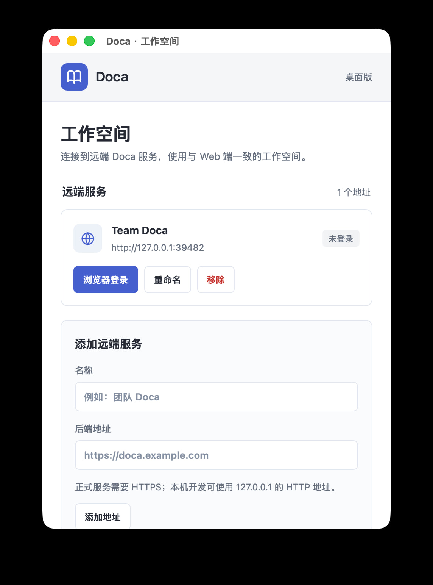
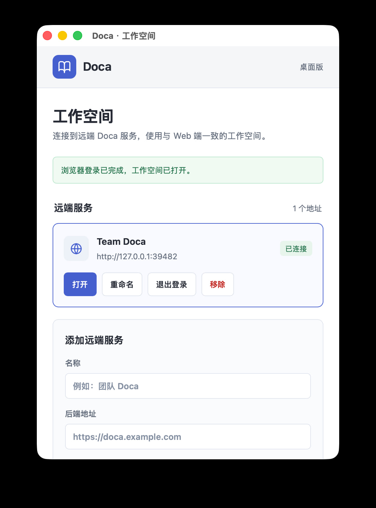
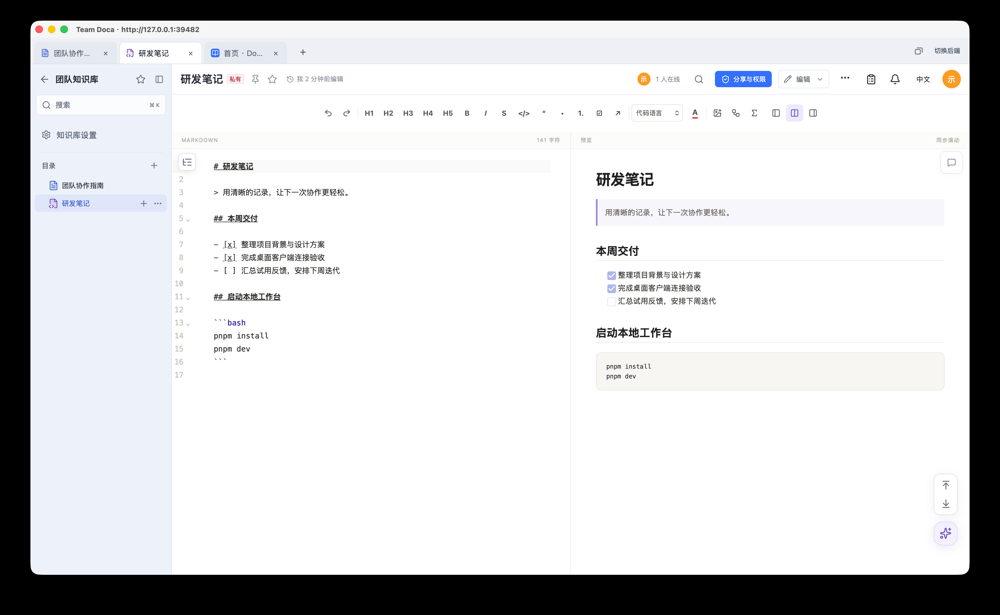

# 桌面客户端

[English](desktop-client.md)

`apps/desktop` 中的桌面客户端基于 Tauri 2，打包 Doca Web 前端和与 Web 风格一致的连接管理器，连接到你自行部署的远端 Doca 服务。多个后端可同时保持连接，每个工作空间窗口绑定一个后端账号。安装包不包含 Node 可执行文件、业务后端或本地数据库运行时。服务端需为 0.2.37 或更高版本，以支持下文的桌面授权接口。

## 安装与连接

从 [Doca 0.2.42](https://github.com/workhold/doca/releases/tag/v0.2.42) 下载 macOS（DMG）或 Windows（NSIS/MSI）安装包。当前安装包未做签名与公证。macOS 首次打开可使用右键 →「打开」，Windows 可能出现 SmartScreen 提示。

首次打开是连接管理器。填写名称与服务地址后选择**添加地址**：正式服务需要 HTTPS，本机开发可使用 127.0.0.1 的 HTTP 地址；地址不能包含路径、凭据、查询或片段。再选择该地址上的**浏览器登录**，系统浏览器会打开该服务的 `/#/desktop-connect` 页面，沿用该站点的既有登录方式；批准后桌面客户端自动打开工作空间。

连接管理器可添加、重命名、选择、退出登录和移除多个服务地址，多个后端可同时保持登录。凭证只保存在本机加密凭据文件中，服务端只保存凭证哈希，详见[连接与认证](#连接与认证)。

## 工作空间与多后端

每个工作空间窗口有独立标签栏。标签页是同一窗口内相互独立的 Doca Web 页面上下文；切换标签保留已打开页面，关闭标签即销毁该页面。后台标签暂停导航、通知和在线心跳轮询，重新选中时刷新。打开的文档继续协作和保存。支持新建标签和窗口、站内链接在新标签打开，以及 Ctrl/Command+T、Ctrl/Command+W、Ctrl/Command+N、Ctrl/Command+Tab（Shift 反向）。新建按钮跟随标签列表，新窗口工具有提示；右键标签标题可复制（相同地址）、在新窗口打开、关闭、关闭左侧、关闭右侧和全部关闭，窗口内标签可拖拽排序。

已登录的工作空间在标签栏显示**切换后端**，设置页因没有标签栏而在页头保留该入口。多个后端可同时保持连接：打开某个后端会启动它自己的代理和窗口，不关闭其他后端的窗口；重新打开已连接的后端会聚焦其已有窗口。在管理器中切换到另一个后端会先关闭之前后端的全部工作空间窗口再打开新地址，请先确认文档没有未保存内容。退出登录、凭证过期或移除地址只关闭该后端的窗口。

正常重启会恢复该地址保存的全部窗口和页面。仍存在其他工作空间窗口时关闭其中一个，仅关闭该窗口且不再恢复；关闭最后一个工作空间窗口会退出应用并保留全部已记录窗口，下次启动全部恢复。地址没有保存窗口时，应用会打开新的首页标签。业务插件安装并运行在你的服务端上，桌面端通过认证代理加载，详见[桌面客户端中的插件](#桌面客户端中的插件)。

下载文件、附件或导出内容时会弹出系统保存对话框：默认目录为系统下载文件夹，文件名取服务端建议；下载写入所选位置并在文件管理器中定位。取消对话框即放弃下载，不写入任何文件。主机资源使用桌面凭据在后台获取，工作空间页面不会导航到原始文件响应。

在「文件」中选中两个或更多文件后，选择「下载 ZIP」即可一次保存。也可以把本地文件拖到可写文件夹上，在上传对话框中核对目标后确认。

原本会在新标签页打开的站外链接交给系统浏览器。同源 Doca 页面仍可在工作空间内开新标签。

同一后端和账号通常会复用本地代理地址。如果首选端口被占用，本次启动可能换用其他端口，显示该地址对应的 WebView 偏好和离线数据。原地址下的数据仍保留在磁盘上。

使用新版联网打开的文档在正文缓存完成后会加入**账号菜单 → 离线文档**。后端不可达时，已连接账号可从首页**最近编辑**打开这些文档，按上次权限编辑并在恢复连接后同步。首次登录需在线完成。使用范围见[离线文档入口](access-offline-events.md#离线文档入口)。

## 连接与认证

添加命名的 HTTPS 服务地址；HTTP 仅接受回环开发地址。系统浏览器打开所选服务的 `/#/desktop-connect` 页面，批准后通过 `doca://auth/complete` 返回短时效单次授权码。桌面客户端校验地址、state 与 PKCE verifier，把独立的桌面凭证保存在应用本地的加密凭据文件中（每个地址一条，密钥仅属当前用户）；早期构建写入系统钥匙串的条目作为只读回退保留，并在首次使用时转换进文件。显式退出、过期或移除地址会同时删除文件条目与保留的钥匙串条目。不带桌面接口的旧服务端需要升级。

服务端只保存桌面凭证的哈希，并在每次请求时检查账号状态。桌面凭证没有时间有效期。显式桌面退出、修改或重置密码、禁用账号和管理员撤销都会使其失效；重新启用账号不会恢复已撤销的凭证。浏览器、移动端和浏览器助手凭证沿用既有格式和规则。

## 打包的前端与传输

桌面安装包通过本地回环代理提供自带的 Web 构建。它只转发 `/api/v1/` 的 HTTP 和 WebSocket 流量到所选后端，附带该后端的桌面凭证，剥离 WebView Cookie 与上游 `Set-Cookie`，重写上游 Origin，并要求携带 Host 与 Origin 完全匹配的随机 HttpOnly 能力 Cookie。工作空间 WebView 没有 Tauri IPC 权限，读不到凭证。公开链接使用所选后端的地址。

切换后端入口使用私有的 `POST /_doca/manager` 回环接口，要求代理能力与完全一致的本地 Origin；它不返回凭证，也不会把请求转发到所选后端。浏览器打开的普通网页不显示该入口。

## 会话数据与恢复

桌面应用数据目录中的 `workspace-session.json`（版本 1）按地址/账号保存端点与账号 ID、窗口与标签 ID、标签顺序、应用内 hash 路由、标题和每个窗口的当前标签；不保存凭证、文档正文、表单输入或插件数据。只有当凭据文件仍保存该地址的凭证（或保留的钥匙串回退条目仍存在）且账号匹配时，正常重启才会恢复该地址的全部窗口和页面。后台标签在选中时加载。上限为每应用 16 个窗口、每窗口 32 个标签、每地址/账号 128 个标签。未知或损坏的会话格式会阻止启动且不修改原文件；恢复前先保留副本。更早的桌面构建会忽略这个独立文件。

在任何 Web 标签页或连接管理器中显式退出登录，会撤销桌面凭证、关闭该会话的全部窗口，并清空该地址/账号保存的页面列表。引导凭证被拒绝时同样关闭这些窗口并删除本地凭证。切换后端会保留原地址保存的页面列表供稍后返回，同时关闭其正在运行的页面和代理。切换后端会关闭之前后端的全部窗口和标签，再打开所选后端自己保存的页面；页面保存在按地址和账号隔离的 WebView 数据区中，文档、草稿、Cookie、凭证和页面路由不会在地址之间移动。同一地址上的不同账号不会收到上一账号保存的页面，客户端也不会把路由或草稿转换到另一个后端。移除地址会撤销其桌面凭证、删除凭据库条目和保存的页面列表；WebView 缓存数据会保留到单独的清理功能实现为止。地址暂时不可达不会清除其保存条目或凭证。

## 桌面客户端中的插件

业务插件安装并运行在所选远端 Doca 服务上。桌面安装包不包含独立插件安装器或插件服务运行时。每个标签页使用打包的 Web 插件加载器：读取后端的 bootstrap 声明，通过认证代理从 `/api/v1/plugin-assets/{id}/{version}/` 导入对应版本的 bundle，并校验 manifest 的 ID 与版本。插件 API 调用同样使用所选后端。桌面标签使用 Web 宿主接口；移动端 `host.native` 桥不可用（为 `null`）。插件服务端代码和托管数据都在远端后端。见[插件 SDK 契约](plugin-sdk-contract.zh-CN.md)与[插件开发](plugin-development.zh-CN.md)。

## 试用版本地数据保留

未公开发布的早期试用版可能在桌面应用数据目录创建 `local-v1` 资料。远端版不打开、不修改、不删除、不迁移、不打包该资料。若它存在，请完整保留整个目录（包括 SQLite WAL 文件和 `credential.key`），仅供对应的旧试用版使用；不要把单个文件复制进新资料，也不要假定远端客户端已转移数据。

私有的 `profiles.json` 版本 1 地址格式和凭据引用保持不变；桌面凭证现在保存在加密的 `credentials.json` v1 文件中，钥匙串保留为只读回退。历史上的 `active: "local"` 表示该构建未选择远端地址。启动时不重写既有设置和凭据，包括自动恢复页面。未知或无效的设置版本会阻止启动并保留原文件。窗口会话的独立决策见[功能 007](../specs/007-desktop-workspace-tabs/spec.md)。

## 构建与验证

桌面图标集由 `icons/icon-source.png` 生成；`icons/icon.svg` 与 Web favicon 保持字节一致。Tauri `beforeBuildCommand` 构建配套的 Web 前端和连接管理器。Tauri 直接把 `apps/web/dist` 打包为 `web` 资源。在 `apps/desktop` 下执行 `node_modules/.bin/tauri build`；应用内不复制 Node 可执行文件或服务端依赖树。生成的应用不要求安装 Node 或 Docker。请分别在各操作系统与 CPU 架构上单独构建和验证。隔离 WebView 数据区要求 macOS 14 或更高；Windows 与 Linux 使用独立的 WebView 数据目录。

见[桌面客户端验证](../specs/006-desktop-client/validation.md)中的实测体积，以及[标签窗口验证](../specs/007-desktop-workspace-tabs/validation.md)中的执行记录与平台上限。安装包签名、公证与分发属于发布步骤。
