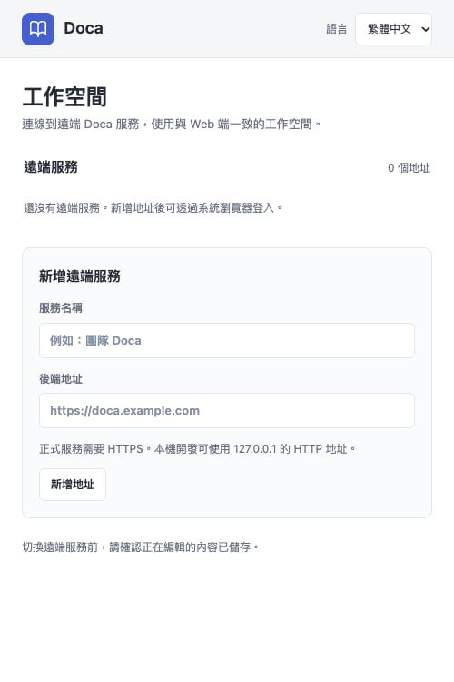
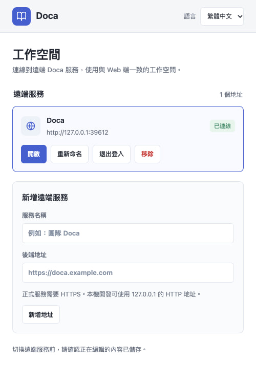
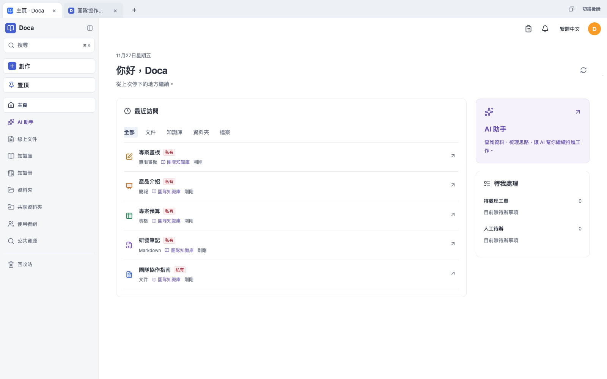

# Doca 桌面用戶端

Doca 桌面用戶端使用 Tauri 2，內建 Doca 網頁前端和連線管理員，可連線到自行部署的遠端站台。多個伺服器可以同時保持連線，每個工作區視窗只屬於一個站台帳號。套件僅包含用戶端所需元件。遠端站台須為 0.2.37 以上版本。

## 安裝與連線

從 [Doca 0.3.1 發行版本](https://github.com/workhold/doca/releases/tag/v0.3.1) 下載 macOS（DMG）或 Windows（NSIS／MSI）安裝程式。此版本尚未簽署或公證。首次在 macOS 啟動時，以右鍵按一下應用程式並選擇**打開**。Windows 可能顯示 SmartScreen 提示。

首次啟動會顯示連線管理員。用戶端選擇系統偏好中第一個支援的語言，並以英文為預設備用語言。連線前可使用**語言**選單選擇八種語言之一。連線管理員會在本機保留此偏好。

輸入名稱及伺服器網址，接著選擇**新增地址**。正式站台必須使用 HTTPS，本機開發環境可使用 127.0.0.1 的 HTTP 網址。只需填寫通訊協定、主機名稱和連接埠。選擇該項目的**瀏覽器登入**後，系統瀏覽器會開啟站台的 `/#/desktop-connect` 頁面。登入並允許連線後，桌面用戶端會開啟工作區。

連線管理員可新增、重新命名、切換、登出和移除伺服器。不同站台可同時保持登入。用戶端將憑證保存在本機加密檔案中，站台只儲存雜湊值。詳見[連線與驗證](#连接与认证)。

## 工作區與多個伺服器

每個工作空間視窗有獨立標籤欄。標籤頁是同一視窗內相互獨立的 Doca Web 頁面上下文；切換標籤保留已開啟頁面，關閉標籤即銷燬該頁面。後臺標籤暫停導航、通知和線上心跳輪詢，重新選中時重新整理。開啟的文件繼續協作和儲存。支援新建標籤和視窗、站內連結在新標籤開啟，以及 Ctrl/Command+T、Ctrl/Command+W、Ctrl/Command+N、Ctrl/Command+Tab（Shift 反向）。新建按鈕跟隨標籤列表，新視窗工具有提示；右鍵標籤標題可複製（相同地址）、在新視窗開啟、關閉、關閉左側、關閉右側和全部關閉，視窗內標籤可拖拽排序。

已登入的工作空間在標籤欄顯示**切換後端**，設定頁因沒有標籤欄而在頁頭保留該入口。多個後端可同時保持連線：開啟某個後端會啟動它自己的代理和視窗，不關閉其他後端的視窗；重新開啟已連線的後端會聚焦其已有視窗。在管理器中切換到另一個後端會先關閉之前後端的全部工作空間視窗再開啟新地址，請先確認文件沒有未儲存內容。退出登入、憑證過期或移除地址只關閉該後端的視窗。

在支援桌面語言的原始碼構建中，標籤欄隨當前頁面的介面語言更新。點**切換後端**會用同一語言開啟連線管理器。連線管理器的**語言**儲存在本機，已連線的工作空間使用各自的語言設定。

正常重啟會恢復該地址儲存的全部視窗和頁面。仍存在其他工作空間視窗時關閉其中一個，僅關閉該視窗且不再恢復；關閉最後一個工作空間視窗會退出應用並保留全部已記錄視窗，下次啟動全部恢復。地址沒有儲存視窗時，應用會開啟新的首頁標籤。業務外掛安裝並執行在你的服務端上，桌面端透過認證代理載入，詳見[桌面客戶端中的外掛](#桌面客户端中的插件)。

下載檔案、附件或匯出內容時會彈出系統儲存對話方塊：預設目錄為系統下載資料夾，檔名取服務端建議；下載寫入所選位置並在檔案管理器中定位。取消對話方塊即放棄下載，不寫入任何檔案。主機資源使用桌面憑據在後臺獲取，工作空間頁面不會導航到原始檔案響應。

在「檔案」中選中兩個或更多檔案後，選擇「下載 ZIP」即可一次儲存。也可以把本地檔案拖到可寫資料夾上，在上傳對話方塊中核對目標後確認。

原本會在新標籤頁開啟的站外連結交給系統瀏覽器。同源 Doca 頁面仍可在工作空間內開新標籤。

同一後端和賬號通常會複用本地代理地址。如果首選埠被佔用，本次啟動可能換用其他埠，顯示該地址對應的 WebView 偏好和離線資料。原地址下的資料仍保留在磁碟上。

使用新版聯網開啟的文件在正文快取完成後會加入**賬號選單 → 離線文件**。後端不可達時，已連線賬號可從首頁**最近編輯**開啟這些文件，按上次許可權編輯並在恢復連線後同步。首次登入需線上完成。使用範圍見[離線文件入口](access-offline-events.md#离线文档入口)。

## 連線與認證

新增命名的 HTTPS 服務地址；HTTP 僅接受迴環開發地址。系統瀏覽器開啟所選服務的 `/#/desktop-connect` 頁面，批准後透過 `doca://auth/complete` 返回短時效單次授權碼。桌面客戶端校驗地址、state 與 PKCE verifier，把獨立的桌面憑證儲存在應用本地的加密憑據檔案中（每個地址一條，金鑰僅屬當前使用者）；早期構建寫入系統鑰匙串的條目作為只讀回退保留，並在首次使用時轉換進檔案。顯式退出、過期或移除地址會同時刪除檔案條目與保留的鑰匙串條目。不帶桌面介面的舊服務端需要升級。

服務端只儲存桌面憑證的雜湊，並在每次請求時檢查賬號狀態。桌面憑證沒有時間有效期。顯式桌面退出、修改或重置密碼、禁用賬號和管理員撤銷都會使其失效；重新啟用賬號不會恢復已撤銷的憑證。瀏覽器、移動端和瀏覽器助手憑證沿用既有格式和規則。

## 打包的前端與傳輸

桌面安裝包透過本地迴環代理提供自帶的 Web 構建。它只轉發 `/api/v1/` 的 HTTP 和 WebSocket 流量到所選後端，附帶該後端的桌面憑證，剝離 WebView Cookie 與上游 `Set-Cookie`，重寫上游 Origin，並要求攜帶 Host 與 Origin 完全匹配的隨機 HttpOnly 能力 Cookie。工作空間 WebView 沒有 Tauri IPC 許可權，讀不到憑證。公開連結使用所選後端的地址。

切換後端入口使用私有的 `POST /_doca/manager` 迴環介面，要求代理能力與完全一致的本地 Origin；它不返回憑證，也不會把請求轉發到所選後端。瀏覽器開啟的普通網頁不顯示該入口。

## 會話資料與恢復

桌面應用資料目錄中的 `workspace-session.json`（版本 1）按地址/賬號儲存端點與賬號 ID、視窗與標籤 ID、標籤順序、應用內 hash 路由、標題和每個視窗的當前標籤；不儲存憑證、文件正文、表單輸入或外掛資料。只有當憑據檔案仍儲存該地址的憑證（或保留的鑰匙串回退條目仍存在）且賬號匹配時，正常重啟才會恢復該地址的全部視窗和頁面。後臺標籤在選中時載入。上限為每應用 16 個視窗、每視窗 32 個標籤、每地址/賬號 128 個標籤。未知或損壞的會話格式會阻止啟動且不修改原檔案；恢復前先保留副本。更早的桌面構建會忽略這個獨立檔案。

在任何 Web 標籤頁或連線管理器中顯式退出登入，會撤銷桌面憑證、關閉該會話的全部視窗，並清空該地址/賬號儲存的頁面列表。引導憑證被拒絕時同樣關閉這些視窗並刪除本地憑證。切換後端會保留原地址儲存的頁面列表供稍後返回，同時關閉其正在執行的頁面和代理。切換後端會關閉之前後端的全部視窗和標籤，再開啟所選後端自己儲存的頁面；頁面儲存在按地址和賬號隔離的 WebView 資料區中，文件、草稿、Cookie、憑證和頁面路由不會在地址之間移動。同一地址上的不同賬號不會收到上一賬號儲存的頁面，客戶端也不會把路由或草稿轉換到另一個後端。移除地址會撤銷其桌面憑證、刪除憑據庫條目和儲存的頁面列表；WebView 快取資料會保留到單獨的清理功能實現為止。地址暫時不可達不會清除其儲存條目或憑證。

## 桌面客戶端中的外掛

業務外掛安裝並執行在所選遠端 Doca 服務上。桌面安裝包不包含獨立外掛安裝器或外掛服務執行時。每個標籤頁使用打包的 Web 外掛載入器：讀取後端的 bootstrap 宣告，透過認證代理從 `/api/v1/plugin-assets/{id}/{version}/` 匯入對應版本的 bundle，並校驗 manifest 的 ID 與版本。外掛 API 呼叫同樣使用所選後端。桌面標籤使用 Web 宿主介面；移動端 `host.native` 橋不可用（為 `null`）。外掛服務端程式碼和託管資料都在遠端後端。見[外掛 SDK 契約](plugin-sdk-contract.zh-Hant.md)与[外掛開發](plugin-development.zh-Hant.md)。

## 試用版本地資料保留

未公開發布的早期試用版可能在桌面應用資料目錄建立 `local-v1` 資料。遠端版不開啟、不修改、不刪除、不遷移、不打包該資料。若它存在，請完整保留整個目錄（包括 SQLite WAL 檔案和 `credential.key`），僅供對應的舊試用版使用；不要把單個檔案複製進新資料，也不要假定遠端客戶端已轉移資料。

私有的 `profiles.json` 版本 1 地址格式和憑據引用保持不變；桌面憑證現在儲存在加密的 `credentials.json` v1 檔案中，鑰匙串保留為只讀回退。歷史上的 `active: "local"` 表示該構建未選擇遠端地址。啟動時不重寫既有設定和憑據，包括自動恢復頁面。未知或無效的設定版本會阻止啟動並保留原檔案。視窗會話的獨立決策見[功能 007](../specs/007-desktop-workspace-tabs/spec.md)。

## 構建與驗證

桌面圖示集由 `icons/icon-source.png` 生成；`icons/icon.svg` 與 Web favicon 保持位元組一致。Tauri `beforeBuildCommand` 構建配套的 Web 前端和連線管理器。Tauri 直接把 `apps/web/dist` 打包為 `web` 資源。在 `apps/desktop` 下執行 `node_modules/.bin/tauri build`；應用內不復制 Node 可執行檔案或服務端依賴樹。生成的應用不要求安裝 Node 或 Docker。請分別在各作業系統與 CPU 架構上單獨構建和驗證。隔離 WebView 資料區要求 macOS 14 或更高；Windows 與 Linux 使用獨立的 WebView 資料目錄。

见[桌面客戶端驗證](../specs/006-desktop-client/validation.md)中的實測體積，以及[標籤視窗驗證](../specs/007-desktop-workspace-tabs/validation.md)中的執行記錄與平臺上限。安裝包簽名、公證與分發屬於釋出步驟。
