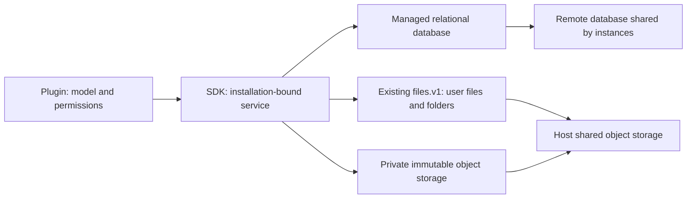

# Contrato de escalado horizontal y almacenamiento gestionado de plugin

0.1.26 utiliza un [base de datos comercial de complementos compartidos](plugin-database-isolation.es.md), separado del núcleo, con espacios de nombres automáticos. Reemplaza a las bases de datos por plugin lanzadas en 0.1.25. La actualización requiere desinstalar normalmente en el host anterior y reinstalar; los datos del plugin no se migran.

[中文](plugin-horizontal-scaling.zh-CN.md)

Estado: contrato aprobado, 2026-10-02; host de origen 0.1.10 / SDK 0.1.8, sin implicación de aceptación para publicación/producción. Toda persistencia es gestionada por el host; los complementos nunca distinguen backend locales/remotos. Se implementan las verificaciones de declaración de paquete y la limpieza del entorno. Los objetos SQL/privados gestionados ahora se exportan; las credenciales se exportan en el SDK source 0.1.8; los espacio de trabajo siguen siendo un vacío. No se leyeron, convirtió ni eliminó datos comerciales antiguos.

## Implementada revisión de almacenamiento (2026-10-03, fuente SDK 0.1.7)

`@smartdoca/plugin-sdk/storage` Ahora exporta productos destinados a instalaciones. `pluginDatabaseToken` (`storage.sql.v1`) y `pluginObjectStorageToken` (`storage.objects.v1`). El subconjunto de la base de datos es la versión de esquema 1, con columnas texto/int32/double, restricciones primarias/únicas, operaciones de selección/inserción/actualización/eliminación estructuradas y transacciones con llamadas a callbacks ejecutadas una vez. `pluginCredentialToken` (`storage.credentials.v1`, SDK source 0.1.8) proporciona credenciales cifradas exclusivas para servidores con actualizaciones y eliminaciones verificadas por revisión. Los vínculos, claves foráneas, SQL genérico, upsert y espacio de trabajo no se exportan. Ver [API de credenciales y despliegue](plugin-credentials.es.md). El SQL empresarial utiliza una base de datos gestionada por un host compartido separada del núcleo: un archivo SQLite con prefijos de tabla, o una URL/cuenta de PostgreSQL con esquemas de plugin automáticos y un pool de conexiones compartido. La aislación de procesos sigue sin estar implementada. Véase [Configuración de almacenamiento y contrato de desinstalación antes de la actualización](plugin-database-isolation.es.md).

Los bases de datos lógicas utilizan `plugin:<pluginId>`Atribución de archivos de usuario y uso de objetos privados `plugins/<pluginId>`, y el uso de ZIPs liberados `host/plugin-releases/<sha256>.zip`. Los bytes ZIP completos e inmutables se almacenan en un almacenamiento de archivos configurado en el entorno; la base de datos compartida contiene la versión 2 del registro, referencias de archivo y índices de hash de archivo confiables. Los hits de caché verificados no descargan los ZIP de nuevo. Todas las instancias se reinician manualmente. Los paquetes de plugin o formatos de almacenamiento no soportados son rechazados sin conversión automática; los datos existentes se conservan. Las actualizaciones de la base de datos principal se realizan por separado. [Contrato de actualización de base de datos](database-schema-evolution.es.md). Ver [Implementación exacta y limitaciones](unified-storage-implementation.md).

## Límites y huecos actuales

Antes de este cambio, las guías asignaban bases de datos y directorios de negocios a complementos. Esa orientación se retira; el [guía de desarrollo](plugin-development.es.md) y [Contrato SDK](plugin-sdk-contract.es.md) Ahora se requiere la persistencia gestionada por el host. Las exportaciones actuales de base de datos estructurada/objetos privados se enumeran arriba. `data.v1` y `data.v2` no se exportan. Existentes `files.v1` Cubre los archivos de usuario, carpetas, subidas, enlaces, permisos y registros de creación duraderos.

Una base de datos remota compartida gestionada de forma independiente puede escalar. La orientación anterior también permitía un estado empresarial duradero local en la instancia sin un contrato multiinstancia común, lo que dejaba a cada autor encargarse de los controladores, despliegue, grupos, respaldo y concurrencia. Nombres de directorio iguales no significan datos compartidos. SQLite WAL requiere que los procesos participantes estén en el mismo host y no funciona en sistemas de archivos en red; un directorio en red no es una solución de base de datos distribuida. Véase [Documentación de WAL de SQLite](https://www.sqlite.org/wal.html).

Hallazgos de auditoría previos al cambio (la guía de almacenamiento anterior ya no se aplica; la aceptación histórica solo se aplica a sus versiones originales):

| Ubicación                                   | Encontrar                                                                                                                                        |
| ------------------------------------------ | ---------------------------------------------------------------------------------------------------------------------------------------------- |
| Guía de desarrollo: directorio de datos empresariales | Las bases de datos comerciales compartidas se describen como utilizando la misma raíz, sin distinguir entre discos de instancia, sistemas de archivos compartidos y bases de datos remotas. |
| Contrato SDK, secciones 7 y 13            | Anteriormente se excluían los SQL genéricos y se asignaban bases de datos/directorios a complementos; ahora se requiere almacenamiento gestionado con brechas de implementación explícitas  |
| Despliegue: ciclo de vida y retención        | Dice que la eliminación nunca elimina datos privados, lo cual contradice su descripción inicial, la guía de desarrollo y la limpieza requerida para la desinstalación.                       |
| Visión general de la arquitectura                      | Lista pública `data`, que no es una exportación actual de SDK                                                                                         |
| `apps/server/src/plugins/manager.ts`       | Los controles persistieron `dataVersions`; llamadas de eliminación `uninstall` antes de guardar el registro; no hay propuesta de drenaje de clúster/limpeza gestionada               |
| `packages/plugin-host/src/index.ts`        | Utiliza un contexto de desinstalación temporal; no se puede asumir la inyección de almacenamiento propuesta.                                                               |

Estas reglas antiguas no son el nuevo estándar de almacenamiento. Las declaraciones faltantes o no conformes fallan sin opciones de ajuste o adaptadores; los paquetes originales y los datos empresariales permanecen sin modificar.

## Propiedad

Los plugins definen las tablas de negocio, índices, autorización, estado de trabajo y outbox. El host es el dueño de las conexiones, el aislamiento físico, los archivos duraderos, las credenciales, los respaldos y los límites. El SDK expone servicios de alcance de plugin sin objetos de base de datos privados del host, controladores, cadenas de conexión o rutas de disco.

Cada instancia en un despliegue horizontal utiliza el mismo banco de datos gestionado y almacenamiento de objetos. El disco local almacena cachés de instalación reutilizables, cachés de tiempo de ejecución desechables y trabajo temporal. La falla del almacenamiento compartido es explícita, sin fallback automático de persistencia local.

## SQL gestionado

El espacio de nombres lógico público es `plugin:<pluginId>`, vinculado a la identidad instalada. El SDK expone un control vinculado a la inyección sin un selector de nombre de base de datos. Los cuerpos, parámetros de consulta y contextos creados por el plugin no pueden seleccionar otra identidad/base de datos.

Los nombres lógicos no necesitan ser nombres de base de datos físicos. Los IDs de plugin pueden contener puntos; los identificadores SQL tienen reglas de longitud/caso. El servidor mantiene una asignación verificada contra colisiones y cita los identificadores en lugar de reemplazar la puntuación o truncar los IDs. El servidor de backend elige bases de datos, esquemas o archivos privados; los plugins utilizan sus nombres de tabla lógicos.

La validación de nombres no aísla SQL arbitrario. El servicio gestionado requiere consultas relacionales estructuradas, definiciones de esquema y transacciones compiladas por el host, sin conexiones crudas, SQL no restringido, nombres entre bases de datos, funciones arbitrarias o comandos de driver. Los privilegios de cuenta de PostgreSQL y las membresías de roles son elegidos por el operador de despliegue. El host acepta inicios de sesión ordinarios y de administrador, incluyendo superusuarios, sin verificar atributos elevados o acceso a tablas principales; los operadores pueden restringir sus cuentas con concedimientos de PostgreSQL. La base de datos comercial configurada debe seguir siendo separada de las tablas principales. Prefijos, `search_path` Y las expresiones regulares por sí solas son insuficientes. Véase [Esquemas y privilegios de PostgreSQL](https://www.postgresql.org/docs/current/ddl-schemas.html) y [reglas de identificación](https://www.postgresql.org/docs/current/sql-syntax-lexical.html).

Los plugins se ejecutan actualmente en un proceso confiable de Node.js. Los límites del SDK no son una sandbox para código hostil; para imponer la aislamiento del sistema de archivos/entorno contra código malicioso, se requiere aislamiento del proceso/OS.

Esconder los drivers no hace que todos los SQL de PostgreSQL/SQLite/MySQL sean intercambiables. El subconjunto de la versión 1 actual se enumera arriba. Los requisitos relacionales más amplios incluyen trabajo futuro; joins, claves foráneas, SQL arbitrario y upsert no se exportan.

- Definiciones de esquema, tipos básicos, claves primarias/únicas/externas e índices. Inicializar solo una base de datos nueva instalada explícitamente; validar las estructuras existentes sin alterarlas en silencio.
- Selección/inserción/actualización/eliminación parametrizadas, uniones en la misma base de datos, paginación, ordenación, conteo y upsert de claves únicas. Validar los valores y los identificadores por separado.
- Transacciones atómicas de plugin único, actualizaciones condicionales de versión y contadores atómicos para idempotencia, reclamos y outbox. Los manejadores conservan la conexión/identidad; los callbacks no contienen subidas ni efectos secundarios externos.
- Interesco definido, booleano, tiempo en UTC, JSON, null, semántica de ordenamiento y errores; límites de resultados/cuestionarios/transacciones/conexiones y cancelación. Las firmas/tipos/límites exactos requieren un contrato de interfaz antes de la implementación.
- Errores de conflicto estable/timeout/cancelación sin fugas de driver. Los commits desconocidos no reproducen automáticamente el llamado de negocio; primero, verifique los registros de operaciones duraderas.

El host puede utilizar PostgreSQL para múltiples instancias y SQLite únicamente para despliegues/tests de instancia única, ambos cumpliendo con la misma serie de requisitos. Estas son opciones de despliegue del host; los complementos nunca se ramifican en el driver o en el almacenamiento local/remoto. Otros drivers necesitan ser aceptados antes de ser declarados compatibles. Las características específicas del dialecto requieren extensiones explícitas, sin degradación silenciosa ni ramificaciones de complementos dependientes del driver. Los requisitos más amplios no extienden el subconjunto de versión 1 exportado ni proporcionan un adaptador para bases de datos antiguas.

El host se encarga de las piscinas, cancelaciones, monitoreo y copias de seguridad; los complementos se encargan de los modelos, índices y permisos de los usuarios. La aislamiento de los complementos no autoriza a los usuarios a leer las filas de negocio. La colocación física no expone transacciones de negocio entre complementos o con el host.

## Archivos y otras funcionalidades

Prohibir el almacenamiento duradero de datos empresariales en los directorios del sistema. Las bases de datos, los archivos subidos, los resultados generados de forma permanente, las credenciales, los punteros y los archivos de salida no pueden ser almacenados directamente en los directorios del programa/instalación, los directorios de trabajo o los archivos fijos. `/tmp` Caminos o directorios de sistemas autoseleccionados. Preserve las características a través de estas entradas:

| Contenido                                                                                                  | Entrada del host                                    | Requisitos                                                                                                                                                                         |
| -------------------------------------------------------------------------------------------------------- | --------------------------------------------- | ------------------------------------------------------------------------------------------------------------------------------------------------------------------------------------ |
| El usuario sube archivos, gestiona archivos adjuntos, importa originales y exporta resultados.                              | Existente `files.v1` files/folders             | IDs de archivo/asociaciones estables, autorización de usuarios, cuotas actuales, verificaciones de subida y idempotencia duradera; sin rutas de disco ni URLs firmadas permanentes                                          |
| Filas, configuración, trabajos, cursores de eventos, registros de operaciones y archivo de salida                                          | Servicio relacional gestionado       | Isolación del ID del plugin y visibilidad compartida                                                                                                                                            |
| Binarios grandes privados, intermediarios duraderos e índices internos costosos, inadecuados para carpetas de usuarios | Almacenamiento de objetos privados e inmutables           | Identidad vinculada al host, almacenamiento compartido, limitaciones, flujos, IDs opacos, commit completo, validación, escrituras condicionales/idempotencia y eliminación controlada; autorización comercial del plugin |
| Tokens OAuth y secretos comerciales                                                                        | `pluginCredentialToken`, SDK source 0.1.8 | Solo para servidor, persistencia encriptada, ocultación y restricciones; sin archivos de credenciales locales ni exposición de configuración del navegador. El host vincula el ID del complemento y la generación de la instalación; ver [API de credenciales](plugin-credentials.es.md)                                 |
| Transcodificación/extracción/escaneo/comandos externos: archivos de trabajo                                                | Espacio de trabajo temporal gestionado por el anfitrión o flujos   | Isolación de plugins/tareas, límites de tamaño/tiempo y limpieza de colapsos; realizar descargas/reconstrucciones de forma repetida en lugar de requerir el camino de una instancia anterior                                          |
| Cachés reutilizables                                                                                       | Memoria o caché temporal aprobada            | La pérdida afecta solo al rendimiento; autorización actual; nunca bloquea, idempotencia o estado autoritativo                                                                                |
| Datos originales del sistema externo                                                                            | APIs remotas autorizadas                        | Las integraciones de correo/sincronización/API siguen siendo posibles; las copias duraderas/cursores/credenciales/adjuntos siguen las filas mencionadas anteriormente                                                                     |

Los objetos privados se exportan en SDK 0.1.7; los servicios temporary-workspace aún no existen. No los reclamen. `files.v1` Cubre todos los blobs privados o disfraza secretos como archivos de usuario. Las capacidades duraderas ausentes fallan explícitamente sin un fallback en el sistema de archivos. Se prefieren streams/bytes cuando los archivos no son necesarios.

Los objetos y los datos relacionales no comparten una transacción. Se mantiene la intención de persistencia, se escriben los objetos, se confirman los metadatos y se recupera mediante reintentos/compensación; la recolección de basura verifica las referencias y las intenciones inacabadas. Se entregan los resultados del usuario mediante la registración/copia formal del servicio de archivos; los IDs privados no son credenciales de descarga públicas. Las permisiones de archivos existentes, los recibos y las protecciones de referencias no cambian con la dirección propuesta.

## Ejecución en múltiples instancias

La persistencia compartida es necesaria, pero insuficiente:

- Las solicitudes pueden llegar a cualquier instancia. Los servicios de procesamiento, registros y conexiones permanecen aislados; la memoria no es una configuración global ni un estado de completación.
- Las restricciones de la base de datos imponen unicidad; las transacciones/versiones condicionales coordinan las escrituras. Los mutexes locales no son bloqueos de clúster.
- Los claims utilizan actualizaciones atómicas, arrendamientos que expiran y condiciones de cerramiento/versión. Los trabajos largos se renuevan; los propietarios caducados no pueden comprometerse. Las claves de horario estable son utilizadas para eliminar duplicaciones de tareas recurrentes, en lugar de hacerlo por cada una. `ready` El temporizador está creando otra tarea.
- Los efectos externos utilizan IDs de operación estables y idempotencia remota. Pueden ocurrir tiempos de espera después de la finalización; no existe una promesa de exacto una vez entre servicios. Los cursores y el manejo de datos se realizan juntos, con arrendamientos que coordinan a los consumidores.
- La inicialización de la nueva base de datos se coordina; las instancias posteriores validan, en lugar de modificar las estructuras simultáneamente. Los desajustes existentes fallan; las migraciones requieren acuerdo.
- Los callbacks locales/WebSockets no son un bus de clúster. La anulación/notificación entre instancias requiere un mecanismo de host compartido proporcionado explícitamente.
- Los respaldos incluyen referencias a bases de datos/objetos/archivos de usuario y credenciales. La restauración verifica la estructura/completitud y hace visible cualquier pérdida/retroceso.

No se promete una actualización en curso con SDK mixtos/esquemas mixtos. Es necesario eliminar el tráfico o la actividad, cambiar todo al mismo tiempo, validar y continuar. La coexistencia sin interrupciones requiere un plan de versión/migración aceptado por separado.

## Rechazo a la instalación y datos antiguos

Cada paquete, incluyendo los complementos sin estado, declara `doca.storage: "host"` En package.json: toda la persistencia depende del host. Los valores faltantes u otros fallan sin valores por defecto, conversión de paquete o adaptadores de directorio antiguo/driver. Este control es independiente del rango del SDK; los plugins que cumplen con los requisitos declaran sus requisitos reales de SDK sin inventar una nueva versión de SDK publicada.

`inspectPlugin` Verifica el almacenamiento antes de la resolución de entrada en el servidor o la importación de código. Se aplica a el empaquetado, las instalaciones de ZIP/npm/store, el descubrimiento e importación de directorios sin conexión, la restauración del archivo compartido y el uso inicial de esa verificación. La declaración es el compromiso de un autor confiable, no una sandbox de Node.js ni una auditoría completa del comportamiento. Reetiquetar un plugin de almacén privado es no conforme; se requiere revisión y una verificación independiente del comportamiento real.

| Objeto                                                            | Decisión                                                                                                                            | Preservación, validación y rollback                                                                                                                                                                                                                     |
| ----------------------------------------------------------------- | ----------------------------------------------------------------------------------------------------------------------------------- | --------------------------------------------------------------------------------------------------------------------------------------------------------------------------------------------------------------------------------------------------------- |
| Paquetes no conformes o declaraciones faltantes/incorrectas              | Instalación/carga de rechazo sin adaptadores                                                                                        | Mantener los paquetes/archivos/datos originales. Reconstruir los paquetes que cumplen con los requisitos, sin sustituir los archivos de la misma versión que son inmutables.                                                                                                                                   |
| Directorios antiguos, bases de datos externas, credenciales, trabajos y archivos de salida | Ninguna lectura, importación automática, eliminación o escritura doble                                                                                 | Nunca sustituya una tienda gestionada vacía por datos instalados. Acorden por separado las estructuras/mapeos/efectos pendientes/validación/rollback de cada complemento.                                                                                                        |
| Versión 1 del registro y línea base del host antiguo                          | Rechazado sin lecturas/conversión                                                                                                   | Conserve el base de datos y los archivos originales; sin migración ni lecturas duplicadas                                                                                                                                                                                       |
| dataVersion                                                       | Coincidencia exacta; las actualizaciones instaladas no cambian; las diferencias no se resuelven sin valores por defecto o actualizaciones/desactualizaciones implícitas                           | Acordamos por separado la conversión de estructura/servidor, nunca desinstalar/eliminar para evitar la migración; los marcadores antiguos no facilitan la lectura en la nueva tienda.                                                                                                    |
| IDs, enlaces, ACLs y recibos de archivos.v1 existentes                | Formats/semánticas existentes; sin conversión de objetos privados ni eliminación de refactorizaciones                                                       | Validar referencias, descargas autorizadas, recibos y existencia de objetos                                                                                                                                                                                  |
| Otros archivos de directorio de sistema antiguos                                  | Preserve sin escaneo/movimiento automático                                                                                                | Estoy de acuerdo con los servicios de destino por complemento y verificar cantidades/tamaños/hashs/autorizaciones                                                                                                                                                                         |
| Disable/shutdown/dispose                                          | Liberar recursos del proceso, preservar la persistencia                                                                                     | Drenar/desregistrar; el estado autoritativo sigue siendo gestionado por el host                                                                                                                                                                                                  |
| Desinstalación explícita                                                | Desvinculación/revocación externa del plugin a través de servicios públicos; el host gestiona una base de datos/punto de datos/credenciales privadas y realiza la limpieza correspondiente. | El éxito de Hook elimina el registro de commits, protege la generación privada y realiza la limpieza de la base de datos/objetos. La eliminación de tareas del clúster sigue sin estar implementada. Los fallos parciales no implican ni éxito ni rollback; los archivos del usuario u otras referencias no se eliminan automáticamente. |

No se proporciona la variable de entorno plugin business-data-directory, incluyendo ejemplos de Compose/environment. `DOCA_PLUGINS_DIR` sigue siendo un caché de código/archivo reutilizable, nunca un almacén de negocios. La configuración de base de datos/objetos local o remota pertenece íntegramente al host; las API del SDK no la exponen ni requieren decisiones del servidor.

Antes de cualquier conversión futura, realice una copia de seguridad y detenga las escrituras antiguas, valide los registros/únicasidad/reglas de negocio/hash/permisos. Antes de las escrituras nuevas, vuelva al despliegue original si es necesario; después de las escrituras nuevas, volver a los directorios antiguos pierde datos y la conversión/restauración inversa requiere acuerdo. Rechazar los paquetes antiguos no autoriza la eliminación o migración.

## Estado y aceptación

| Capacidad                                     | Estado actual                                                                                        | Requerido antes de la entrega                                                                                |
| ---------------------------------------------- | ----------------------------------------------------------------------------------------------------- | ------------------------------------------------------------------------------------------------------- |
| Archivos/carpetas/adjuntos del usuario, `files.v1`     | Interfaz de fuente existente                                                                             | Aceptación de la integración de múltiples instancias con servidor compartido                                                    |
| Almacenamiento relacional gestionado en el ámbito de los plugins       | SDK 0.1.7 exporta esquemas/transacciones estructuradas                                                                              | Tipos, subconjuntos, permisos de identidad/físicos, limitaciones, errores, validación y aceptación independiente del SDK |
| Objetos privados                                | SDK 0.1.7 exporta bytes inmutables y limitados                                                             | Streams, permisos, escrituras completas, escrituras condicionales/idempotencia, referencias, recuperación y cuotas  |
| Credenciales de complemento gestionadas | SDK source 0.1.8: CRUD encriptado, metadatos, CAS de revisiones y protección contra desinstalación | Aceptación de SQLite/PostgreSQL aislados y SDK independiente; ver [API de credenciales](plugin-credentials.es.md) |
| Espacio de trabajo temporal | No se exporta | Ciclo de vida, limitaciones y limpieza |
| Reclamaciones de clúster                                 | Responsabilidad del complemento; sin promesa genérica de servicio público                                        | Vencimiento del arrendamiento/adquisición/separación de terrenos/ejecución duplicada en transacciones gestionadas                               |
| Declaración de almacenamiento                            | Declaración obligatoria del anfitrión y rechazo previo a la importación implementados en todos los paquetes/directorios/inicios   | Revisión de la declaración y aceptación del camino de rechazo                                                        |
| Formats antiguos, verificaciones de esquema, desinstalación privada  | El antiguo marco de referencia/registro fue rechazado; la identidad del esquema fue verificada; la generación fue encerrada y se realizó la limpieza de objetos duraderos. | El clúster de tareas empresariales que consumen recursos sigue en estado pendiente                                                          |

Utilice bases de datos aisladas, plugins independientes y archivos de prueba. Dos instancias comparten almacenamiento de bases de datos/objetos: escritura/carga en A, lectura en B; destruir A, reconstruir en un disco local vacío y volver a leer. Cubra inicialización concurrente/única, solicitud de reproducción, commits desconocidos, trabajadores eliminados/traslado de control, escrituras de trabajadores obsoletos denegadas, fallos de almacenamiento sin fallback local, denegación de bases de datos/objetos entre plugins, revocación de negocios, limpieza temporal y protección de instancias antiguas contra recreación/escrituras durante la desinstalación.

La prohibición de bases de datos duraderas y directorios de sistema gestionados por sí mismos entra en vigor ahora, sin excepciones para las capacidades faltantes del host. Los complementos que utilizan servicios existentes del host pueden integrarse; las funciones que requieren un espacio de trabajo temporal esperan la entrega y aceptación en lugar de proporcionar almacenamiento privado. Mantenga los guías, el README del SDK y el estado de implementación sincronizados; nunca presente objetivos no exportados como APIs ejecutables.
