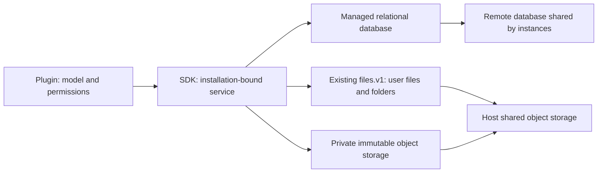

# Extension de scalage horizontal et contrat de stockage géré

0.1.26 utilise un [base de données commerciale de plugin partagé](plugin-database-isolation.fr.md), séparé du noyau, avec des espaces de noms automatiques. Il remplace les bases de données par plugin publiées dans 0.1.25. L’upgrade nécessite une désinstallation normale sur l’hôte précédent et une réinstallation ; les données du plugin ne sont pas migrées.

[中文](plugin-horizontal-scaling.zh-CN.md)

État : contrat approuvé, 2026-10-02 ; hôte source 0.1.10 / SDK 0.1.8, sans implication d’acceptation de publication ou de production. Toute persistance est gérée par le hôte ; les extensions ne distinguent jamais les backends locaux ou distants. Les vérifications de déclaration des packages et le nettoyage de l’environnement ont été mis en œuvre. Les objets SQL gérés ou privés sont maintenant exportés ; les identifiants sont exportés dans la source SDK 0.1.8 ; les espaces de travail restent un déficit. Aucune donnée commerciale ancienne n’a été lue, convertie ou supprimée.

## Mise en œuvre de la révision de stockage (2026-10-03, source SDK 0.1.7)

`@smartdoca/plugin-sdk/storage` actuellement, les exportations sont liées à l’installation `pluginDatabaseToken` (`storage.sql.v1`) et `pluginObjectStorageToken` (`storage.objects.v1`). Le sous-ensemble de la base de données est une version de schéma explicite 1, avec des colonnes text/int32/double, des contraintes primaires/uniques, des opérations de sélection, d’insertion, de mise à jour et de suppression structurées, ainsi que des transactions avec des callbacks exécutés une fois. `pluginCredentialToken` (`storage.credentials.v1`, le source SDK 0.1.8) fournit des identifiants chiffrés uniquement pour le serveur, avec des mises à jour et suppressions vérifiées par révision. Les joints, les clés étrangères, le SQL générique, les upsert et les espaces de travail ne sont pas exportés. Voir [API de credencial et déploiement](plugin-credentials.fr.md). Le SQL professionnel utilise une base de données gérée par un hôte partagé distinct du noyau : un fichier SQLite avec des préfixes de table, ou un compte PostgreSQL avec des schémas de plugins automatiques et un pool de connexions partagé. L’isolation des processus n’est pas encore implémentée. Voir [Configuration de stockage et contrat d’uninstallation avant upgrade](plugin-database-isolation.fr.md).

Les bases de données logiques utilisent `plugin:<pluginId>`, attribution des fichiers utilisateurs et utilisation des objets privés `plugins/<pluginId>`, et les ZIP sont libérés `host/plugin-releases/<sha256>.zip`. Les octets ZIP immuables complets sont stockés dans un fichier de stockage configuré dans l’environnement ; la base de données partagée contient la version 2 du registre, des références d’archivage et des index de hachage de fichiers de confiance. Les accès à la cache vérifiés ne font pas réduire à nouveau les téléchargements de ZIP. Toutes les instances sont redémarrées manuellement. Les paquets de plugins ou formats de stockage non supportés sont rejetés sans conversion automatique ; les données existantes sont conservées. Les mises à jour de la base de données principale se font séparément. [contrat d’amélioration de la base de données](database-schema-evolution.fr.md). Voir [implémentation exacte et limites](unified-storage-implementation.md).

## Frontières et décalages actuels

Avant ce changement, les guides assignaient les bases de données et les catalogues commerciaux aux extensions. Cette directive est retirée ; [guide de développement](plugin-development.fr.md) et [Contrat SDK](plugin-sdk-contract.fr.md) Il est maintenant nécessaire une persistance gérée par l’hôte. Les exportations actuelles de base de données structurées/objets privés sont listées ci-dessus ; `data.v1` et `data.v2` ne sont pas exportées. Existantes `files.v1` Couvre les fichiers utilisateur, les dossiers, les uploads, les bindings, les permissions et les reçus de création durables.

Une base de données distante partagée gérée indépendamment peut être scalée. Les directives précédentes permettaient également un état commercial durable localisé à l’instance, sans contrat multi-instance commun, ce qui laissait chaque auteur s’occuper des drivers, du déploiement, des pools, du backup et de la concurrence. Des noms de dossier identiques ne signifient pas que les données sont partagées. SQLite WAL nécessite que les processus participants soient sur le même hôte et ne fonctionne pas sur les systèmes de fichiers réseau ; un dossier réseau n’est pas une solution de base de données distribuée. Voir [Documentation sur WAL de SQLite](https://www.sqlite.org/wal.html).

Résultats de l’audit avant la modification (les directives d’archivage antérieures sont remplacées ; les acceptations historiques s’appliquent uniquement aux versions originales) :

| Emplacement                                   | Trouver                                                                                                                                        |
| ------------------------------------------ | ---------------------------------------------------------------------------------------------------------------------------------------------- |
| Guide de développement : répertoire de données commerciales | Les bases de données commerciales partagées sont définies comme utilisant la même racine, sans distinction entre disques d’instance, systèmes de fichiers partagés et bases de données distantes. |
| Contrat SDK, sections 7 et 13            | Auparavant, les SQL généraux étaient exclus et les bases de données/dossiers étaient attribués aux plugins ; maintenant, il est nécessaire de disposer d’un stockage géré avec des lacunes d’implémentation explicites.  |
| Déploiement : cycle de vie et conservation        | Il affirme que la suppression ne supprime jamais les données privées, ce qui contredit son introduction, les instructions de développement et la nécessité de nettoyer les installations désinstallées.                       |
| Aperçu de l'architecture                      | Listes publiques `data`, qui n’est pas une exportation actuelle de SDK                                                                                         |
| `apps/server/src/plugins/manager.ts`       | Les vérifications ont continué. `dataVersions`; appels de suppression `uninstall` avant de sauvegarder le registre ; aucune élimination de cluster proposée/nettoyage géré               |
| `packages/plugin-host/src/index.ts`        | Utilise un contexte d’uninstallation temporaire ; l’injection de stockage proposée ne peut pas être supposée.                                                               |

Ces anciennes règles ne constituent pas le nouveau standard de stockage. Les déclarations manquantes ou non conformes échouent sans options de compensation ou adaptateurs ; les paquets originaux et les données commerciales restent inchangés.

## Propriété

Les plugins définissent les tables de business, les index, l'autorisation, l'état des tâches et l'outbox. Le hôte est responsable des connexions, de l'isolation physique, des fichiers durables, des identifiants, des sauvegardes et des limites. Le SDK expose des services spécifiques aux plugins, sans objets de base de données privés du hôte, ni pilotes, ni chaînes de connexion, ni chemins de disque.

Chaque instance dans un déploiement horizontal utilise le même base de données gérée et le stockage d’objets. Le disque local contient les caches d’installation réutilisable, les caches de runtime temporaire et les données de travail temporaires. La panne du stockage partagé est explicitée, sans fallback automatique de persistance locale.

## Gestion de SQL

Le nom de espace logique public est `plugin:<pluginId>`, lié à l’identité installée. Le SDK expose un handle lié à l’injection sans un sélecteur de nom de base de données. Les corps, les paramètres de requête et les contextes créés par le plugin ne peuvent pas sélectionner une autre identité/base de données.

Les noms logiques ne doivent pas être des noms de base de données physiques. Les IDs de plugin peuvent contenir des points ; les identifiants SQL suivent des règles de longueur et de casse. Le serveur conserve une mapping vérifiée contre les collisions et cite les identifiants plutôt que de remplacer les signes de ponctuation ou de raccourcir les IDs. Le serveur serveur choisit les bases de données, les schémas ou les fichiers privés ; les plugins utilisent leurs noms de table logiques.

La validation des noms ne permet pas l’utilisation arbitraire de SQL. Le service géré nécessite des requêtes relationnelles structurées, des définitions de schéma et des transactions compilées par l’hôte, sans connexions brutes, SQL non restreint, noms entre bases de données, fonctions arbitraires ou commandes de pilote. Les privilèges des comptes PostgreSQL et les membres des rôles sont choisis par l’opérateur de déploiement. L’hôte accepte les connexions ordinaires et administratives, y compris les superutilisateurs, sans vérifier les attributs élevés ou l’accès aux tables de base ; les opérateurs peuvent restreindre leurs comptes avec des grants PostgreSQL. La base de données commerciale configurée doit néanmoins rester distincte de la base de données de base. Préfixes, `search_path` Et les expressions régulières seuls ne suffisent pas. Voir [Schémas et privilèges de PostgreSQL](https://www.postgresql.org/docs/current/ddl-schemas.html) et [règles d’identification](https://www.postgresql.org/docs/current/sql-syntax-lexical.html).

Les plugins fonctionnent actuellement dans un processus Node.js fiable. Les limites du SDK ne constituent pas une sandbox pour le code hostile ; pour imposer une isolation du système de fichiers/du environnement contre le code malveillant, il est nécessaire d’imposer une isolation du processus/du système d’exploitation.

Cacher les drivers ne rend pas tous les SQL de PostgreSQL/SQLite/MySQL interchangeables. Le sous-ensemble de la version 1 actuelle est indiqué ci-dessus. Les exigences relationnelles plus larges comprennent des travaux futurs ; les joins, les clés étrangères, le SQL arbitraire et les upsert ne sont pas exportés.

- Définitions de schéma, types de base, clés primaires/uniques/étrangères et index. Initialiser uniquement une nouvelle base de données installée explicitement ; valider les structures existantes sans les modifier silencieusement.
- Sélection/insertion/modification/suppression paramétrée, joins dans la même base de données, pagination, ordre, comptage et upsert avec clé unique. Valider les valeurs et les identifiants séparément.
- Transactions atomiques avec plugin, mises à jour de version conditionnelles et comptes atomiques pour l’idempotence, les revendications et l’outbox. Les gestionnaires conservent la connexion/identité ; les callbacks ne contiennent aucune upload ni effets externes.
- Entiers définis, booléens, horodatage UTC, JSON, null, sémantiques d’ordre et d’erreur ; limites de résultats/requêtes/transactions/connexions et annulation. Les signatures, types et limites exactes nécessitent un contrat d’interface avant la mise en œuvre.
- Erreurs de conflit stable/timeout/cancellation sans fuite de driver. Les commits inconnus ne rejouent pas automatiquement un appel de business ; vérifiez d’abord les enregistrements d’opération durables.

L’hôte peut utiliser PostgreSQL pour plusieurs instances et SQLite uniquement pour les déploiements/tests à instance unique, tous respectant la même série de tests. Ce sont des choix de déploiement de l’hôte ; les plugins ne se branchent jamais sur le driver ou sur le stockage local/remote. D’autres drivers doivent être acceptés avant d’être déclarés supportés. Les fonctionnalités spécifiques aux dialectes nécessitent des extensions explicites, sans dégradation silencieuse ou branches de plugins dépendantes du driver. Les exigences plus larges ne prolongent pas l’ensemble de version-1 exporté ni ne fournissent un adaptateur pour anciennes bases de données.

L'hôte gère les pools, les annulations, la surveillance et les sauvegardes ; les plugins gèrent les modèles, les index et les permissions utilisateur. L’isolation des plugins ne permet pas aux utilisateurs de lire les lignes de données commerciales. La colocation physique ne expose pas les transactions commerciales entre plugins ou avec l’hôte.

## Fichiers et autres fonctionnalités

Interdire la persistance durable des données de l’entreprise en fonction des répertoires du système. Les bases de données, les uploads, les résultats générés de manière permanente, les identifiants, les curseurs et les données en attente de traitement ne peuvent pas être persistés directement dans les répertoires du programme/installation, les répertoires de travail, les répertoires fixes. `/tmp` Cheminés ou répertoires de système auto-sélectionnés. Conserver les fonctionnalités via ces entrées :

| Contenu                                                                                                  | Entrée hôte                                    | Exigences                                                                                                                                                                         |
| -------------------------------------------------------------------------------------------------------- | --------------------------------------------- | ------------------------------------------------------------------------------------------------------------------------------------------------------------------------------------ |
| L'utilisateur téléverse des fichiers, gère les pièces jointes, importe les originaux et exporte les résultats.                              | Existant `files.v1` files/folders             | Identifiants/fichiers stables, autorisation utilisateur, quotas actuels, vérifications d’upload et idempotence durable ; pas de chemins de disque ou de URLs signées permanentes                                          |
| Lignes, configuration, tâches, curseurs d’événements, enregistrements d’opérations et outbox                                          | Service relationnel géré       | Isolation de l’ID du plugin et visibilité partagée                                                                                                                                            |
| Des fichiers privés de grande taille, des intermédiaires durables et des index internes coûteux, inadaptés aux dossiers utilisateur | Stockage d’objets privés immuables           | Identité liée au hôte, stockage partagé, limites, flux, identifiants opaques, commit complet, validation, écritures conditionnelles/empotence et suppression contrôlée ; autorisation commerciale du plugin |
| Tokens OAuth et secrets commerciaux                                                                        | `pluginCredentialToken`, SDK source 0.1.8 | Sans accès distant, persistance chiffrée, suppression et restrictions ; aucune exposition de fichiers de identifiants locaux ou de configuration du navigateur. L’hôte associé l’ID du plugin et la génération de l’installation ; voir [API de credences](plugin-credentials.fr.md)                                 |
| Transcodage/extraction/scanning/fichiers de travail d’commandes externes                                                | Espace de travail temporaire géré par l'hôte ou les flux   | Isolation des plugins/tâches, limites de taille/du temps et nettoyage des plantages ; réessayer les téléchargements/reconstructions plutôt que de nécessiter le chemin d’une instance précédente                                          |
| Caches réutilisables                                                                                       | Mémoire ou cache temporaire approuvée            | La perte n'affecte que les performances ; autorisation actuelle ; ne bloque jamais, idempotence ou état autoritaire                                                                                |
| Données externes du système original                                                                            | APIs distantes autorisées                        | Les intégrations de messagerie, de synchronisation et d’API restent possibles ; les copies durables, les curseurs, les identifiants et les pièces jointes suivent les lignes mentionnées ci-dessus.                                                                     |

Les objets privés sont exportés dans le SDK 0.1.7 ; les services temporary-workspace ne existent pas encore. Ne les réclamez pas. `files.v1` Cela couvre tous les blobs privés ou dissimule les secrets sous des fichiers utilisateur. Les fonctionnalités durables manquantes entraînent une erreur explicite sans possibilité de recours au système de fichiers. Il est préférable d’utiliser des flux ou des bytes lorsque les fichiers ne sont pas nécessaires.

Les objets et les données relationnelles ne partagent pas de transaction. L’intention de persistance, la création d’objets, la confirmation des métadonnées et la restauration par réessai ou compensation sont effectuées ; la collecte de déchets vérifie les références et les intentions inachevées. Les résultats utilisateur sont fournis par une inscription/copie formelle dans le service de fichiers ; les IDs privés ne constituent pas des credences de téléchargement publiques. Les permissions de fichiers existantes, les reçus et les protections des références restent inchangés par la direction proposée.

## Exécution multi-instances

La persistance partagée est nécessaire, mais insuffisante :

- Les demandes peuvent atteindre n’importe quelle instance. Les services de traitement, les enregistrements et les connexions restent isolés ; la mémoire n’est pas une configuration globale ou un état de completion.
- Les contraintes de base de données imposent l’unicité ; les transactions/verses conditionnelles coordonnent les écritures. Les mutex locaux ne sont pas des verrous de cluster.
- Les demandes utilisent des mises à jour atomiques, des baux expirants et des conditions de sécurisation/version. Les tâches longues se renouvellent ; les propriétaires expirés ne peuvent pas faire des commits. Les clés de planning stable éliminent les tâches récurrentes, plutôt que de les traiter individuellement. `ready` le timer crée une autre tâche.
- Les effets externes utilisent des outbox durables, des IDs de fonctionnement stables et une idempotence distante. Des timeout peuvent survenir après l’exécution ; aucune promesse de traitement exact une fois entre services n’est assurée. Les curseurs et le traitement des faits s’accomplissent ensemble, avec des locations qui coordonnent les consommateurs.
- L’initialisation de la nouvelle base de données est coordonnée ; les instances ultérieures valident plutôt que de modifier simultanément les structures. Les différences existantes échouent ; les migrations nécessitent un accord.
- Les callbacks locaux/WebSockets ne constituent pas un bus de cluster. L’invalidation/notification entre instances nécessite un mécanisme de hôte partagé explicitement fourni.
- Les sauvegardes incluent les références de base de données/objets/fichiers utilisateurs ainsi que les identifiants. La restauration vérifie la structure et la complétude des données, et rend visibles les pertes ou les actions de retour en arrière.

Aucune mise à jour en continu avec des SDK/méthodes de schéma mixte n’est promise. Il faut évacuer le trafic ou le travail, changer tout en même temps, valider et reprendre la fonctionnalité. Une coexistence sans coupure de service nécessite un plan de version/migration accepté séparément.

## Rejet de l'installation et données anciennes

Chaque package, y compris les plugins sans état, déclare `doca.storage: "host"` Dans package.json : toute persistance dépend du hôte. Les valeurs manquantes ou autres échouent sans paramètres par défaut, conversion de paquet ou adaptateurs old-directory/driver. Cette vérification est indépendante de la gamme SDK ; les plugins conformes utilisant les capacités publiques actuelles déclarent leurs véritables exigences SDK sans inventer une nouvelle version SDK publiée.

`inspectPlugin` Vérifie le stockage avant la résolution de l’entrée serveur ou l’import du code. Les opérations de packaging, les installations via ZIP/npm/store, la découverte/import des dossiers hors ligne, la restauration du fichier archive partagé et l’utilisation au démarrage utilisent cette vérification. La déclaration constitue l’engagement d’un auteur fiable, et non une sandbox Node.js ou une vérification complète du comportement. Le relabeling d’un plugin de stockage privé est non conforme ; il faut examiner et vérifier indépendamment le véritable comportement.

| Objet                                                            | Décision                                                                                                                            | Sauvegarde, validation et rollback                                                                                                                                                                                                                     |
| ----------------------------------------------------------------- | ----------------------------------------------------------------------------------------------------------------------------------- | --------------------------------------------------------------------------------------------------------------------------------------------------------------------------------------------------------------------------------------------------------- |
| Emballages non conformes ou déclarations manquantes/incorrectes              | Refus de l’installation/chargement sans adaptateurs                                                                                        | Conserver les paquets/archives/données originaux. Reconstruire les paquets conformes sans remplacer les archives immuables de même version.                                                                                                                                   |
| Directories anciens, bases de données externes, identifiants, tâches et outbox | Aucun lecture, import automatique, suppression ou écritures doubles                                                                                 | Ne remplacez jamais un magasin géré vide par des données installées. Acordez séparément les structures, les mappages, les effets en attente, les validations et les retours en arrière de chaque plugin.                                                                                                        |
| Version de registre 1 et ancien niveau de base de l’hôte                          | Rejeté sans lecture/conversion                                                                                                   | Préserver la base de données et les archives originales ; aucune migration ou lecture double.                                                                                                                                                                                       |
| dataVersion                                                       | Match exact ; les mises à jour installées restent inchangées ; les écarts échouent sans paramètres par défaut ou mise à jour/redémarrage implicites                           | Nous avons convenu séparément sur la conversion structure/serveur, mais ne jamais désinstaller/effacer pour éviter la migration ; les anciens marqueurs de correspondance ne facilitent pas la lecture dans le nouveau store.                                                                                                    |
| ID des fichiers existants.v1, liens, ACL et reçus                | Formats/semantiques existants ; aucune conversion de objets privés ni suppression de refactorisation                                                       | Vérifier les références, les téléchargements autorisés, les reçus et l’existence des objets                                                                                                                                                                                  |
| Autres fichiers de répertoires de système anciens                                  | Conserver sans scan/mouvement automatique                                                                                                | D'accord sur les services de destination par plugin et vérifier les comptes, les tailles, les hachages et l'autorisation.                                                                                                                                                                         |
| Disable/shutdown/dispose                                          | Libérer les ressources du processus, préserver la persistance                                                                                     | Drainer/annuler le registre ; l’état autoritaire reste sous gestion de l’hôte                                                                                                                                                                                                  |
| Désinstallation explicite                                                | Déconnexion/revocation externe du plugin via les services publics ; le hôte gère une base de données/objet/credenciales privées gérées et effectue le nettoyage. | L’accomplissement de l’action Hook permet l’élimination du registre, la protection des données privées et la nettoyage durable des bases de données/objets. La décharge des tâches de cluster reste non implémentée. Les échecs partiels ne signifient ni succès ni retour en arrière ; les fichiers utilisateur et les autres références ne sont pas supprimés automatiquement. |

Aucune variable d’environnement `business-data-directory` avec plugin n’est fournie, y compris les exemples pour Compose/environment. `DOCA_PLUGINS_DIR` reste un cache de code/archive réutilisable, jamais une boutique commerciale. La configuration de la base de données/objet locale ou distante appartient entièrement au hôte ; les API du SDK ne l’exposent pas et ne nécessitent pas de décisions concernant le serveur.

Avant toute conversion future, effectuer une sauvegarde et arrêter les écritures anciennes, valider les enregistrements/unicité/règles/hachages/permissions. Avant les nouvelles écritures, revenir à la déploiement originale si nécessaire ; après les nouvelles écritures, le retour aux anciens répertoires entraîne la perte de données et la conversion/restauration inverse nécessite l’accord des parties concernées. Rejeter les anciens paquets ne autorise ni la suppression ni la migration.

## Statut et acceptation

| Capacité                                     | Statut actuel                                                                                        | Requis avant la livraison                                                                                |
| ---------------------------------------------- | ----------------------------------------------------------------------------------------------------- | ------------------------------------------------------------------------------------------------------- |
| Fichiers/fichiers de l'utilisateur/attachements, `files.v1`     | Interface source existante                                                                             | Acceptation de l'intégration multi-instance avec serveur partagé                                                    |
| Stockage relationnel géré à l’échelle des plugins       | SDK 0.1.7 exporte des schémas et transactions structurés                                                                              | Types, sous-ensemble, permissions d’identité/physiques, limites, erreurs, validation et acceptation indépendante du SDK |
| Objets privés                                | SDK 0.1.7 exporte des bytes immuables et limités.                                                             | Streams, permissions, écritures complètes, écritures conditionnelles/idempotence, références, récupération et quotas  |
| Gestion des identifiants de la extension | Source SDK 0.1.8 : CRUD chiffré, métadonnées, CAS de révision et protection contre l’uninstallation | Acceptation de SQLite/PostgreSQL isolés et de SDK indépendant ; voir [API de credences](plugin-credentials.fr.md) |
| Espace de travail temporaire | Non exporté | Cycle de vie, limites et nettoyage |
| Reclamations de cluster                                 | Responsabilité du plugin ; aucune promesse générique de service public                                        | Expiration du bail, rachat, clôture du bien, exécution de copies sur les transactions gérées                               |
| Déclaration de stockage                            | Déclaration obligatoire de l'hôte et rejet préalable à l'importation appliqués pour tous les paquets/dossiers/startup   | Revue de la déclaration et acceptation du chemin de rejet                                                        |
| Formats anciens, vérifications de schéma, désinstallation privée  | L'ancien baseline/registro rejeté ; l'identité du schéma vérifiée ; la génération sécurisée et la nettoyage des objets durables effectué. | Le traitement des tâches commerciales en cluster reste en attente.                                                          |

Utilisez des bases de données isolées, des plugins indépendants et des fichiers de test. Deux instances partagent le stockage de base de données/objets : écriture/chargement sur A, lecture sur B ; détruisez A, reconstruisez sur un disque local vide et lisez à nouveau. Prévoyez les initialisations concurrentes/une unicité, les demandes de relecture, les commits inconnus, les travailleurs supprimés/prise de contrôle, les écritures des travailleurs obsolètes refusées, les échecs de stockage sans fallback local, les refus de base de données/objets entre plugins, la révocation commerciale, le nettoyage temporaire et la sécurisation des anciennes instances contre la ré création/écritures lors de l’uninstallation.

L’interdiction des bases de données durables gérées par soi-même et des répertoires système est effective immédiatement, sans exception pour les capacités manquantes du hôte. Les extensions utilisant les services existants du hôte peuvent s’intégrer ; les fonctionnalités nécessitant un espace de travail temporaire attendent la livraison et l’acceptation plutôt que de fournir un stockage privé. Assurez-vous que les guides, le README du SDK et l’état d’implémentation sont synchronisés ; ne présentez jamais des cibles non exportées en tant qu’API exécutables.
