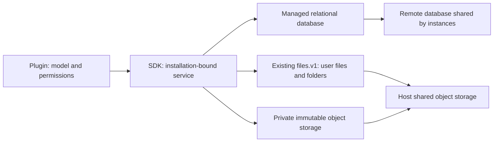

# プラグイン水平スケーリングおよび管理されたストレージ契約

0.1.26はaを使用しています [共有プラグインビジネスデータベース](plugin-database-isolation.ja.md)コアから分離され、自動的な名前空間を持つ。0.1.25でリリースされたプラグインごとのデータベースを代替する。アップグレードには、以前のホストで通常のアンインストールと再インストールが必要であり、プラグインデータは移行されない。

[中文](plugin-horizontal-scaling.zh-CN.md)

状況：承認された契約、2026-10-02。ソースホストは0.1.10 / SDK 0.1.8であり、公開や生産の受け入れは明記されていない。すべての永続化はホストが管理する。プラグインはローカル/リモートバックエンドを区別しない。パッケージ宣言チェックと環境クリーンアップが実装されている。管理されたSQL/privateオブジェクトが今やエクスポートされるようになった。認証情報はSDKソース0.1.8でエクスポートされる。ワークスペースはまだギャップが残る。古いビジネスデータは読み取られたり、変換されたり、削除されたりしていない。

## ストレージリビジョンを実施（2026-10-03、SDKソース0.1.7）

`@smartdoca/plugin-sdk/storage` 現在、インストール向けの輸出を行っている `pluginDatabaseToken` (`storage.sql.v1`) と `pluginObjectStorageToken` (`storage.objects.v1`). データベースサブセットは明示的なスキーマバージョン1であり、text/int32/double列、プライマリ/ユニーク制約、構造化されたselect/insert/update/remove操作、および一度実行されるコールバックを含むトランザクションを備えている。 `pluginCredentialToken` (`storage.credentials.v1`SDKソース0.1.8)は、リビジョンチェックされた更新と削除機能を備えたサーバー専用の暗号化認証情報を提供します。Join、 foreign key、一般的なSQL、upsert、ワークスペースはエクスポートされません。詳細はこちら [認証APIとデプロイ](plugin-credentials.ja.md)ビジネスSQLでは、コアとは別の共有ホスト管理データベースが使用される。テーブルプレフィックスを持つSQLiteファイル、または自動的なプラグインスキーマと共有接続プールを備えたPostgreSQL URL/アカウントである。プロセス分離は実装されていない。詳細は参照。 [ストレージ構成と、アップグレード前にアンインストールする契約](plugin-database-isolation.ja.md).

論理データベースは使用する `plugin:<pluginId>`ユーザーファイルの帰属とプライベートオブジェクトの使用 `plugins/<pluginId>`、そしてZIPファイルを解放する際に使用される `host/plugin-releases/<sha256>.zip`完全に不変のZIPバイトは、環境で設定されたファイルストレージに保存されている。共有データベースにはレジストリバージョン2、アーカイブ参照情報、信頼できるファイルハッシュインデックスが含まれている。検証されたキャッシュヒットは、ZIPファイルを再ダウンロードしない。すべてのインスタンスは手動で再起動される。サポートされていないプラグインパッケージ/ストレージ形式は自動変換なしで拒否され、既存のデータは保持される。コアデータベースのアップグレードは別途行われる。 [データベースアップグレード契約](database-schema-evolution.ja.md)。参照 [正確な実装と制限事項](unified-storage-implementation.md).

## 現在の境界とギャップ

この変更前は、ガイドがデータベースとビジネスディレクトリをプラグインに割り当てていました。そのガイドは取り消されます。 [開発ガイド](plugin-development.ja.md) そして [SDK契約](plugin-sdk-contract.ja.md) 今ではホスト管理による永続性が必要です。現在の構造化されたデータベース/プライベートオブジェクトのエクスポートは上記に記載されています。 `data.v1` そして `data.v2` 輸出されていない。既存のもの `files.v1` ユーザーファイル、フォルダ、アップロード、バインディング、権限、および持続可能な作成記録を保護します。

独立して管理される共有リモートデータベースはスケーリング可能です。以前のガイダンスでは、共通のマルチインスタンス契約なしでインスタンスローカルのダイナミックビジネス状態も許されており、各作者がドライバー、デプロイ、プール、バックアップ、並行性を処理する必要がありました。同じディレクトリ名が共有データを意味するわけではありません。SQLite WALは同じホスト上のプロセスが参加する必要があり、ネットワークファイルシステムでは動作しません。ネットワークディレクトリは分散型データベースソリューションではありません。詳細は参照してください。 [SQLiteのWALに関するドキュメント](https://www.sqlite.org/wal.html).

変更前の監査結果（旧の保存ガイダンスは廃止され、歴史的な受け入れ規定は元のバージョンにのみ適用される）：

| 場所                                   | 探す                                                                                                                                        |
| ------------------------------------------ | ---------------------------------------------------------------------------------------------------------------------------------------------- |
| 開発ガイド：ビジネスデータディレクトリ | 共有ビジネスデータベースは、インスタンスディスク、共有ファイルシステム、リモートデータベースを区別せずに同じルートを使用するものとして説明される |
| SDK契約、第7条および第13条            | 以前は汎用的なSQLを除外し、データベース/ディレクトリをプラグインに割り当てていましたが、現在は明確な実装のギャップがある管理されたストレージが必要です  |
| デプロイ：ライフサイクルと保持        | 削除によってプライベートデータが消えることはないと言われており、これはその説明や開発ガイド、必要なアンインストール後のクリーンアップと矛盾しています。                       |
| 建築概要                      | 公開リスト `data`現在のSDKエクスポートではない                                                                                         |
| `apps/server/src/plugins/manager.ts`       | チェックが続いた `dataVersions`; 削除コール `uninstall` レジストリを保存する前；提案されているクラスターの排出/管理されたクリーンアップはない               |
| `packages/plugin-host/src/index.ts`        | 一時的なアンインストールコンテキストを使用しているため、提案されているストレージインジェクションは仮定できない。                                                               |

これらの古い規則は新しいストレージ標準ではありません。欠落したり準拠しない宣言は、デフォルト/アダプターなしでは失敗します。元のパッケージやビジネスデータは変更されません。

## 所有権

プラグインは、ビジネステーブル、インデックス、認可、ジョブ状態、アウトボックスを定義します。ホストは接続、物理的な隔離、耐久性のあるファイル、認証情報、バックアップ、制限を管理します。SDKは、プラグインスコープのサービスを、プライベートホストデータベースオブジェクト、ドライバー、接続文字列、ディスクパスなしで提供します。

水平展開における各インスタンスは、同じ管理型データベースとオブジェクトストレージを使用する。ローカルディスクには再構築可能なインストールキャッシュ、使い捨ての実行時キャッシュ、および一時的な作業が保存される。共有ストレージの障害は明確であり、自動的なローカル永続化フォールバックは存在しない。

## マネージドSQL

公開の論理名前空間は `plugin:<pluginId>`インストールされたアイデンティティに結びついています。SDKは、データベース名のセレクターなしでインジェクションに結びついたハンドルを提供します。ボディ、クエリパラメータ、プラグインによって作成されたコンテキストは、別のアイデンティティ/データベースを選択することはできません。

論理名は物理的なデータベース名である必要はありません。プラグインIDには点が含まれることがあります。SQL識別子には長さ/大文字小文字の規則があります。ホストは、句読点を置き換えたりIDを切り捨てたりすることなく、衝突チェックされたマッピングと引用符を使って識別子を保持します。サーバーはデータベース、スキーマ、またはプライベートファイルを選択し、プラグインはその論理テーブル名を使用します。

名前の検証は任意のSQLを隔離しません。管理サービスでは、生の接続、制限のないSQL、クロスデータベース名、任意の関数やドライバーコマンドなしで、ホストによって構築された構造化された関係データクエリ、スキーマ定義、トランザクションが必要です。PostgreSQLアカウントの権限やロールのメンバーシップはデプロイオペレーターによって選択されます。ホストは、高レベルの属性やコアテーブルへのアクセスをチェックせずに、スーパユーザーを含む通常のログインや管理者ログインを受け入れます。オペレーターはPostgreSQLのグレードで自分のアカウントを制限することができます。設定されたビジネスデータベースは、依然としてコアから分離されている必要があります。接頭辞は、 `search_path` 単なる正規表現だけでは不十分です。ご覧ください。 [PostgreSQLのスキーマと権限](https://www.postgresql.org/docs/current/ddl-schemas.html) そして [識別子規則](https://www.postgresql.org/docs/current/sql-syntax-lexical.html).

プラグインは現在、信頼できるNode.jsプロセス内で実行されています。SDKの境界は敵対的なコードサンドボックスではありません。悪意のあるコードに対するファイルシステム/環境の隔離を実施するには、プロセス/OSの隔離が必要です。

ドライバーの隠蔽によって、PostgreSQL/SQLite/MySQLのSQLがすべて互換になるわけではありません。現在のバージョン1のサブセットは上記に記載されています。以下のより広範なリレーショナル要件には、将来の作業も含まれますが、join、 foreign key、任意のSQL、upsertはエクスポートされません。

- スキーマ定義、基本型、主キー/ユニークキー/外部キー、インデックス。明示的にインストールされた新しいデータベースのみを初期化し、既存の構造を無意識に変更せずに検証する。
- パラメータ化された選択/挿入/更新/削除、同じデータベースでの結合、ページング、順序付け、カウント、ユニークキーによるUPSERT。値と識別子を別々に検証する。
- 原子的なシングルプラグイントランザクション、条件付きバージョン更新、およびイデミポテンシー、クレーム、アウトボックス用の原子カウンター。接続/アイデンティティの保持が可能。コールバックにはアップロードや外部効果は含まれない。
- 定義された整数、ブール値、UTC時間、JSON、null、順序やエラーセマンティクス；結果/クエリ/トランザクション/接続の制限やキャンセル。正確なシグネチャ/タイプ/制限については、実装前にインターフェース契約が必要です。
- ドライバーの漏れがない安定したコンフリクト/タイムアウト/キャンセルエラー。不明なコミットは自動的にビジネスコールバックを再実行しない；まず耐久性のある操作記録を確認する。

ホストは、同じコントラクトスイートを満たす複数のインスタンスに対してPostgreSQLを、単一インスタンスのデプロイ/テストに対してはSQLiteのみを使用することができる。これらはホストのデプロイ選択肢であり、プラグインはドライバーやローカル/リモートストレージに関連して分岐することはない。他のドライバーはサポートと宣言される前に承認が必要である。方言特有の機能には明示的な拡張が必要であり、無意識の劣化やドライバー依存のプラグイン分岐はない。より広範な要件は、エクスポートされたバージョン1のサブセットを拡大したり、古いデータベースアダプターを提供したりすることはない。

ホストはプール、キャンセル、監視、バックアップを処理します。プラグインはモデル、インデックス、ユーザー権限を処理します。プラグインの隔離により、ユーザーはビジネス行を読む権限はありません。物理的なコロケーションでは、クロスプラグインやホストのビジネストランザクションが公開されません。

## ファイルやその他の機能

システムディレクトリに依存する持続的なビジネス状態を禁止する。データベース、アップロード、永続的に生成された結果、認証情報、カーソル、アウトボックスは、プログラム/インストールディレクトリ、作業ディレクトリ、固定ディレクトリ下に直接保存することはできない。 `/tmp` パスや自己選択されたシステムディレクトリ。これらのエントリを通じて機能を保持します。

| コンテンツ                                                                                                  | ホストエントリ                                    | 要件                                                                                                                                                                         |
| -------------------------------------------------------------------------------------------------------- | --------------------------------------------- | ------------------------------------------------------------------------------------------------------------------------------------------------------------------------------------ |
| ユーザーがアップロードする、管理される添付ファイル、原本のインポート、エクスポートされた成果物の出力                              | 既存の `files.v1` files/folders             | 安定したファイルID/バインド、ユーザー認可、現在のクォータ、アップロードチェック、持続的なイメパトニティ；ディスクパスや永続的な署名されたURLは含まれない                                          |
| 行、設定、ジョブ、イベントカーソル、操作記録、アウトボックス                                          | 管理型リレーショナルサービス       | プラグインIDの隔離と共有可視性                                                                                                                                            |
| プライベートな大容量バイナリファイル、耐久性のある中間ファイル、ユーザーフォルダには適さない高価な内部インデックス | プライベートな不変オブジェクトストレージ           | ホストに結びついたアイデンティティ、共有ストレージ、制限、ストリーム、不透明なID、完全なコミット、検証、条件付き書き込み/イデメポネシー、制御された削除；プラグインのビジネス承認 |
| OAuthトークンとビジネスシークレット                                                                        | `pluginCredentialToken`SDKソース 0.1.8 | サーバー専用、暗号化された永続化、削除および制限；ローカル認証ファイルやブラウザ設定の公開はありません。ホストはプラグインIDとインストール生成を結びつけます。詳細は [認証API](plugin-credentials.ja.md)                                 |
| トランスコード/抽出/スキャン/外部コマンドによる作業ファイル                                                | ホストが管理する一時的なワークスペースまたはストリーム   | プラグイン/タスクの分離、サイズ/時間制限、クラッシュのクリアアップ。以前のインスタンスのパスを要求するのではなく、ダウンロード/再構築の入力を再試行する。                                          |
| 再構築可能なキャッシュ                                                                                       | メモリまたは承認された一時キャッシュ            | 損失はパフォーマンスにのみ影響する；現在の承認状態；ロック、イデミポテンシー、または権威ある状態は一切ない                                                                                |
| 元の外部システムデータ                                                                            | 認可されたリモートAPI                        | メール/同期/APIの統合は依然として可能です。耐久性のあるコピー/カーソル/認証情報/添付ファイルは上記の行に従います。                                                                     |

プライベートオブジェクトはSDK 0.1.7でエクスポートされますが、一時的なワークスペースサービスはまだ存在しません。主張しないでください。 `files.v1` すべてのプライベートブロブをカバーしたり、ユーザーファイルとして偽装したりします。耐久性のある機能が欠けている場合、ファイルシステムの代替手段がないため明確に失敗します。ファイルが不要な場合はストリームやバイトを使用する方が良いです。

オブジェクトや関係データはトランザクションを共有しない。意図を保持し、オブジェクトを書き込み、メタデータを確認し、再試行/補償によって復旧する。ガベージコレクションは参照や未完了の意図をチェックする。正式なファイルサービス登録/コピーによってユーザーの結果を提供する。プライベートIDは公開ダウンロードの認証情報ではない。提案された方向性によって、既存のファイル権限、受領書、参照の保護は変わらない。

## マルチインスタンス実行

共有された永続性は必要だが、不十分である：

- リクエストは任意のインスタンスに到達できます。プロセスサービス/登録/接続は孤立したままであり、メモリはグローバルな設定/完了状態ではありません。
- データベースの制約は一意性を保証する。トランザクションや条件付きバージョンが書き込みを調整する。ローカルミューテックスはクラスターロックではない。
- クレームには原子更新、有効期限のあるリース、フェンシング/バージョン条件が使用される。長期のジョブは更新されるが、有効期限が切れたオーナーはコミットできない。安定したスケジュールキーは、各個別の代わりに定期的なタスクを重複なく処理する。 `ready` タイマーが別のタスクを作成中。
- 外部効果では、持続性のあるアウトボックス、安定した操作ID、遠隔でのインペトリー性が利用される。完了後にタイムアウトが発生する可能性があり、サービス間での「正確に一度のみ」という約束はない。カーソルと事実の処理は一緒に実行され、リース機構が消費者を調整する。
- 新しいデータベースの初期化は調整され、その後のインスタンスは同時に構造を変更するのではなく、検証する。既存の不一致は失敗し、マイグレーションには合意が必要である。
- ローカルコールバック/WebSocketsはクラスターバスではありません。クロスインスタンスの無効化/通知には、明示的に提供される共有ホストメカニズムが必要です。
- バックアップにはデータベース/オブジェクト/ユーザーファイルの参照や認証情報が含まれます。復元時には構造や完全性をチェックし、損失やロールバックが明確に表示されます。

混合型SDK/混合型スキーマのローリングアップグレードは保証されません。トラフィックや作業を停止し、一緒に切り替え、検証して再開します。ゼロダウンタイムでの共存には、別途承認されたバージョン/移行計画が必要です。

## インストール拒否と古いデータ

ステートレスではないプラグインを含むすべてのパッケージは、宣言する `doca.storage: "host"` package.jsonにおいて、すべての永続化はホストに依存します。欠落した値や他の値は、デフォルト、パッケージ変換、古いディレクトリ/ドライバアダプターなしでは機能しません。このチェックはSDKの範囲とは独立しています。現在の公開された機能を利用する適合するプラグインは、新しい公開SDKバージョンを作成することなく、自身の実際のSDK要件を宣言します。

`inspectPlugin` サーバーエントリー解決/コードインポート前にストレージを検証する。パッキング、ZIP/npm/storeのインストール、オフラインディレクトリの発見/インポート、共有アーカイブの復元および起動時の使用にそのチェックが適用される。この宣言は信頼できる著者のコミットメントであり、Node.jsサンドボックスや完全な動作監査ではない。プライベートストアプラグインの再命名は準拠していない。実際の動作についてレビューと独立した受け入れチェックが必要である。

| オブジェクト                                                            | 決定                                                                                                                            | 保存、検証、ロールバック                                                                                                                                                                                                                     |
| ----------------------------------------------------------------- | ----------------------------------------------------------------------------------------------------------------------------------- | --------------------------------------------------------------------------------------------------------------------------------------------------------------------------------------------------------------------------------------------------------- |
| 不適合のパッケージや、記載が欠けている/間違っているもの              | アダプターなしでの拒絶装置の設置/荷重                                                                                        | 元のパッケージ/アーカイブ/データを保持する。不変の同じバージョンのアーカイブを置き換えずに、準拠パッケージを再構築する。                                                                                                                                   |
| 古いディレクトリ、外部データベース、認証情報、ジョブ、アウトボックス | 読み取りなし、自動インポート、削除、デュアル書き込み                                                                                 | インストールされたデータを空のマネージドストアで置き換えることは決して行わないでください。各プラグインの構造/マッピング/保留中の効果/検証/ロールバックについては個別に合意する必要があります。                                                                                                        |
| レジストリバージョン1と古いホストベースライン                          | 読み取り/変換なしで拒否された                                                                                                   | 元のデータベースとアーカイブを保護する。移行や二重読み取りは行わない。                                                                                                                                                                                       |
| データバージョン                                                       | 正確な一致；インストールされたアップグレードは変わらず；一致しない場合はデフォルトや暗黙のアップグレード/ダウングレードが行われない                           | 構造/サーバーへの変換については別途合意し、移行を回避するためにアンインストール/削除は行わないこと。古いマッチングマーカーは新店舗での読み取り性を確保するものではない。                                                                                                    |
| 既存の files.v1 ID、バインディング、ACL、受領書                | 既存のフォーマット/セマンティクス；プライベートオブジェクトの変換やリファクタリングの削除はない                                                       | 参照情報、許可されたダウンロード、領収書、およびオブジェクトの存在を確認する                                                                                                                                                                                  |
| 他の古いシステムディレクトリファイル                                  | 自動スキャン/移動なしで保存する                                                                                                | プラグインごとの目的地サービスに同意し、数、サイズ、ハッシュ、認可を確認する                                                                                                                                                                         |
| Disable/shutdown/dispose                                          | リリースプロセスのリソースを解放し、永続性を保つ                                                                                     | ドレイン/登録解除；権威的な状態はホストが管理する                                                                                                                                                                                                  |
| 明示的なアンインストール                                                | 公共サービスを通じたプラグイン事業の解除/外部からの取り消し；ホストが管理するプライベートデータベース/オブジェクト/認証情報のクリーンアップ | Hookの成功によりレジストリの削除、プライベート生成のフェイシング、持続可能なデータベース/オブジェクトのクリーンアップが行われる。クラスタータスクの消費はまだ実装されていない。部分的な失敗は成功もロールバックも意味しない；ユーザーファイルやその他の参照は自動的に削除されない。 |

Compose/environmentの例を含む、プラグイン business-data-directory環境変数は提供されていません。 `DOCA_PLUGINS_DIR` 再構築可能なコード/アーカイブキャッシュであり、ビジネスストアではない。ローカル/リモートデータベース/オブジェクト構成は完全にホストに属し、SDK APIはそれを公開したり、バックエンドの決定を要求したりしない。

今後の変換前に、バックアップを行い古い書き込みを停止し、記録/一意性/ビジネスルール/ハッシュ/権限を検証する。新しい書き込みを行う前に、必要に応じて元のデプロイ状態に戻る。新しい書き込み後、古いディレクトリに戻すとデータが失われるため、逆変換/復元には同意が必要である。古いパッケージの拒否は、削除や移行を許可するものではない。

## 状況と受け入れ

| 能力                                     | 現在の状況                                                                                        | 配達前に必要                                                                                |
| ---------------------------------------------- | ----------------------------------------------------------------------------------------------------- | ------------------------------------------------------------------------------------------------------- |
| ユーザーファイル/フォルダ/添付ファイル `files.v1`     | 既存のソースインターフェース                                                                             | 共有サーバー多インスタンス統合の受け入れ                                                    |
| 管理されたプラグインスコープ対応の関係データストレージ       | SDK 0.1.7は構造化されたスキーマ/トランザクションをエクスポートする                                                                              | タイプ、サブセット、アイデンティティ/物理的権限、制限、エラー、検証、および独立したSDKの受け入れ |
| プライベートオブジェクト                                | SDK 0.1.7は、制限付き不変バイトをエクスポートする                                                             | ストリーム、権限、完全な書き込み、条件付き書き込み/イデミポネシー、参照、復元、およびクォータ  |
| 管理されたプラグイン認証情報 | SDKソース0.1.8：暗号化されたCRUD、メタデータ、リビジョンCAS、およびアンインストール保護機能 | 孤立したSQLite/PostgreSQLと独立したSDKの受け入れ；参照 [認証API](plugin-credentials.ja.md) |
| 一時的なワークスペース | 輸出されていない | ライフサイクル、制限とクリーンアップ |
| クラスター請求                                 | プラグインの責任；一般的な公共のクレーム・サービス約束はない                                        | リース期間の満了/買収/境界設定/管理された取引における二重実行                               |
| 保管に関する申告                            | パッケージ/ディレクトリ/スタートアップ全体で、必須のホスト宣言と輸入前の拒否が実施される   | 宣言のレビューと拒否・受け入れプロセス                                                        |
| 古いフォーマット、スキーマチェック、プライベートアンインストール  | 古いベースライン/レジストリが拒否されました。スキーマのアイデンティティがチェックされました。生成処理が制御され、持続可能なオブジェクトのクリーンアップが行われました。 | クラスタービジネス・タスクの消費はまだ進行中                                                          |

独立したデータベース、独立したプラグイン、テストファイルを使用する。2つのインスタンスがデータベース/オブジェクトストレージを共有する：Aで書き込み/アップロード、Bで読み取り；Aを破棄し、空のローカルディスクで再構築し、再び読み取りする。同時起動/一意性、リプレイ要求、不明なコミット、作業者を終了/乗り代わり、古いワーカーの書き込みが拒否され、ローカルフォールバックなしのストレージ障害、クロスプラグインデータベース/オブジェクトの拒否、ビジネスの取り消し、一時的なクリーンアップ、およびアンインストール中の再作成/書き込みに対する古いインスタンスのフェンシング。

自己管理型の持続可能なデータベース/システムディレクトリの状態への制限は、ホスト機能が不足しても例外なく即時に有効となります。既存のホストサービスを利用するプラグインは統合可能です。一時的なワークスペースが必要な機能は、プライベートストレージを提供する代わりに提供されることに待機する必要があります。ガイド書、SDK README、実装状況を同期状態に保ち、エクスポートされていないターゲットを実行可能なAPIとして提示しないでください。
