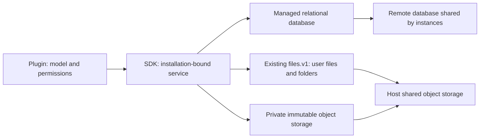

# 플러그인 수평 확장 및 관리된 스토리지 계약

0.1.26는 사용합니다. [공유 플러그인 비즈니스 데이터베이스](plugin-database-isolation.ko.md)핵심 부분과는 분리된 형태로, 자동 네임스페이스가 제공됩니다. 이는 0.1.25에서 출시된 플러그인별 데이터베이스를 대체합니다. 업그레이드를 위해서는 이전 호스트에서 일반적인 제거 후 재설치가 필요하며, 플러그인 데이터는 마이그레이션되지 않습니다.

[中文](plugin-horizontal-scaling.zh-CN.md)

상태: 승인된 계약, 2026-10-02; 소스 호스트 0.1.10 / SDK 0.1.8, 출시/생산 승인은 없음. 모든 지속성은 호스트가 관리함; 플러그인은 로컬/원격 백엔드를 구분하지 않음. 패키지 선언 검사 및 환경 정리가 구현됨. 관리되는 SQL/개인 객체가 이제 내보내짐; 자격 증명은 SDK 소스 0.1.8에 내보내짐; 작업 공간은 여전히 부족함. 기존 비즈니스 데이터는 읽히거나 변환되거나 삭제되지 않았음.

## 저장소 개정 사항 적용 (2026-10-03, SDK 소스 0.1.7)

`@smartdoca/plugin-sdk/storage` 현재 설치용 제품을 수출하고 있습니다. `pluginDatabaseToken` (`storage.sql.v1`) 그리고 `pluginObjectStorageToken` (`storage.objects.v1`). 데이터베이스 하위 집합은 명시적 스키마 버전 1이며, 텍스트/int32/double 컬럼, 기본/유일 제약 조건, 구조화된 select/insert/update/remove 작업 및 한 번 실행되는 콜백을 포함하는 트랜잭션이 있습니다. `pluginCredentialToken` (`storage.credentials.v1`SDK 소스 0.1.8)은 수정된 값이 확인된 갱신 및 삭제 기능을 갖춘 서버 전용 암호화된 자격 증명을 제공합니다. 참여, 외래 키, 일반적인 SQL, 업사이드 및 작업 공간은 내보내지 않습니다. 자세한 내용은 참조하세요. [자격 증명 API 및 배포](plugin-credentials.ko.md)비즈니스 SQL은 핵심 시스템과는 별개의 공유 호스트 관리 데이터베이스를 사용합니다. 테이블 프렌지가 있는 SQLite 파일이거나, 자동 플러그인 스키마와 공유 연결 풀이 있는 PostgreSQL URL/계정이 있습니다. 프로세스 격리 기능은 아직 구현되지 않았습니다. 자세한 내용은 참조하세요. [저장 설정 및 업그레이드 전 삭제 계약](plugin-database-isolation.ko.md).

논리적 데이터베이스는 사용 `plugin:<pluginId>`, 사용자 파일의 소유권 및 개인 객체 사용 `plugins/<pluginId>`, 그리고 ZIP 파일을 풀어주는 것 `host/plugin-releases/<sha256>.zip`완전히 불변인 ZIP 바이트는 환경에 설정된 파일 저장소에 존재합니다. 공유 데이터베이스에는 레지스트리 버전 2, 아카이브 참조 및 신뢰할 수 있는 파일 해시 인덱스가 저장되어 있습니다. 확인된 캐시 히트는 ZIP 파일을 다시 다운로드하지 않습니다. 모든 인스턴스는 수동으로 재시작됩니다. 지원되지 않는 플러그인 패키지/저장 형식은 자동 변환 없이 거부되며, 기존 데이터는 보존됩니다. 핵심 데이터베이스 업그레이드는 별도로 진행됩니다. [데이터베이스 업그레이드 계약](database-schema-evolution.ko.md). 보기 [정확한 구현 및 제한 사항](unified-storage-implementation.md).

## 현재의 경계와 간극

이 변경 이전에는 가이드가 데이터베이스와 비즈니스 디렉토리를 플러그인에 할당했습니다. 그 가이드는 폐지됩니다. [개발 가이드](plugin-development.ko.md) 그리고 [SDK 계약](plugin-sdk-contract.ko.md) 이제 호스트 관리형 지속성이 필요합니다. 현재의 구조화된 데이터베이스/프라이빗 객체 내보내기가 위에 나와 있습니다. `data.v1` 그리고 `data.v2` 수출되지 않습니다. 기존에 있습니다. `files.v1` 사용자 파일, 폴더, 업로드 파일, 바인딩, 권한 및 지속적인 생성 증빙 문서를 포함합니다.

독립적으로 관리되는 공유 원격 데이터베이스는 확장이 가능합니다. 이전 지침에서는 공통 다중 인스턴스 계약 없이 인스턴스 로컬의 견고한 비즈니스 상태를 허용했으며, 각 작성자는 드라이버, 배포, 풀, 백업 및 동시성 처리를 담당해야 했습니다. 동일한 디렉터리 이름이 공유 데이터를 의미하지는 않습니다. SQLite WAL은 동일한 호스트에서 참여하는 프로세스가 필요하며 네트워크 파일 시스템에서는 작동하지 않습니다; 네트워크 디렉터리는 분산 데이터베이스 솔루션이 아닙니다. 참조하십시오. [SQLite의 WAL 문서화](https://www.sqlite.org/wal.html).

변경 전 감사 결과 (구 저장 지침이 폐지되었으며, 과거 승인은 원본 버전에만 적용됨):

| 위치                                   | 찾기                                                                                                                                        |
| ------------------------------------------ | ---------------------------------------------------------------------------------------------------------------------------------------------- |
| 개발 가이드: 비즈니스 데이터 디렉터리 | 공유 비즈니스 데이터베이스는 동일한 루트를 사용한다고 설명되며, 인스턴스 디스크, 공유 파일 시스템, 원격 데이터베이스를 구분하지 않습니다. |
| SDK 계약, 7조 및 13조            | 이전에는 일반적인 SQL과 데이터베이스/디렉터리를 플러그인으로 분류했지만, 이제는 명시적인 구현 공백이 있는 관리되는 저장소가 필요합니다.  |
| 배포: 생명주기 및 보관        | 삭제 기능이 개인 데이터를 절대 삭제하지 않는다고 하는데, 이는 설명서와 개발 가이드, 그리고 필요한 제거 작업에 반하는 것입니다.                       |
| 건축 개요                      | 공개 목록 `data`현재 사용 중인 SDK 출력물이 아닙니다.                                                                                         |
| `apps/server/src/plugins/manager.ts`       | 체크가 계속되었습니다. `dataVersions`; 제거 호출 `uninstall` 레지스트리를 저장하기 전; 제안된 클러스터 드레인/관리된 정리 작업 없음               |
| `packages/plugin-host/src/index.ts`        | 임시 제거 컨텍스트를 사용합니다; 제안된 저장소 주입은 가정할 수 없습니다.                                                               |

이러한 오래된 규칙들은 새로운 저장 표준이 아닙니다. 누락되거나 부적합한 선언은 기본값/ 어댑터 없이 실패하며, 원본 패키지와 비즈니스 데이터는 변경되지 않습니다.

## 소유권

플러그인은 비즈니스 테이블, 인덱스, 권한 설정, 작업 상태 및 아웃박스를 정의합니다. 호스트는 연결, 물리적 격리, 내구성 있는 파일, 자격 증명, 백업 및 제한 사항을 담당합니다. SDK는 개인적인 호스트 데이터베이스 객체, 드라이버, 연결 문자열 또는 디스크 경로 없이 플러그인 범위의 서비스를 제공합니다.

수평 배포의 각 인스턴스는 동일한 관리형 데이터베이스와 객체 스토리지를 사용합니다. 로컬 디스크에는 재구축 가능한 설치 캐시, 일회용 런타임 캐시 및 임시 작업이 저장됩니다. 공유 스토리지 장애는 명시적으로 처리되며, 자동적인 로컬 지속성 대체가 없습니다.

## 관리형 SQL

공공 논리적 네임스페이스는 `plugin:<pluginId>`설치된 ID와 연결된 상태입니다. SDK는 데이터베이스 이름 선택자가 없는 인젝션-연결된 핸들을 제공합니다. 바디, 쿼리 매개변수 및 플러그인으로 생성된 컨텍스트는 다른 ID/데이터베이스를 선택할 수 없습니다.

논리적 이름은 실제 데이터베이스 이름이 될 필요가 없습니다. 플러그인 ID에는 점이 포함될 수 있으며, SQL 식별자에는 길이/대문자 규칙이 있습니다. 호스트는 문장 부호를 대체하거나 ID를 잘라내기보다는 충돌 검사된 매핑과 인용문을 사용하여 식별자를 저장합니다. 서버는 데이터베이스, 스키마 또는 개인 파일을 선택하며, 플러그인은 그 논리적 테이블 이름을 사용합니다.

이름 검증은 임의의 SQL을 격리하지 않습니다. 관리되는 서비스는 원시 연결, 제한되지 않은 SQL, 교차 데이터베이스 이름, 임의의 함수 또는 드라이버 명령 없이 호스트가 작성한 구조화된 관계형 쿼리, 스키마 정의 및 트랜잭션을 요구합니다. PostgreSQL 계정 권한과 역할 멤버십은 배포 운영자가 선택합니다. 호스트는 슈퍼유저를 포함한 일반 및 관리자 로그인을 받아들이며, 상위 속성이나 핵심 테이블에 대한 접근을 확인하지 않습니다; 운영자는 PostgreSQL 보조를 통해 자신의 계정을 제한할 수 있습니다. 설정된 비즈니스 데이터베이스는 여전히 핵심 데이터베이스와 분리되어야 합니다. 접두사, `search_path` 단순한 정규 표현식만으로는 부족합니다. 참조하세요. [PostgreSQL 스키마와 권한](https://www.postgresql.org/docs/current/ddl-schemas.html) 그리고 [식별자 규칙](https://www.postgresql.org/docs/current/sql-syntax-lexical.html).

플러그인은 현재 신뢰할 수 있는 Node.js 프로세스에서 실행됩니다. SDK 경계는 적대적인 코드 샌드박스가 아닙니다. 악성 코드에 대응하기 위해 파일 시스템/환경 격리를 강제하기 위해서는 프로세스/OS 격리가 필요합니다.

드라이버를 숨기는 것만으로는 PostgreSQL/SQLite/MySQL SQL을 모두 서로 교환할 수 없다. 현재 버전-1 하위 집합이 위에 나와 있다. 다음과 같은 더 넓은 관계형 요구 사항들은 향후 작업에 포함된다; join, 외래 키, 임의의 SQL, upsert는 전송되지 않는다.

- 스키마 정의, 기본 타입, 기본/유일/외래 키 및 인덱스. 명시적으로 설치된 새로운 데이터베이스만 초기화하세요; 기존 구조는 무언의 변경 없이 검증하세요.
- 파라미터화된 선택/삽입/업데이트/삭제, 동일 데이터베이스 간 조인, 페이징, 정렬, 카운트 및 고유 키 업사이드. 값과 식별자를 각각 검증해야 합니다.
- 원자적 단일 플러그인 트랜잭션, 조건부 버전 업데이트 및 idempotency, 클레임, outbox를 위한 원자적 카운터. 연결/식별 정보는 유지되며, 콜백에는 업로드나 외부 효과가 포함되지 않습니다.
- 정의된 정수, 부울, UTC 시간, JSON, null, 순서 및 오류 의미론; 결과/쿼리/거래/연결 제한 및 취소. 정확한 서명/타입/제한은 구현 전에 인터페이스 계약이 필요합니다.
- 드라이버 누출 없이 안정적인 충돌/타임아웃/취소 오류가 발생함. 알려지지 않은 커밋은 자동으로 비즈니스 콜백을 재전송하지 않으며, 먼저 견고한 운영 기록을 확인해야 함.

호스트는 여러 인스턴스에 대해 PostgreSQL을, 단일 인스턴스 배포/테스트에 대해서는 SQLite만을 사용할 수 있으며, 둘 다 동일한 컨트랙트 스위트를 통과합니다. 이는 호스트 배포 선택 사항이며, 플러그인은 드라이버나 로컬/원격 스토리지에 따라 분기되지 않습니다. 다른 드라이버는 지원되었다고 선언되기 전에 승인이 필요합니다. 방언별 기능은 무음 감소나 드라이버 의존성 플러그인 분기 없이 명시적인 확장이 필요합니다. 더 넓은 요구 사항은 내보내는 버전-1 부분 집합을 확장하지 않으며, 오래된 데이터베이스 어댑터를 제공하지 않습니다.

호스트는 풀, 취소, 모니터링 및 백업을 처리하고, 플러그인은 모델, 인덱스 및 사용자 권한을 처리합니다. 플러그인 격리는 사용자에게 비즈니스 행을 읽을 권한을 부여하지 않습니다. 물리적 콜로케이션은 크로스플러그인 또는 호스트의 비즈니스 트랜잭션을 노출하지 않습니다.

## 파일 및 기타 기능

시스템 디렉터리에 따라 지속적인 비즈니스 상태를 허용하지 마십시오. 데이터베이스, 업로드된 파일, 영구적으로 생성된 결과, 자격 증명, 커서, 아웃박스는 프로그램/설치 디렉터리, 작업 디렉터리, 고정된 위치에 직접 저장될 수 없습니다. `/tmp` 경로나 자체 선택된 시스템 디렉터리들입니다. 이러한 항목들을 통해 기능을 보존하세요.

| 콘텐츠                                                                                                  | 호스트 항목                                    | 요구사항                                                                                                                                                                         |
| -------------------------------------------------------------------------------------------------------- | --------------------------------------------- | ------------------------------------------------------------------------------------------------------------------------------------------------------------------------------------ |
| 사용자가 업로드하는 파일, 관리되는 첨부파일, 원본 파일의 가져오기 및 결과물의 내보내기                              | 기존에 존재하는 `files.v1` files/folders             | 안정적인 파일 ID/바인딩, 사용자 인증, 현재 할당량, 업로드 검사 및 지속적인 중복 방지 기능; 디스크 경로나 영구적인 서명된 URL은 없음                                          |
| 행, 설정, 작업, 이벤트 커서, 작업 기록 및 아웃박스                                          | 관리형 관계형 서비스       | 플러그인-ID 격리 및 공유 가시성                                                                                                                                            |
| 개인용 대용량 바이너리 파일, 내구성이 좋은 중간 파일, 사용자 폴더에 적합하지 않은 비싼 내부 인덱스 | 개인적이고 불변한 객체 저장소           | 호스트에 종속된 정체성, 공유 스토리지, 제한, 스트림, 불투명한 ID, 완전한 커밋, 검증, 조건부 쓰기/임페포털성 및 제어된 삭제; 플러그인 비즈니스 권한 부여 |
| OAuth 토큰과 비즈니스 기밀                                                                        | `pluginCredentialToken`, SDK 소스 0.1.8 | 서버 전용, 암호화된 지속성, 삭제 및 제한 기능; 로컬 자격 증명 파일이나 브라우저 설정 노출이 없습니다. 호스트는 플러그인 ID와 설치 생성 정보를 결합합니다; 참조하세요. [자격증 API](plugin-credentials.ko.md)                                 |
| 트랜스코딩/추출/스캔/외부 명령어 작업 파일                                                | 호스트가 관리하는 임시 작업 공간 또는 스트림   | 플러그인/작업 격리, 크기/시간 제한 및 크래시 정리; 이전 인스턴스의 경로를 요구하는 대신 다운로드/재구축 입력을 다시 시도함                                          |
| 재구축 가능한 캐시                                                                                       | 메모리 또는 승인된 임시 캐시            | 손실은 성능에만 영향을 미치며, 현재의 승인 방식으로 처리됩니다. 절대 잠금, 중복 작업 방지 또는 권위 있는 상태는 없습니다.                                                                                |
| 원본 외부 시스템 데이터                                                                            | 승인된 원격 API                        | 메일/동기화/API 통합은 여전히 가능합니다; 안정적인 사본/커서/인증서/첨부파일은 위의 행들에 따라 처리됩니다.                                                                     |

개인 객체는 SDK 0.1.7에서 내보내집니다; 임시 작업 공간 서비스는 아직 존재하지 않습니다. 주장하지 마세요. `files.v1` 모든 개인용 블로브를 커버하거나 사용자 파일로 위장할 수 있습니다. 내구성 기능이 없으면 파일 시스템 대체가 없어 명확하게 실패합니다. 파일이 불필요한 경우 스트림/바이트를 사용하는 것이 좋습니다.

객체와 관계형 데이터는 트랜잭션을 공유하지 않습니다. 의도를 유지하고 객체를 저장하며 메타데이터를 확인하고 재시도/보상 방식으로 복구합니다. 가비지 컬렉션은 참조와 미완료된 의도를 확인합니다. 공식 파일 서비스 등록/복사을 통해 사용자 결과를 제공합니다. 개인용 ID는 공개 다운로드 자격 정보가 아닙니다. 기존 파일 권한, 영수증 및 참조 보호 방식은 제안된 방향에 따라 변경되지 않습니다.

## 멀티인스턴스 실행

공유된 지속성은 필요하지만 충분하지 않다:

- 요청은 어떤 인스턴스에도 도달할 수 있습니다. 프로세스 서비스/등록/연결은 격리된 상태로 유지되며, 메모리는 전역적인 설정/완료 상태가 아닙니다.
- 데이터베이스 제약 조건은 고유성을 보장합니다; 트랜잭션/조건부 버전이 작성 작업을 조율합니다. 로컬 멤버십은 클러스터 잠금이 아닙니다.
- 클레임은 원자적 업데이트, 만료되는 임대 계약, 펜싱/버전 조건을 사용합니다. 긴 작업은 갱신되며, 만료된 소유자는 커밋할 수 없습니다. 안정적인 스케줄 키는 반복되는 작업을 중복되지 않게 처리합니다. `ready` 타이머가 또 다른 작업을 생성하고 있습니다.
- 외부 효과는 지속적인 아웃박스, 안정적인 운영 ID, 원격 중복 제거 기능을 사용합니다. 완료 후 시간 초과가 발생할 수 있으며, 서비스 간 정확히 한 번만 처리하는 약속은 없습니다. 커서와 사실 처리 작업은 함께 수행되며, 임대 계약을 통해 사용자를 조정합니다.
- 새로운 데이터베이스 초기화는 조율됩니다; 이후의 인스턴스들은 동시에 구조를 변경하는 대신 검증합니다. 기존의 불일치는 실패하며, 마이그레이션은 합의가 필요합니다.
- 로컬 콜백/WebSockets는 클러스터 버스가 아닙니다. 인스턴스 간의 무효화/알림은 명시적으로 제공된 공유 호스트 메커니즘이 필요합니다.
- 백업에는 데이터베이스/객체/사용자 파일 참조와 자격 정보가 포함됩니다. 복구 과정에서는 구조와 완전성을 확인하고 손실 또는 롤백 현상을 표시합니다.

혼합 SDK/혼합 스키마의 롤링 업그레이드는 제공되지 않습니다. 트래픽/작업을 중단하고 함께 전환한 후 검증하고 다시 시작해야 합니다. 무정지 환경에서의 공존을 위해서는 별도로 승인된 버전/마이그레이션 계획이 필요합니다.

## 설치 거부 및 오래된 데이터

상태가 없는 플러그인을 포함한 모든 패키지는 선언합니다. `doca.storage: "host"` package.json에서: 모든 지속성은 호스트에 의존합니다. 누락된 값이나 다른 값은 기본값, 패키지 변환 또는 오래된 디렉터리/드라이버 어댑터 없이는 작동하지 않습니다. 이 검사는 SDK 범위와 무관합니다; 현재 공개된 기능을 사용하는 적합한 플러그인은 새로운 발표된 SDK 버전을 만들지 않고 실제 SDK 요구사항을 명시합니다.

`inspectPlugin` 서버 등록 해결/코드 임포트 전에 저장소를 검증합니다. 패키징, ZIP/npm/store 설치, 오프라인 디렉터리 발견/임포트, shared-archive 복원 및 시작 사용에 이러한 검사를 적용합니다. 이 선언은 신뢰할 수 있는 작성자의 약속이며, Node.js 샌드박스나 완전한 동작 감사가 아닙니다. 개인 저장소 플러그인의 재라벨링은 부적합하며, 실제 동작에 대한 검토 및 독립적 승인 검사가 필요합니다.

| 객체                                                            | 결정                                                                                                                            | 보존, 검증 및 롤백                                                                                                                                                                                                                     |
| ----------------------------------------------------------------- | ----------------------------------------------------------------------------------------------------------------------------------- | --------------------------------------------------------------------------------------------------------------------------------------------------------------------------------------------------------------------------------------------------------- |
| 부적합한 패키지 또는 누락된/잘못된 선언              | 어댑터 없이 설치/로드를 거부함                                                                                        | 원본 패키지/아카이브/데이터를 보존합니다. 불변인 동일 버전의 아카이브를 대체하지 않고 준수하는 패키지를 재구축합니다.                                                                                                                                   |
| 오래된 디렉터리, 외부 데이터베이스, 자격증, 작업 및 아웃박스 | 읽기 없음, 자동 임포트, 삭제 또는 이중 쓰기 없음                                                                                 | 설치된 데이터를 빈 관리 스토어로 대체해서는 안 됩니다. 각 플러그인의 구조/맵핑/예상 효과/유효성 검사/롤백에 대해 별도로 합의해야 합니다.                                                                                                        |
| 리거티브 버전 1과 오래된 호스트 기준                          | 읽기/변환 없이 거부됨                                                                                                   | 원본 데이터베이스와 아카이브를 보존하세요. 마이그레이션이나 이중 읽기는 허용되지 않습니다.                                                                                                                                                                                       |
| 데이터버전                                                       | 정확한 일치; 설치된 업그레이드는 변함없음; 불일치는 기본값이나 암시적 업그레이드/다운그레이드 없이 실패함                           | 구조/서버 변환에 대해 별도로 합의하되, 마이그레이션을 피하기 위해 언제든지 제거/삭제하지 마세요. 기존 일치 마커는 새로운 스토어의 읽기성을 보장하지 않습니다.                                                                                                    |
| 기존 파일.v1 ID, 바인딩, ACL 및 영수증                | 기존 형식/의미론; 개인적 객체 변환이나 리팩토링 삭제 없음                                                       | 참고문헌, 허가된 다운로드, 영수증 및 객체 존재 여부를 확인합니다.                                                                                                                                                                                  |
| 기타 오래된 시스템 디렉터리 파일들                                  | 자동 스캔/이동 없이 보관하기                                                                                                | 플러그인별 목적지 서비스에 동의하고, 개수/크기/해시/인증을 확인하세요.                                                                                                                                                                         |
| Disable/shutdown/dispose                                          | 리스유 프로세스 리소스를 해제하고, 지속성을 유지하세요.                                                                                     | 드레인/등록 해제; 권한 있는 상태는 호스트가 관리함                                                                                                                                                                                                  |
| 명시적 제거                                                | 공공 서비스를 통한 플러그인 사업의 해지/외부 취소; 호스트가 관리하는 개인 데이터베이스/객체/자격증명의 정리 | Hook 성공 시 레지스트리 제거, 개인용 생성물 격리 및 내구성 있는 데이터베이스/객체 정리가 이루어집니다. 클러스터 작업의 소진은 아직 구현되지 않았습니다. 부분적인 실패는 성공이나 롤백을 의미하지 않으며, 사용자 파일 및 기타 참조는 자동으로 삭제되지 않습니다. |

플러그인 business-data-directory 환경 변수는 제공되지 않으며, Compose/environment 예시도 포함되어 있지 않습니다. `DOCA_PLUGINS_DIR` 재구축 가능한 코드/아카이브 캐시로 남아 있으며, 결코 비즈니스 저장소는 아닙니다. 로컬/원격 데이터베이스/객체 설정은 전적으로 호스트에 속하며, SDK API는 이를 노출하지 않거나 백엔드 결정이 필요하지 않습니다.

향후 변환이 이루어지기 전에 백업을 수행하고 기존의 쓰기 작업을 중단하세요. 레코드/유일성/비즈니스 규칙/해시/권한을 검증하세요. 새로운 쓰기 작업을 시작하기 전에 필요하다면 원래의 배포 방식으로 돌아가세요. 새로운 쓰기 작업 후에 기존 디렉터리로 돌아가면 데이터가 손실되며, 역변환/복구는 동의가 필요합니다. 기존 패키지를 거부하는 것은 삭제나 마이그레이션을 허가하는 것이 아닙니다.

## 상태와 수용

| 능력                                     | 현재 상태                                                                                        | 배송 전에 필요                                                                                |
| ---------------------------------------------- | ----------------------------------------------------------------------------------------------------- | ------------------------------------------------------------------------------------------------------- |
| 사용자 파일/폴더/첨부파일 `files.v1`     | 기존 소스 인터페이스                                                                             | 공유 서버 멀티인스턴스 통합 수용                                                    |
| 관리되는 플러그인 범위에 속한 관계형 저장소       | SDK 0.1.7은 구조화된 스키마/거래를 내보냅니다.                                                                              | 유형, 하위 집합, 식별/물리적 권한, 제한 사항, 오류, 유효성 검사 및 독립적인 SDK 수용 |
| 프라이빗 객체                                | SDK 0.1.7은 제한된 불변 바이트를 내보냅니다.                                                             | 스트림, 권한, 완전한 쓰기, 조건부 쓰기/중복 방지, 참조, 복구 및 할당량  |
| 관리되는 플러그인 자격 증명 | SDK 소스 0.1.8: 암호화된 CRUD, 메타데이터, 수정 번호 CAS 및 제거 보호 기능 | 독립적인 SQLite/PostgreSQL 및 독립적인 SDK 지원; 참조 [자격증 API](plugin-credentials.ko.md) |
| 임시 작업 공간 | 수출되지 않았음 | 생명주기, 제한 및 정리 |
| 클러스터 청구                                 | 플러그인 책임; 일반적인 공공 서비스 약속이 없습니다.                                        | 임대기간 만료/인수/경계 설정/관리된 거래에 대한 복제 실행                               |
| 저장 동의서                            | 모든 패키지/디렉터리/스타트업에 강제적인 호스트 선언 및 수입 전 거부 절차가 적용됨   | 선언 검토 및 거부-경로 수락                                                        |
| 구형 형식, 스키마 검사, 개인용 제거  | 구식 기준/레지스트리가 거부됨; 스키마 식별 정보가 확인됨; 생성 과정이 차단되었으며 지속 가능한 객체 정리가 이루어짐 | 클러스터 비즈니스-업무 소진 문제는 아직 처리되지 않았습니다.                                                          |

독립된 데이터베이스, 별도의 플러그인 및 테스트 파일을 사용하세요. 두 인스턴스가 데이터베이스/객체 저장소를 공유합니다: A에서 쓰기/업로드, B에서 읽기; A를 삭제하고 빈 로컬 디스크에 다시 구축하여 다시 읽습니다. 동시 초기화/유일성, 요청 재시뮬레이션, 알 수 없는 커밋, 작업자 종료/점유, 유효하지 않은 작업자 쓰기 거부, 로컬 대체 없이 저장소 장애, 크로스-플러그인 데이터베이스/객체 거부, 비즈니스 취소, 임시 정리 및 제거 과정 중 오래된 인스턴스의 재생성/쓰기 방지.

자체 관리형 내구성 있는 데이터베이스/시스템 디렉터리 상태에 대한 금지가 현재부터 시행되며, 호스트 기능이 부족한 경우는 예외 없이 적용됩니다. 기존 호스트 서비스를 사용하는 플러그인은 통합될 수 있지만, 일시적인 작업 공간이 필요한 기능은 개인 저장소를 제공하는 대신 배포 및 승인을 기다려야 합니다. 가이드, SDK README, 구현 상태를 동기화하되, 내보내지지 않은 목표를 실행 가능한 API로 제시하지 마십시오.
