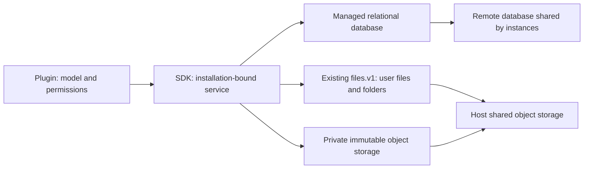

# Плагин горизонтального масштабирования и контракт на управление хранилищем

0.1.26 использует [Общая бизнес-база данных плагинов](plugin-database-isolation.ru.md)Отдельно от ядра, с автоматическими пространствами имен. Он заменяет базы данных для каждого плагина, выпущенные в версии 0.1.25. Для обновления необходимо обычно удалить приложение на предыдущем хосте и переустановить; данные плагинов не мигрируют.

[中文](plugin-horizontal-scaling.zh-CN.md)

Статус: утвержденный контракт, 2026-10-02; источник хост 0.1.10 / SDK 0.1.8, без предположения о принятии публикации/производства. Вся поддержка сохранения данных осуществляется на хосте; плагины никогда не различают локальные/дистанционные серверы. Реализованы проверки декларации пакета и очистка окружения. Управляемые SQL/приватные объекты теперь экспортируются; учетные данные экспортируются в источник SDK 0.1.8; рабочие пространства остаются неразрешенными. Ни старые бизнес-данные не читались, не конвертировались и не удалялись.

## Внедрена ревизия хранилища (2026-10-03, источник SDK 0.1.7)

`@smartdoca/plugin-sdk/storage` Теперь экспортируются устройства для установки `pluginDatabaseToken` (`storage.sql.v1`) и `pluginObjectStorageToken` (`storage.objects.v1`). Подмножество базы данных представляет собой версию схемы 1, с колонками text/int32/double, первичными/уникальными ограничениями, структурированными операциями select/insert/update/remove, а также транзакциями с выполнением кallback-функций один раз. `pluginCredentialToken` (`storage.credentials.v1`, источник SDK 0.1.8) предоставляет зашифрованные учетные данные только для сервера с проверкой ревизии при обновлении и удалении. Соединения, иностранные ключи, общий SQL, upsert и рабочие пространства не экспортируются. Смотрите [API квалификации и развёртывание](plugin-credentials.ru.md)Бизнес-SQL использует один общий базу данных, управляемый хостом, отдельный от основного: один файл SQLite с префиксами таблиц, или один URL/аккаунт PostgreSQL с автоматическими схемами плагинов и общим пулом подключений. Изоляция процессов остается не реализованной. См. также [Настройка хранения и условия удаления перед обновлением](plugin-database-isolation.ru.md).

Логические базы данных используют `plugin:<pluginId>`Принадлежность пользовательских файлов и использование приватных объектов `plugins/<pluginId>`и выпуск ZIP-файлов `host/plugin-releases/<sha256>.zip`Полные неизменяемые байты ZIP хранятся в файловом хранилище, настроенном в среде; общая база данных содержит реестр версии 2, ссылки на архивы и индексы доверенных хешей файлов. Проверенные попадания в кэш не делают повторного скачивания ZIP-файлов. Все экземпляры перезапускаются вручную. Не поддерживаемые пакеты/форматы хранения плагинов отклоняются без автоматической конвертации; существующие данные сохраняются. Обновления основной базы данных производятся отдельно. [Контракт на обновление базы данных](database-schema-evolution.ru.md). Смотрите [точная реализация и ограничения](unified-storage-implementation.md).

## Текущие границы и пробелы

До этого изменения руководства присваивали базы данных и бизнес-каталоги плагинам. Это руководство отменяется; [руководство по разработке](plugin-development.ru.md) и [Контракт SDK](plugin-sdk-contract.ru.md) Теперь требуется устройство управления постоянной работой. Ниже перечислены текущие структурированные базы данных/приватные объекты; `data.v1` и `data.v2` не экспортируются. Существующие `files.v1` Обслуживает пользовательские файлы, папки, загрузки, связи, права доступа и документы о долговременной создании.

Отдельно управляемая общая удаленная база данных может масштабироваться. Ранее предлагавшиеся рекомендации также разрешали использование долговечного бизнес-стата локально для каждой инстанции без общого многоинстанционного контракта, что требовало от каждого автора самостоятельного управления драйверами, развертыванием, пулами, резервным копированием и конкуренцией. Одинаковые имена директорий не означают совместное использование данных. SQLite WAL требует участия процессов на одном хосте и не работает с сетевыми файловыми системами; сетевая директория не является решением для распределенной базы данных. См. также [Документация SQLite о WAL](https://www.sqlite.org/wal.html).

Наблюдения перед изменением (старые рекомендации по хранению не действуют; исторические правила применяются только к их первоначальным версиям):

| Местоположение                                   | Нахождение                                                                                                                                        |
| ------------------------------------------ | ---------------------------------------------------------------------------------------------------------------------------------------------- |
| Руководство по разработке: директория бизнес-данных | Общие бизнес-базы данных описываются как использующие один и тот же корень, без различия между дисками инстансов, общими файловыми системами и удаленными базами данных |
| Соглашение SDK, разделы 7 и 13            | Раньше генерический SQL и базы данных/директории назначались плагинам; теперь требуется управляемое хранилище с явными пробелами в реализации  |
| Развертывание: жизненный цикл и хранение        | Говорят, что удаление никогда не удаляет личные данные, что противоречит его описанию, руководству по разработке и требованиям к очистке после удаления.                       |
| Обзор архитектуры                      | Список общественных объектов `data`, что не является текущим экспортом SDK                                                                                         |
| `apps/server/src/plugins/manager.ts`       | Проверки продолжались `dataVersions`; вызовы удаления `uninstall` Перед сохранением реестра; нет предложения по удалению кластера/управленческой очистке               |
| `packages/plugin-host/src/index.ts`        | Используется временный контекст удаления; вмешательство в хранение не может быть предположено                                                               |

Эти старые правила не являются новым стандартом хранения. Отсутствующие или несоответствующие объявления не работают без заменителей/адаптеров; оригинальные пакеты и бизнес-данные остаются неизменными.

## Владение

Плагины определяют бизнес-таблицы, индексы, авторизацию, состояние задач и процесс выгрузки. Хост управляет соединениями, физической изоляцией, долговечными файлами, учетными данными, резервными копиями и ограничениями. SDK предоставляет услуги, ограниченные плагинами, без приватных объектов базы данных хоста, драйверов, строк соединений или путей к диску.

Каждый экземпляр в горизонтальной развертывании использует один и тот же управляемый база данных и объектный хранилище. Локальный диск хранит кэшированные установки, кэшированные данные временного выполнения и временные данные работы. Падение общедоступного хранилища является явным, без автоматического fallback-режима локальной сохранения.

## Управляемый SQL

Публичный логический пространство имен `plugin:<pluginId>`, связанный с установленным идентификатором. SDK предоставляет управляющее обращение, связанное с инъекцией, без селектора имени базы данных. Тела, параметры запроса и контексты, созданные плагином, не могут выбрать другой идентификатор/базу данных.

Логические имена не обязаны соответствовать физическим именам баз данных. ID плагинов могут содержать точки; идентификаторы SQL имеют правила длины и регистра. Хост сохраняет карту с проверкой на коллизии и заключает идентификаторы в кавычки, вместо того чтобы заменять знаки препинания или обрезать ID. Сервер выбирает базы данных, схемы или приватные файлы; плагины используют их логические имена таблиц.

Проверка имени не позволяет использовать произвольный SQL. Управляемая служба требует структурированных отношений-запросов, определений схем и транзакций, составленных хостом, без чистого подключения, неограниченного SQL, имен в разных базах данных, произвольных функций или команд драйвера. Права на аккаунт PostgreSQL и членство в ролях выбираются оператором развертывания. Хост принимает обычные и администраторские входы, включая суперпользователей, без проверки повышенных атрибутов или доступа к основным таблицам; операторы могут ограничить свои аккаунты с помощью прав PostgreSQL. Настроенная бизнес-база данных должна оставаться отдельной от основной. Префиксы… `search_path` И одних регулярных выражений недостаточно. Смотрите [Схемы и привилегии PostgreSQL](https://www.postgresql.org/docs/current/ddl-schemas.html) и [правила идентификации](https://www.postgresql.org/docs/current/sql-syntax-lexical.html).

Плагины в настоящее время работают в надежном процессе Node.js. Границы SDK не являются сумеречной среда для вредоносного кода; для обеспечения изоляции файловой системы/окружения от злонамеренных кодов необходима изоляция процесса/ОС.

Скрытие драйверов не делает все SQL для PostgreSQL/SQLite/MySQL взаимозаменяемыми. Текущий подсет от версии 1 перечислен выше. Следующие более широкие реляционные требования включают будущую работу; joins, внешние ключи, произвольное SQL и upsert не экспортируются:

- Определения схем, базовые типы, первичные/уникальные/внешние ключи и индексы. Инициализировать можно только явно установленную новую базу данных; проверять существующие структуры не следует, не меняя их без ведома.
- Параметризованный выбор/вставка/обновление/удаление, соединения в одной базе данных, странирование, порядковый порядок, подсчет и уникальное ключевое вставка-удаление. Валидировать значения и идентификаторы отдельно.
- Атомические транзакции с использованием плагинов, условные обновления версий и атомические счетчики для эффекта импедентизма, требований и отправки данных. Система сохраняет соединение/идентичность; кallback-события не содержат загрузок или внешних эффектов.
- Определены целые числа, булевы значения, время в UTC, JSON, null, семантика порядка и ошибок; ограничения на результаты/запросы/транзакции/соединения и возможность отмены. Для точных сигнатур/типов/ограничений необходим контракт интерфейса перед реализацией.
- Ошибки стабильного конфликта/таймаута/отмены без утечки драйвера. Неизвестные коммиты не автоматически повторно выполняют бизнес-вызов; сначала проверьте записи долговременных операций.

Хост может использовать PostgreSQL для множества инстансов, а SQLite только для развёртываний/тестов с одним инстансом, при этом оба подхода соответствуют одному контрактному набору требований. Это варианты развёртывания хоста; плагины никогда не разделяются по драйверам или по локальному/дистанционному хранилищу. Для других драйверов необходимо получение согласия перед их признанием поддерживаемыми. Функции, специфичные для диалектов, требуют явных расширений, без бессознательного ухудшения работы или разделения плагинов в зависимости от драйвера. Более широкие требования не расширяют экспортируемый подсеток версии 1 и не предоставляют адаптер для старых баз данных.

Хост управляет пулами, отменами, мониторингом и резервными копиями; плагины занимаются моделями, индексами и правами пользователей. Изоляция плагинов не разрешает пользователям читать бизнес-строки. Физическое размещение на одном сервере не позволяет осуществлять трансплагинные или хост-бизнес-транзакции.

## Файлы и другая функциональность

Запрещается хранение долговременных данных бизнеса в директориях системы. Базы данных, загрузки, постоянно генерируемые результаты, учетные данные, курсоры и данные, отправляемые на внешние серверы, не могут быть напрямую сохранены в директориях программы/инсталляции, рабочих директориях, фиксированных местах. `/tmp` Пути или директории самостоятельно выбранных систем. Сохраняйте функции через эти записи:

| Контент                                                                                                  | Вход host                                    | Требования                                                                                                                                                                         |
| -------------------------------------------------------------------------------------------------------- | --------------------------------------------- | ------------------------------------------------------------------------------------------------------------------------------------------------------------------------------------ |
| Пользователи загружают файлы, управляют прикреплениями, импортируют оригиналы и экспортируют результаты работы.                              | Существующие `files.v1` files/folders             | Стабильные идентификаторы файлов/связи, авторизация пользователя, текущие квоты, проверки загрузки и надежная эмпитопность; отсутствие путей к диску или постоянных подписанных URL-адресов                                          |
| Ряды, конфигурация, задачи, указатели событий, записи операций и выходные данные                                          | Управляемый реляционный сервис       | Изоляция ID плагина и общая видимость                                                                                                                                            |
| Приватные крупные бинарные файлы, долговечные промежуточные данные и дорогие внутренние индексы, не подходящие для пользовательских папок | Частное неизменяемое хранилище объектов           | Адресная идентичность хоста, совместное хранение, ограничения, потоки, непрозрачные идентификаторы, полное подтверждение, валидация, условные записи/эмпотенция и контролируемая удаление; бизнес-авторизация плагина |
| Отпечатки OAuth и коммерческая секретность                                                                        | `pluginCredentialToken`, источник SDK 0.1.8 | Только серверная, зашифрованная сохранность данных, скрытие и ограничения; отсутствие локальных файлов учетных данных или экспозиции настроек браузера. Хост соединяет ID плагина и процесс установки; см. [API для кредентирования](plugin-credentials.ru.md)                                 |
| Транскодирование/экстракция/сканирование/внешние команды для работы с файлами                                                | Временное рабочее пространство или потоки, управляемые хостом   | Изоляция плагинов/задач, ограничения по размеру/времени и очистка сбоев; повторные загрузки/перестроивание входных данных вместо требования к пути предыдущей инстанции                                          |
| Можно перестраивать кэшировщики                                                                                       | Память или одобренная временная кэш-память            | Потеря влияет только на производительность; текущее разрешение; никогда не блокирует, импедентичность или авторитетное состояние                                                                                |
| Оригинальные данные внешней системы                                                                            | Авторизованные удаленные API                        | Интеграция по электронной почте, синхронизации и API остается возможной; долговечные копии, курсоры, учетные данные и прикрепления соответствуют вышеупомянутым строкам.                                                                     |

Частные объекты экспортируются в SDK 0.1.7; сервисы temporary-workspace ещё не существуют. Не претендуйте на них. `files.v1` Обслуживает все приватные блоки данных или маскирует секреты как пользовательские файлы. Отсутствие долговечных возможностей приводит к явной ошибке без возможности перехода на файловую систему. Лучше использовать потоки/байты, когда файлы не необходимы.

Объекты и отношения данных не имеют общей транзакции. Сохраняется намерение, записываются объекты, подтверждаются метаданные, восстановление происходит через повторные попытки/компенсацию; сборка мусора проверяет ссылки и незавершенные намерения. Результаты для пользователя предоставляются через формальное регистрацию/копирование файлов; приватные идентификаторы не являются открытыми ключами для скачивания. Существующие разрешения на файлы, подтверждения и меры защиты ссылок не изменяются в рамках предложенного направления.

## Выполнение в нескольких инстансах

Общая постоянность необходима, но недостаточна:

- Запросы могут достигать любой экземпляра. Сервисы обработки регистраций/соединений остаются изолированными; память не является глобальной конфигурацией/статусом завершения.
- Ограничения базы данных обеспечивают уникальность; транзакции/условные версии координируют записи. Локальные муты не являются блокировками кластера.
- Заявки используют атомарные обновления, истекающие аренды и условия финансирования/версий. Долгие задачи обновляются; владельцы, у которых истек срок, не могут приступить к выполнению задач. Ключи стабильного графика устраняют дублирование повторяющихся задач, а не каждую отдельную. `ready` Таймер создает ещё одну задачу.
- Внешние эффекты используют долговечные выходные устройства, стабильные идентификаторы работы и удаленную импедентность. После завершения могут возникать таймауты; нет обязательства о точном выполнении в разных сервисах. Циклоры и процессы обработки данных совместно принимают решения, при этом аренды координируют потребителей.
- Инициализация новой базы данных осуществляется скоординированно; последующие экземпляры проверяют, а не одновременно изменяют структуры. Существующие несоответствия не работают; миграции требуют согласия.
- Локальные кбэк-обработки/WebSockets не являются кластерным шлюзом. Для отмены/уведомлений между инстансами необходим механизм общей хост-сети, предусмотренный явно.
- Бэкапы включают ссылки на базу данных/объекты/файлы пользователя и учетные данные. Восстановление проверяет структуру и полноту данных, а также выявляет любые потери или ошибки.

Не предусмотрена мульти-SDK/мульти-схема обновления. Необходимо отвлечь трафик/работу, переключить все вместе, проверить и возобновить работу. Сосуществование без сбоя требует отдельно утвержденного плана версий/миграции.

## Отказ при установке и старые данные

Каждый пакет, включая статические плагины, объявляет `doca.storage: "host"` В package.json: вся поддержка сохранения данных зависит от хоста. Отсутствие/другие значения приводят к ошибкам без по умолчанию, конвертации пакета или адаптеров old-directory/driver. Этот контроль не зависит от диапазона SDK; соответствующие плагины, использующие текущие публичные возможности, указывают свои реальные требования к SDK без создания новой опубликованной версии SDK.

`inspectPlugin` Проверяется хранение перед решением/импортом кода сервера. При упаковке, установке через ZIP/npm/store, обнаружении/импорте офлайн-директории, восстановлении и запуске общей архивы используется эта проверка. Декларация — это обязательство доверенного автора, а не сэндвич-среда Node.js или полный аудит поведения. Переименование плагина для частного хранилища является несоответствующим; необходимо проверить и независимо утвердить реальное поведение.

| Объект                                                            | Решение                                                                                                                            | Сохранение, верификация и откат                                                                                                                                                                                                                     |
| ----------------------------------------------------------------- | ----------------------------------------------------------------------------------------------------------------------------------- | --------------------------------------------------------------------------------------------------------------------------------------------------------------------------------------------------------------------------------------------------------- |
| Не соответствующие упаковки или отсутствующие/неправильные декларации              | Установка/загрузка отказа без адаптеров                                                                                        | Сохраняйте оригинальные пакеты/архивы/данные. Перестроить соответствующие пакеты без замены неизменяемых архивов того же версии.                                                                                                                                   |
| Старые директории, внешние базы данных, учетные данные, задачи и выходные данные | Нет чтения, автоматический импорт, удаление или двойное запись                                                                                 | Никогда не заменять заполненный управляемый магазин установленными данными. Отдельно договориться о структурах, картах, ожидающих эффектах, валидации и возвратах каждого плагина.                                                                                                        |
| Версия реестра 1 и старый базовый уровень хоста                          | Отклонено без прочтения/конвертации                                                                                                   | Сохраняйте оригинальную базу данных и архивы; не проводите миграцию или двойное чтение.                                                                                                                                                                                       |
| dataVersion                                                       | Точное совпадение; установленные обновления не изменились; несовпадения не работают без параметров по умолчанию или имплицитных обновлений/декомпиляций                           | Отдельно договорились о конвертации структуры и сервера, никогда не удалять/не uninstallять для обхода миграции; старые метки соответствия не обеспечивают читаемость нового магазина                                                                                                    |
| Существующие файлы, ID v1, привязки, ACL и подтверждения                | Существующие форматы/семантика; отсутствие конвертации частных объектов или удаления рефакторинга                                                       | Валидация ссылок, разрешенных скачиваний, квитанций и наличия объектов                                                                                                                                                                                  |
| Другие старые файлы системных каталогов                                  | Сохранять без автоматического сканирования/перемещения                                                                                                | Согласен с услугами доставки по плагинам и проверяю количество, размер, хэш и авторизацию                                                                                                                                                                         |
| Disable/shutdown/dispose                                          | Отпустить ресурсы процесса, сохранить постоянство                                                                                     | Отключить/отозвать регистрацию; авторитетное состояние остается под управлением хоста                                                                                                                                                                                                  |
| Очевидное удаление                                                | Отключение бизнеса плагина/внешнее отменение через публичные сервисы; владелец управляет приватной базой данных/объектом/ключом и проводит очистку. | Успешные действия Hook устраняют регистр, защищают частное генерацию и обеспечивают долговечное очищение базы данных/объектов. Задание кластера для расходования ресурсов остается не реализованным. Частичные неудачи не приводят ни к успеху, ни к возврату к исходному состоянию; пользовательские файлы и другие ссылки не удаляются автоматически. |

Не указана переменная окружения business-data-directory с плагином, включая примеры Compose/environment. `DOCA_PLUGINS_DIR` Остается пересобочечным кэшем кода/архива, а не бизнес-магазином. Настройка локальной/дистанционной базы данных/объектов полностью принадлежит хосту; API SDK не раскрывают её и не требуют решений от сервера.

Перед любой будущей конвертацией необходимо сделать резервную копию и прекратить старые записи, проверить данные/уникальность/правила бизнеса/хэши/права. Перед новыми записями, при необходимости, вернуться к первоначальной конфигурации развертывания; после новых записей, возвращение к старым директориям приведет к потере данных, а обратная конвертация/восстановление требует согласия. Отклонение старых пакетов не разрешает их удаление или миграцию.

## Статус и принятие

| Способность                                     | Текущее состояние                                                                                        | Необходимо перед доставкой                                                                                |
| ---------------------------------------------- | ----------------------------------------------------------------------------------------------------- | ------------------------------------------------------------------------------------------------------- |
| Пользовательские файлы/папки/приложения, `files.v1`     | Существующий интерфейс источника                                                                             | Прием интеграции множества инстансов с общим сервером                                                    |
| Управляемое отношенческое хранилище с ограничением по плагинам       | SDK 0.1.7 экспортирует структурированные схемы/транзакции                                                                              | Типы, подмножества, идентичность/физические разрешения, ограничения, ошибки, валидация и независимое принятие SDK |
| Приватные объекты                                | SDK 0.1.7 экспортирует ограниченные неизменяемые байты                                                             | Стримы, права доступа, полные записи, условные записи/эйдемпотенция, ссылки, восстановление и квоты  |
| Управляемые учетные данные плагина | Источник SDK версии 0.1.8: зашифрованные функции CRUD, метаданные, ревизия CAS и механизмы удаления приложений | Изолированное использование SQLite/PostgreSQL и независимый SDK; см. [API для кредентирования](plugin-credentials.ru.md) |
| Временное рабочее пространство | Не экспортировано | Цикл жизни, ограничения и очистка |
| Заявления о кластере                                 | Ответственность за плагин; нет общих обещаний публичного сервиса                                        | Срок действия аренды/завладение/ограничение/дублирование исполнения в управляемых транзакциях                               |
| Декларация о хранении                            | Обязательное заявление хоста и отклонение перед импортом для всех пакетов/директорий/процессов запуска   | Пересмотр декларации и принятие решения о отклонении                                                        |
| Старые форматы, проверка схем, приватное удаление  | Старый базовый/реестр отклонен; идентичность схемы проверена; процесс генерации ограничен, очистка долговечных объектов выполнена. | Кластерное распределение бизнес-задач остается незавершенным                                                          |

Используйте изолированные базы данных, независимые плагины и тестовые файлы. Два экземпляра используют одну базу данных/хранилище объектов: запись/загрузка на А, чтение на Б; уничтожить А, перестроить на пустой локальной диске и снова читать. Обеспечьте одновременное инициализацию/уникальность, возможность повторного воспроизведения запросов, неизвестные коммиты, отключение рабочих процессов/замещение, записи рабочих процессов, не поддерживаемые из-за устаревания, сбои хранения без локального резерва, отказ в использовании базы данных/объектов между плагинами, отмена бизнес-процессов, временная очистка и физическое отделение старых экземпляров от повторного создания/записей во время удаления.

Запрет на самостоятельное управление долговыми базами данных/системными каталогами вступает в силу сейчас, без исключений для отсутствующих возможностей хоста. Плагины, использующие существующие сервисы хоста, могут интегрироваться; функции, требующие временного рабочего пространства, ждут доставки и принятия, вместо предоставления приватного хранения. Необходимо поддерживать синхронизацию руководств, README SDK и статуса реализации; никогда не предоставлять неэкспортируемые цели в виде работающих API.
