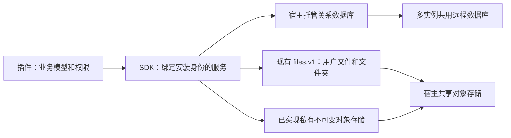

# 外掛水平擴充套件與託管儲存規範

0.1.26 使用與核心庫分開的[外掛共享業務資料庫](plugin-database-isolation.zh-Hant.md)，自動建立外掛名稱空間，取代 0.1.25 的每外掛獨立庫。升級須先在舊宿主正常解除安裝，再重灌，不遷移外掛資料。

[English](plugin-horizontal-scaling.md)

狀態：2026-10-02 已確認規範。原始碼基線為宿主 0.1.10、SDK 0.1.8；不代表 npm 釋出或生產驗收。所有持久化依賴宿主，外掛不感知本地/遠端後端。包宣告校驗與環境配置清理已實現；託管 SQL 與內部物件已匯出；憑證已在 SDK 原始碼 0.1.8 匯出，臨時工作服務尚未匯出。本次沒有讀取、轉換或刪除舊業務資料。

## 已實現儲存修訂（2026-10-03，SDK 原始碼 0.1.7）

`@smartdoca/plugin-sdk/storage` 已匯出安裝身份繫結的 `pluginDatabaseToken`（`storage.sql.v1`）和 `pluginObjectStorageToken`（`storage.objects.v1`）。關係庫支援顯式 version 1 結構宣告、text/int32/雙精度列、主鍵/唯一約束、結構化查詢/寫入/刪除，以及回撥只執行一次的事務。SDK 原始碼 0.1.8 另匯出 `pluginCredentialToken`（`storage.credentials.v1`），提供服務端加密憑證、後設資料、修訂號更新與刪除。聯表、外來鍵、通用 SQL、upsert 和臨時工作區尚未匯出。見[憑證介面](plugin-credentials.zh-Hant.md)。業務 SQL 使用與核心庫分開的宿主管理共享資料庫：SQLite 一個檔案、按外掛加表名字首；PostgreSQL 一個 URL／賬號、自動建立外掛 schema，共用連線池。程序隔離仍未實現，見[儲存配置與先解除安裝再升級約定](plugin-database-isolation.zh-Hant.md)。

邏輯庫為 `plugin:<pluginId>`，使用者檔案歸屬及私有物件使用 `plugins/<pluginId>`，發行包使用 `host/plugin-releases/<sha256>.zip`。ZIP 位元組進入環境變數配置的檔案儲存，共享資料庫只儲存 version 2 清單、歸檔引用和可信檔案雜湊索引。有效快取無需重新下載 ZIP。全部例項由運維逐個重啟。不支援的外掛包和儲存格式拒絕自動轉換，原資料保留。核心資料庫升級另遵守[資料庫升級規範](database-schema-evolution.zh-Hant.md)。詳見[準確實現與限制](unified-storage-implementation.md)。

## 現狀與問題

改造前的開發規範和 SDK 契約要求外掛自管資料庫與業務資料目錄；這條指引已撤銷。當前[開發規範](plugin-development.zh-Hant.md)和 [SDK 契約](plugin-sdk-contract.zh-Hant.md)統一要求宿主託管。宿主已公開受限託管 SQL 和私有物件服務，不提供任意 SQL、`data.v1` 或 `data.v2`。`files.v1` 已提供使用者檔案、資料夾、上傳、附件繫結、許可權和檔案建立持久冪等。

外掛自行連線同一個遠端資料庫，理論上也能擴充套件。原方案的問題是允許把業務持久狀態放在例項目錄，沒有統一的多例項要求，外掛作者需要分別處理驅動、部署、連線池、備份和併發。多個例項配置同一個目錄名，不等於訪問同一份資料。SQLite 的 WAL 要求訪問資料庫的程序位於同一主機，不能在網路檔案系統上工作，不能把共享目錄作為分散式資料庫方案。見 [SQLite 官方 WAL 說明](https://www.sqlite.org/wal.html)。

改造前的審計記錄（舊儲存指引現已替換，歷史驗收僅適用於當時版本）：

| 位置                                 | 核對結果                                                                                                          |
| ------------------------------------ | ----------------------------------------------------------------------------------------------------------------- |
| 開發規範「業務資料目錄」             | 將共用業務庫描述成使用同一根目錄，沒有區分例項磁碟、共享檔案系統與遠端資料庫                                      |
| SDK 契約第 7、13 節                  | 明確不提供通用外掛 SQL，外掛自管資料庫與目錄；現已改為宿主託管並列明實現缺口                                      |
| 部署說明「生命週期與保留」           | 英文寫移除不刪除私有業務資料，與同文開頭、開發規範及當前解除安裝清理要求矛盾                                          |
| 外掛架構概覽                         | 列出公開 `data` 服務，當前 SDK 並無此匯出                                                                         |
| `apps/server/src/plugins/manager.ts` | 校驗持久 `dataVersions`，結構號不同拒絕；移除先呼叫 `uninstall`，再儲存清單；託管私有庫、物件與憑證清理已實現，叢集業務任務排空尚未實現 |
| `packages/plugin-host/src/index.ts`  | 解除安裝使用臨時生命週期上下文，不能假定待實現的儲存服務已可注入                                                      |

這些舊規則不作為新外掛的儲存標準。缺失或不符合新宣告的包直接拒絕，不補預設值或適配；舊包與舊業務資料不刪除、不轉換。

## 職責

外掛繼續定義業務表、索引、授權、任務狀態和 outbox；宿主統一管理資料庫連線、物理隔離、持久檔案、憑證、備份和資源限制。SDK 提供公開的外掛作用域服務，不提供宿主私有資料庫物件、驅動、連線串或磁碟路徑。

水平擴充套件部署要求所有例項訪問相同的託管資料庫和物件儲存，例項磁碟只儲存可重建的安裝快取、可丟棄的執行快取和臨時檔案。共享儲存失敗時明確報錯，不自動切換成本地持久儲存。

## 託管 SQL 服務

對外掛公開的是繫結安裝身份的邏輯庫，名稱空間為 `plugin:<pluginId>`。SDK 只暴露注入時繫結的控制代碼，不提供可選擇庫名的引數。HTTP body、查詢引數和外掛自行構造的上下文不能決定身份，也不能開啟其他外掛的庫。

邏輯庫名不必是物理資料庫名。外掛 ID 可含點號，資料庫識別符號還有長度和大小寫規則；宿主持久登記無衝突的對映並正確引用識別符號，不能簡單替換符號或截斷。資料庫、schema 或物理檔案的位置由宿主選擇，外掛只使用自己的邏輯表名。

僅限制庫名不能隔離任意 SQL。託管關係服務提供受限的關係查詢、建表定義和事務 API，由宿主編譯成 SQL，不暴露原始連線、任意 SQL 字串、跨庫表名、任意函式或驅動命令。PostgreSQL 賬號許可權及角色成員關係由部署者決定。宿主接受普通賬號及超級使用者等管理員賬號，不檢查高許可權屬性或賬號對核心表的訪問許可權；部署者可自行透過 PostgreSQL 授許可權制賬號。配置的業務庫仍須與核心庫分離。不能僅靠表名字首、`search_path` 或正則過濾；schema 本身不是許可權隔離。見 [PostgreSQL schema 與許可權說明](https://www.postgresql.org/docs/current/ddl-schemas.html)和[識別符號規則](https://www.postgresql.org/docs/current/sql-syntax-lexical.html)。

外掛當前執行於受信任的 Node.js 程序。這些規則約束 SDK 訪問，不構成惡意程式碼沙箱。真正限制惡意外掛訪問程序檔案或環境，需要單獨的程序與作業系統隔離。

隱藏驅動不等於任意 PostgreSQL、SQLite、MySQL SQL 都能無差別執行。當前 version 1 子集見上文。下列更完整的關係能力要求包含後續目標；join、外來鍵、任意 SQL 和 upsert 尚未匯出：

- 表定義、基本型別、主鍵、唯一約束、外來鍵和索引。初始化只建立顯式首次安裝的新庫，已有庫先校驗結構，不借初始化偷偷改舊結構。
- 引數化查詢、插入、更新、刪除、同庫 join、分頁、排序、計數和基於唯一鍵的 upsert；值和識別符號分別校驗，不拼接使用者輸入。
- 同外掛庫內的原子事務、帶版本條件的更新和原子計數，支援冪等回執、任務領取及 outbox。事務控制代碼固定連線和身份，回撥不能包含檔案上傳或外部副作用。
- 定義整數範圍、布林、UTC 時間、JSON、空值、排序和錯誤語義；限制單次結果、查詢與事務時長、總連線數，支援取消。型別、簽名和具體數值在實現前補充契約。
- 返回穩定的唯一衝突、版本衝突、超時和取消錯誤，不暴露驅動錯誤。提交結果未知時不能自動重試業務回撥，應先查持久冪等記錄。

宿主可用 PostgreSQL 支撐多例項，SQLite 限於單例項和隔離測試，兩者須執行同一契約測試；這些是宿主部署選擇，不暴露給外掛，外掛不按驅動或本地/遠端分支。其他驅動透過能力驗收後才宣稱支援。方言特有功能需要顯式擴充套件，不能靜默降級、假裝成功或要求外掛按驅動分支。這是託管介面要求，SQL 子集已匯出，也不是舊資料庫格式適配。

宿主負責連線池、取消、監控和備份，外掛負責業務模型、索引和使用者許可權。外掛庫隔離不等於使用者許可權：業務入口仍須檢查當前使用者對記錄的授權。即使物理上共用 PostgreSQL，也不開放跨外掛或宿主業務事務。

## 檔案儲存與其他功能

應杜絕依賴系統目錄的持久業務狀態。資料庫、使用者上傳、永久生成結果、憑證、任務遊標和 outbox，不能直接寫入程式目錄、安裝目錄、工作目錄、固定 `/tmp` 路徑或外掛自行選擇的系統目錄。正常功能使用以下入口：

| 內容                                                                   | 建議入口                        | 要求                                                                                                                   |
| ---------------------------------------------------------------------- | ------------------------------- | ---------------------------------------------------------------------------------------------------------------------- |
| 使用者上傳、使用者管理的附件、匯入原件、匯出成品                           | 現有 `files.v1` 檔案/資料夾系統 | 穩定檔案 ID 與業務繫結，遵循使用者許可權、當前配額、上傳檢查和持久冪等；不儲存絕對路徑或永久使用簽名 URL                   |
| 表記錄、配置、任務狀態、事件遊標、冪等記錄和 outbox                    | 已實現託管關聯式資料庫            | 外掛 ID 隔離，多例項共同可見                                                                                           |
| 不應展示到使用者資料夾的內部大二進位制、持久中間產物、重建成本高的內部索引 | 已實現外掛私有物件儲存          | 宿主繫結身份、共享儲存和資源限制；流式讀寫、穩定不透明 ID、完整提交、校驗、條件寫/冪等及受控刪除；業務授權仍由外掛檢查 |
| OAuth token、業務金鑰等憑證                                            | `pluginCredentialToken`，SDK 原始碼 0.1.8        | 服務端使用、加密持久化、脫敏和限制訪問；不寫本地憑證檔案、不下發普通瀏覽器配置；身份與安裝代次由宿主繫結，見[憑證介面](plugin-credentials.zh-Hant.md)         |
| 轉碼、解壓、掃描或第三方命令必需的工作檔案                             | 宿主管理的臨時工作目錄或流      | 按外掛/任務隔離、限制大小與時長、清理崩潰遺留；重試重新下載或重建，不依賴前一例項的臨時路徑                            |
| 可重建快取                                                             | 記憶體或宿主允許的臨時快取        | 丟失隻影響效能，命中後仍做當前授權；不承擔鎖、冪等或唯一事實                                                           |
| 外部業務系統的原始資料                                                 | 經授權的遠端 API                | 不阻止郵件、同步等對外連線；持久副本、遊標、憑證和附件遵循上列入口                                                     |

內部物件儲存已在 SDK 0.1.7 公開，臨時目錄服務尚未公開。不能假稱 `files.v1` 已提供所有內部 blob 場景，也不能將憑證偽裝成使用者檔案。缺失持久能力時明確報告功能不可用，不回退系統目錄。不需要本地檔案的處理優先傳流或位元組資料。

內部物件與關聯式資料庫仍不是共同事務。先記錄持久意圖、寫物件、確認後設資料，失敗透過重試/補償恢復；垃圾回收檢查引用和未完成意圖。將結果交給使用者時經檔案服務正式登記或複製，不將內部物件 ID 變成公開下載憑據。不改變既有檔案許可權、冪等回執和引用保護。

## 多例項執行規則

統一儲存只解決持久事實，還必須做到：

- 請求可路由到任意例項；服務、註冊和連線仍按程序隔離，記憶體變數不是全域性配置或完成狀態。
- 業務唯一性由資料庫約束保證；更新用事務或版本條件，程序內 mutex 不能作為叢集鎖。
- 任務使用原子領取、到期租約和 fencing/version。長任務續租，失去租約的執行者不能提交新狀態。週期任務用穩定排程鍵去重，不能每個 `ready` 定時器各建一份任務。
- 外部副作用用持久 outbox、穩定業務操作 ID 和遠端冪等能力處理；超時可能已完成，不承諾跨服務 exactly-once。事件遊標和處理事實在本外掛事務裡提交，多消費者透過共享租約協調。
- 首次建庫與初始化也需資料庫協調，第二個例項驗證結構而不是並行改表；已有結構不同拒絕，遷移須另行確認。
- WebSocket/本地回撥不承擔全域性匯流排；跨例項失效或通知依賴宿主明確提供的共享機制，不能把現有程序內廣播解釋成叢集廣播。
- 備份覆蓋資料庫、內部物件、使用者檔案引用及憑證；恢復驗證結構與物件完整性，任何資料回退或丟失必須可見。

本方案不承諾混合 SDK、混合結構版本的滾動升級。先停流、排空，統一切換並驗證後恢復；不停機升級需要另行接受版本共存與遷移方案。

## 安裝拒絕與舊資料邊界

所有安裝包（包括無獨立狀態的外掛）必須在 package.json 宣告 `doca.storage: "host"`，其含義是持久化完全依賴宿主。欄位缺失或任何其他值直接拒絕，不自動補欄位、不轉換舊包、不提供舊目錄/驅動適配。此宣告獨立於 SDK range，使用當前已實現公共服務的合規外掛可繼續宣告其真實 SDK 要求，不虛構新 SDK 釋出版本。

`inspectPlugin` 在解析服務端入口與匯入程式碼前檢查宣告；打包、ZIP/npm/商店安裝、離線目錄發現/匯入、共享歸檔恢復和啟動均使用該入口。宣告是受信任作者的契約承諾，不是對任意 Node.js 程式碼的沙箱或完整行為審計。不能僅補宣告而繼續使用私有儲存，稽核與獨立驗收須核對真實行為。

| 物件                                            | 處理決定                                                                    | 儲存、驗證和回退                                                                                                                             |
| ----------------------------------------------- | --------------------------------------------------------------------------- | -------------------------------------------------------------------------------------------------------------------------------------------- |
| 不符合宿主託管規範、缺失/錯誤宣告的包           | 拒絕安裝和載入，無相容適配                                                  | 原包和歸檔保留，拒絕不刪除資料；新合規包需重新構建釋出，不能同版本偷偷改歸檔                                                                 |
| 原自管資料目錄、外部業務庫、憑證、任務和 outbox | 不讀取、不自動匯入、不刪除、不雙讀雙寫                                      | 已有資料不能被新空庫覆蓋；逐外掛轉換須另交源/目標結構、對映、未完成副作用、校驗和回退，經確認後執行                                          |
| 舊宿主基線與 version 1 清單                     | 拒絕讀取/轉換                                                               | 保留原資料庫和歸檔，不遷移、不雙讀                                                                                                           |
| `doca.dataVersion`                              | 精確匹配；已安裝升級不變，實際結構不同拒絕，無隱式升降級或預設欄位          | 結構/後端轉換另行確認，不用解除安裝刪庫繞過遷移；舊標記相同不證明新庫可讀                                                                        |
| 現有 files.v1 檔案 ID、繫結、許可權和回執         | 保持既有格式與語義，不轉換為內部物件、不因業務庫改造刪除                    | 驗證引用、下載許可權、回執和物件存在性                                                                                                         |
| 系統目錄內其他舊持久檔案                        | 保持原樣，不自動掃描移動                                                    | 未來按外掛確認目標服務，校驗數量、大小、雜湊及授權                                                                                           |
| 禁用、停機、dispose                             | 只回收程序資源，不刪持久資料                                                | 註冊/任務排空，業務狀態仍由宿主管理                                                                                                          |
| 顯式解除安裝                                        | 外掛用公共服務處理業務解綁/外部撤銷；宿主負責託管私有庫、內部物件和憑證清理 | 清單事務執行 generation 隔離並記錄私有庫/物件清理意圖，業務表在提交後清理並支援重試；業務任務叢集排空仍未實現，所有例項需人工重啟。部分清理失敗不得假稱回滾/成功；使用者檔案及其他引用不自動刪除。 |

不再提供外掛業務資料目錄環境變數，Compose 和環境配置示例不再傳入它。安裝快取 `DOCA_PLUGINS_DIR` 保留，僅存可重建程式碼歸檔與解壓結果，不能承載持久業務資料。資料庫/物件儲存的本地或遠端配置完全歸宿主，SDK 不返回這些配置或要求外掛判斷後端。

若未來轉換舊資料，切換前備份並停止舊寫入，驗證記錄數、唯一約束、業務規則、檔案/物件雜湊和許可權。新部署尚未接收寫入時可回到原部署；接收新寫入後不能簡單改回舊目錄，反向轉換或備份恢復需要單獨確認。拒絕舊包不構成刪除或遷移授權。

## 實現狀態與驗收

| 能力                             | 當前狀態                                                       | 交付前要求                                                                      |
| -------------------------------- | -------------------------------------------------------------- | ------------------------------------------------------------------------------- |
| 使用者檔案/資料夾與附件 `files.v1` | 已有原始碼介面                                                   | 共享後端的多例項整合驗收                                                        |
| 外掛作用域託管關聯式資料庫         | SDK 0.1.7 已匯出結構化事務/結構宣告                            | 型別、能力子集、身份校驗、物理許可權、限制、錯誤語義和結構校驗；獨立 SDK 消費驗收 |
| 外掛內部物件儲存                 | SDK 0.1.7 已匯出有界不可變物件                                 | 流式讀寫、許可權、完整提交、冪等/條件寫、引用保護、恢復和配額驗收                 |
| 託管外掛憑證 | SDK 原始碼 0.1.8 已實現加密 CRUD、後設資料、版本 CAS 和解除安裝失效 | 隔離 SQLite/PostgreSQL 與獨立 SDK 驗收，見[憑證介面](plugin-credentials.zh-Hant.md) |
| 臨時目錄 | 未匯出 | 生命週期、隔離、限制和清理 |
| 跨例項業務任務領取               | 外掛負責，沒有通用公開領取服務承諾                             | 在託管事務能力上驗證租約、過期接管、fencing 與重複執行                          |
| 儲存宣告                         | 已實現必填 host 與匯入程式碼前拒絕；包/目錄/啟動統一校驗         | 宣告真實性稽核和拒絕路徑驗收                                                    |
| 舊格式、結構校驗與私有儲存解除安裝   | 拒絕舊基線/清單，檢查結構宣告，generation 隔離並持久化清理物件 | 業務任務叢集排空仍待實現                                                        |

驗收使用隔離資料庫、獨立外掛和測試檔案。至少兩個例項共用資料庫和物件儲存，在 A 上傳/寫入、B 讀取；銷燬 A，以空本地磁碟重建後仍能讀取。還需覆蓋同時首次初始化、併發唯一性、重複請求、提交響應丟失、任務程序被殺與過期接管、重疊租約下舊執行者寫入被拒絕、儲存故障無本地回退、跨外掛庫/物件拒絕、業務撤權、臨時目錄清理和解除安裝時舊例項不能重建/寫入資料。

禁止自建持久庫和系統目錄儲存的規範立即生效，不為缺失宿主能力提供例外。當前使用已實現宿主服務的外掛可以接入；需要臨時工作區的新功能等待對應能力實現與驗收，不以私有儲存替代。規範、SDK README 和實現狀態表須持續同步，不將尚未匯出的介面寫成可執行示例。
